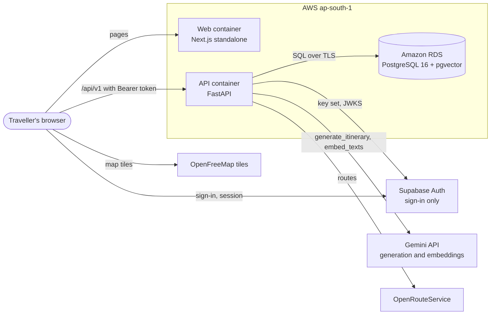
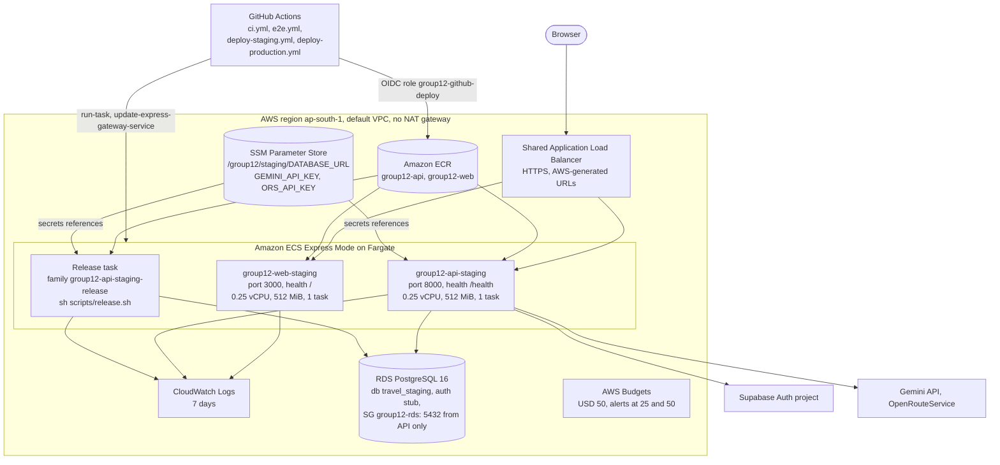
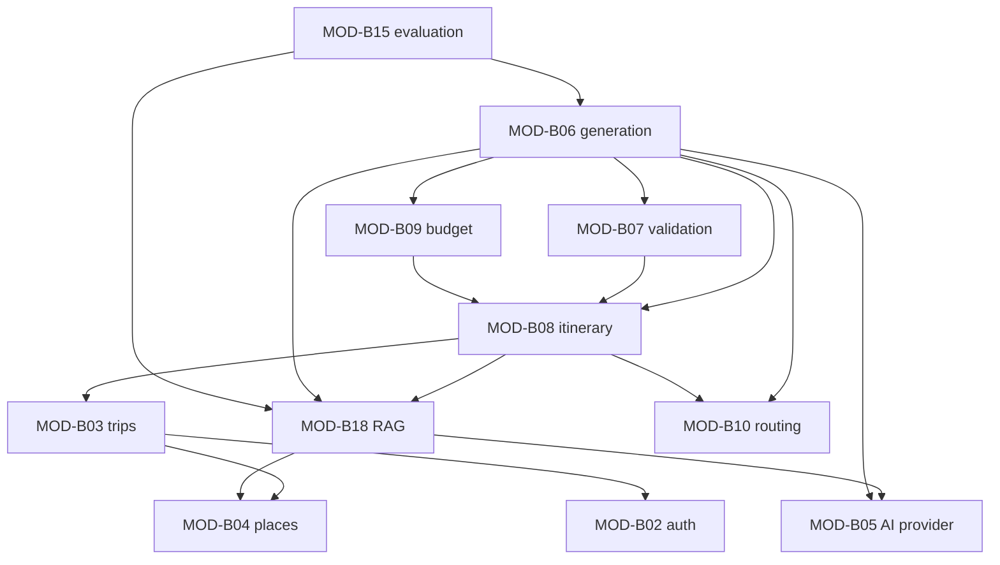
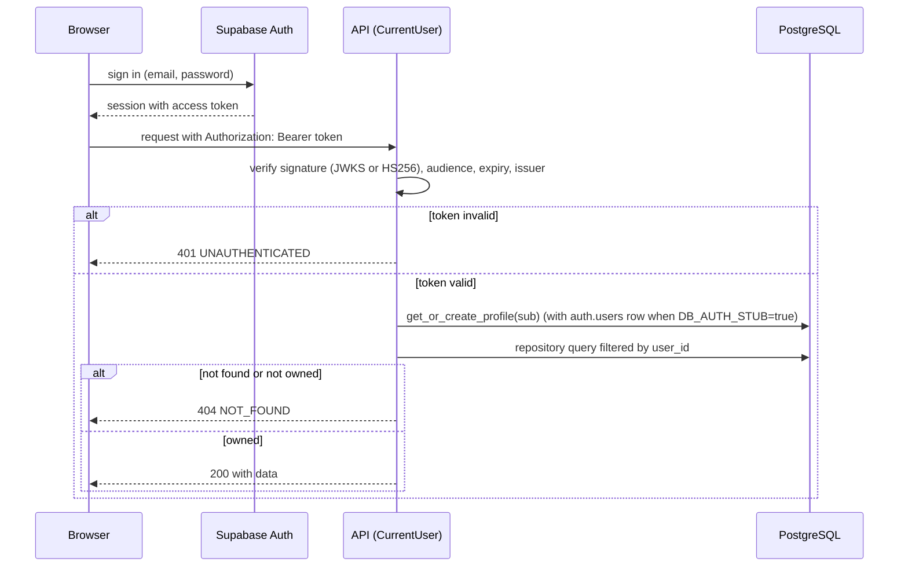
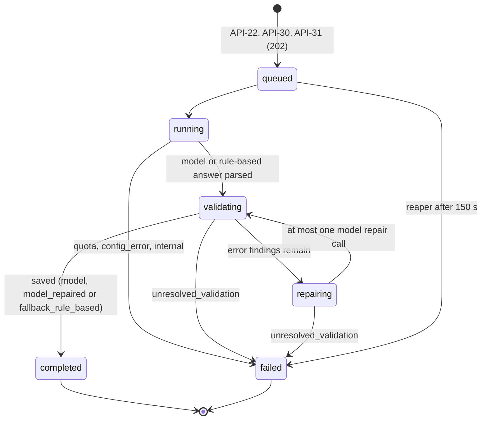
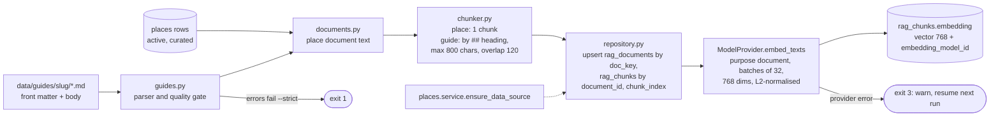
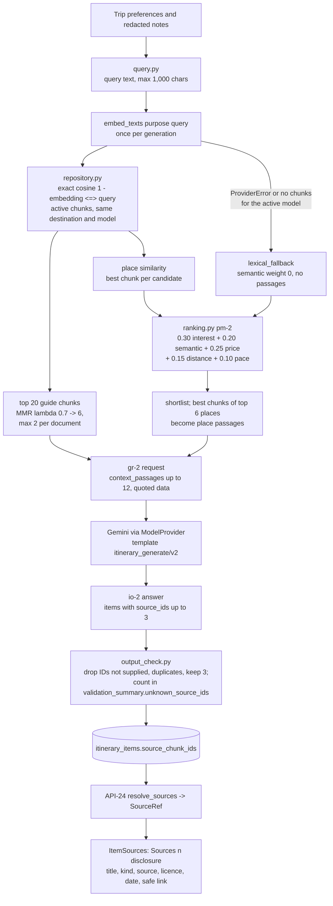
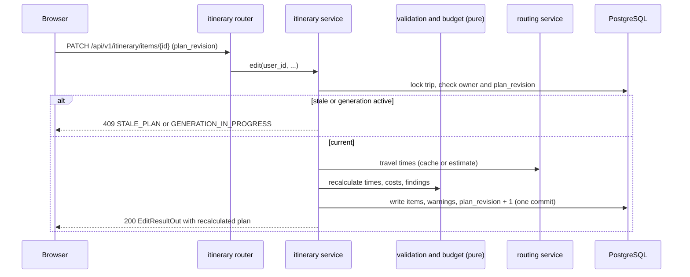
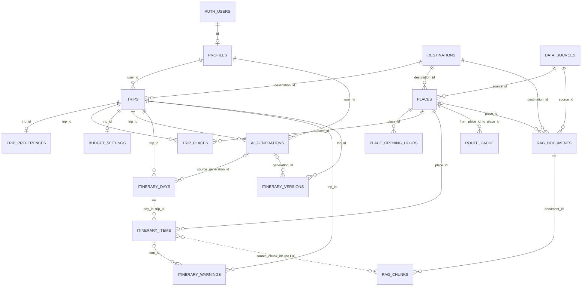

# Architecture: AI Travel Planner

| Item | Value |
| --- | --- |
| Document | Architecture description with deployment view, RAG pipeline and ER diagram |
| Owner | Manal Patel (IMP-707 part "Architecture and API documentation") |
| Version | 1.0 (draft for SG-7), 19 November 2026 |
| Card | IMP-707, US-145, NFR-033 |
| Built from | `docs/spec/IMPLEMENTATION_SPEC.md` v1.3 §1.5, §3, §4, §6.4, §8; `docs/spec/AMENDMENT_A1_AWS_RAG.md` (A1) §2 to §8; `docs/spec/DECISION_REGISTER.md`; the code, workflows and `infra/aws/` templates on `main` at `f75aa94` |
| Related documents | [SRS and data model](srs.md), [API](api.md), [Test plan](test-plan.md), [AWS set-up](guides/aws-setup.md), [Deployment](guides/deployment.md), [RAG corpus](guides/rag-corpus.md) |

**Precedence.** Where this document and the specification v1.4 (v1.3 plus Amendment A1) differ, the specification wins. Section 11 lists where the built or deployed system differs from the documented design (US-145 AC2). All diagrams are Mermaid; their rendering was not checked in this run (no Mermaid renderer in the container).

## 1. System context

The browser talks to two systems only: Supabase Auth (sign-up, sign-in, session refresh) and the API. The API is the only component that reaches the database, Gemini (generation and embeddings) and OpenRouteService. The web container serves pages only; it holds no secret and never calls the database or a provider (A1 §3).



| External system | Called by | Required | When unavailable |
| --- | --- | --- | --- |
| Supabase Auth (hosted project; local stack in development) | Browser (sessions); API (key set, JWKS) | Yes | Sign-in impossible; public pages still load |
| Amazon RDS for PostgreSQL 16 (pgvector) | API only (private network; TLS required) | Yes | API-02 not ready (503); API answers 503 `SERVICE_UNAVAILABLE` |
| Gemini API: generation | `app/ai/providers/gemini.py` only | No | Rule-based plan with outcome `fallback_rule_based` |
| Gemini API: embeddings | `app/ai/providers/gemini.py` only, through `ModelProvider.embed_texts` | No | `retrieval_mode = lexical_fallback`, no passages; generation continues |
| OpenRouteService | `app/routing/client.py` only | No | Distance estimate labelled Estimate |
| OpenFreeMap tiles | Browser only | No | List view instead of the map |

## 2. Deployment view (AWS)

### 2.1 Resources

Source: A1 §3 and §4, `infra/aws/` (set-up scripts `01_budget.sh` to `06_services.sh`, service templates `services/api.staging.json.tmpl` and `services/web.staging.json.tmpl`), `.github/workflows/deploy-staging.yml` and `deploy-production.yml`.



| Resource | Name or setting | Source |
| --- | --- | --- |
| Region | `ap-south-1` | A1 §4.1 |
| Services | Express Mode services `group12-api-<env>` and `group12-web-<env>`, one Fargate task each (0.25 vCPU, 512 MiB, minimum and maximum one task), one shared HTTPS load balancer | A1 §3, service templates |
| Database | One RDS PostgreSQL 16 instance, `db.t4g.micro` (or the smallest class allowed), 20 GB gp3, single-AZ, not public, `rds.force_ssl` on, backups 1 day, deletion protection; databases `travel_staging` and `travel_production` (the second created in IMP-801) | A1 §4.1, IMD-100 |
| Registry | ECR repositories `group12-api` and `group12-web`, scan on push, newest 10 images kept | A1 §4.1 |
| Secrets | SSM `SecureString` `/group12/<env>/DATABASE_URL`, `GEMINI_API_KEY`, `ORS_API_KEY`; passed to containers only as `secrets` references; `SUPABASE_JWT_SECRET` not used (JWKS mode) | A1 §4.1, IMD-102, IMD-123 |
| Roles | `group12-ecs-execution`, `group12-ecs-infrastructure`, GitHub OIDC deploy role `group12-github-deploy` trusting `main`, `v*` tags and the `production` environment (plus the immutable subject forms) | A1 §4.4, IMD-138 |
| Logs | CloudWatch log group per service, 7 days | A1 §4.1 |
| Cost guardrails | Budget USD 50 a month with alerts at USD 25 and 50; one task per staging service; no NAT gateway; production only from Sprint 8; staging off between staging windows | A1 §4.7, IMD-104, IMD-137 |

The set-up scripts in `infra/aws/` are run only by the AWS account owner (Kirtan), from his own terminal or CloudShell (A1 §4.1). Steps and the cost table are in [aws-setup.md](guides/aws-setup.md).

### 2.2 Environments

| Aspect | Local (developer) | Test / CI | Staging | Production |
| --- | --- | --- | --- | --- |
| `APP_ENV` | `local` | `test` | `staging` | `production` |
| Database | Supabase CLI local Postgres (`127.0.0.1:54322`) or compose `db` | Compose/service `db` (`pgvector/pgvector:pg16`) plus auth stub, blank and migrated per run | RDS `travel_staging` plus auth stub | RDS `travel_production` plus auth stub |
| `DB_AUTH_STUB` | `false` on the local stack; `true` against compose `db` | `true` | `true` | `true` |
| Auth | Supabase CLI local Auth (HS256) | Minted HS256 test tokens; E2E uses the local stack | Hosted Supabase Auth (JWKS, IMD-123) | Same project as staging (IMD-101) |
| AI provider | `MOCK` with `MOCK_PROVIDER_SCENARIO`; MOCK embeddings | `MOCK` only; no key in PR CI | `GEMINI`; `MOCK` for the failure demo (IMD-33) | `GEMINI`; `MOCK` refused at start-up |
| RAG index | `make rag-index` after `make seed` (MOCK embeddings) | Built by test fixtures with MOCK embeddings | Built by the release task with Gemini embeddings | Same as staging |
| Secrets live in | Untracked `apps/api/.env`, `apps/web/.env.local` | GitHub Actions (none for PR jobs) | SSM Parameter Store | SSM Parameter Store |
| Deployed by | The member | The pipeline | `deploy-staging.yml` after `ci.yml` succeeds on `main` | Kirtan, by hand from a tag, `deploy-production.yml` |

Source: A1 §4.2. The staging API template sets `AI_PROVIDER=GEMINI`, `GEMINI_MODEL_ID=gemini-3.5-flash-lite`, `GEMINI_EMBEDDING_MODEL_ID=gemini-embedding-2`, `PROMPT_TEMPLATE_VERSION=v2`, `DB_AUTH_STUB=true` and `SEED_DIRS=data/places/ahmedabad` (`infra/aws/services/api.staging.json.tmpl`). The web image receives the four `NEXT_PUBLIC_*` values as build arguments, so each environment has its own web image (A1 §4.3).

### 2.3 Deploy flow

`deploy-staging.yml` runs after `ci.yml` succeeds on `main` (and by manual dispatch); `deploy-production.yml` is started by hand with a release tag in the protected GitHub environment `production` (A1 §4.5). While a repository variable it needs is missing, a workflow ends green with a "not configured" notice (A1 §4.4).

```mermaid
sequenceDiagram
    participant GH as GitHub Actions
    participant ECR as Amazon ECR
    participant ECS as ECS Express Mode
    participant RT as Release task
    participant DB as RDS
    GH->>GH: assume group12-github-deploy (OIDC)
    GH->>ECR: build and push API image (tag = commit SHA, BUILD_VERSION)
    GH->>ECS: register group12-api-<env>-release with the new image
    GH->>RT: run-task: sh scripts/release.sh
    RT->>DB: python -m app.db.auth_stub --if-missing
    RT->>DB: alembic upgrade head
    RT->>DB: python -m app.places.seed <each SEED_DIRS dir>
    RT->>DB: python -m app.rag.index --strict (exit 3 only warns)
    RT-->>GH: exit code; log lines printed into the job log
    alt exit code is not 0
        GH->>GH: stop; no service is updated
    else exit code 0
        GH->>ECS: update group12-api-<env> (full rendered template, new image)
        GH->>ECR: build and push web image (NEXT_PUBLIC_* build arguments)
        GH->>ECS: update group12-web-<env>
        GH->>GH: make smoke URL=<API URL> and CORS check
    end
```

The container never migrates on start (IMD-38). Production migrations are forward only; a rollback deploys the previous tag's images (A1 §4.5). Locally, `docker compose up api web` builds both production images against the local stack (A1 §4.6; `docs/guides/deployment.md` §1).

## 3. Backend components

### 3.1 Layers

The API is a modular monolith (`apps/api/app/`). In every module, routers call services, services call domain code and repositories, and clients and adapters sit at the bottom (specification §3.2, CLAUDE.md §4).

| Layer | Files | May import | Must not |
| --- | --- | --- | --- |
| Routers | `router.py` | Services, `schemas`, `core` | Run SQL, call vendors, hold business rules |
| Services | `service.py`, `jobs.py`, `pipeline.py`, `versions.py`, `edits.py` | Domain, own repository, lower-ranked services, `ai.factory`, `routing.service` | Return ORM objects to routers |
| Domain (pure) | for example `routing/estimate.py`, `generation/ranking.py`, `generation/fallback_planner.py`, `budget/engine.py`, `validation/rules.py`, `validation/validator.py`, `rag/chunker.py`, `rag/documents.py`, `rag/guides.py`, `rag/query.py`, `rag/mmr.py` | `schemas`, other domain files | Import FastAPI, SQLAlchemy, httpx or vendor SDKs; do I/O |
| Repositories | `repository.py`, `db/models/` | `db` | Business rules |
| Clients and adapters | `ai/providers/*`, `routing/client.py` | `schemas`, `core.config` | Be imported except by `ai/factory.py` (adapters) or the owning service (clients) |

`make imports` checks six import-linter contracts in `apps/api/.importlinter`; in this run it reported `Contracts: 6 kept, 0 broken.`:

1. Layers: router > service > domain, repository > client, providers (every module).
2. Vendor isolation: `google` (`google.genai`) only in `app.ai.providers.gemini`.
3. Vendor isolation: concrete adapters only imported by `app.ai.factory`.
4. Pure domain: the listed modules import no framework, I/O, core or layer module.
5. Routing isolation: `httpx` only in `app.routing.client` within `app.routing`.
6. Service order: `app.rag` imports no generation, itinerary, budget, validation or evaluation.

### 3.2 Modules and service ranks

A module may call only modules of a lower rank (specification §3.9, A1 §8.1). Extension modules (prep, weather, context) are not built (IMD-65).

| Rank | Module | Folder | Writes tables |
| --- | --- | --- | --- |
| 0 | MOD-B01 core, MOD-D01 db, shared schemas | `app/core`, `app/db`, `app/schemas` | none |
| 1 | MOD-B02 auth | `app/auth` | `profiles` |
| 1 | MOD-B04 places | `app/places` | `destinations`, `data_sources`, `places`, `place_opening_hours` |
| 1 | MOD-B05 AI provider | `app/ai` | none in the MVP |
| 1 | MOD-B10 routing | `app/routing` | `route_cache` |
| 2 | MOD-B03 trips | `app/trips` | `trips` (except `plan_revision`), `trip_preferences`, `trip_places` (see section 11) |
| 2 | MOD-B18 RAG | `app/rag` | `rag_documents`, `rag_chunks` |
| 3 | MOD-B08 itinerary | `app/itinerary` | `itinerary_days`, `itinerary_items`, `itinerary_warnings`, `itinerary_versions`, `trips.plan_revision` |
| 4 | MOD-B09 budget | `app/budget` | `budget_settings` |
| 4 | MOD-B07 validation | `app/validation` | none (findings written through MOD-B08) |
| 5 | MOD-B06 generation | `app/generation` | `ai_generations` |
| 6 | MOD-B15 evaluation | `app/evaluation` | files under `eval/` only |



Arrows point to the callee and show the main service calls; the binding rule is "lower rank only" at service level. Pure domain files of any module may be used by any service (§3.9), so module-level imports also reach pure files of higher-ranked modules (for example `app/itinerary` uses the generation ranking for alternatives, IMD-171).

### 3.3 AI provider layer

`ModelProvider` (`app/ai/providers/base.py`) has the operations `generate_itinerary` and `embed_texts` (A1 §6.5). Adapters: `gemini.py` (the only `google-genai` import), `mock.py` (deterministic scenarios and `mock-embed-v1` embeddings) and `finetuned.py` (Stage 1 stub). Only `app/ai/factory.py` imports a concrete adapter, selected by `AI_PROVIDER`. `app/ai/breaker.py` opens the generation circuit breaker after 5 consecutive failures (IMD-146); embedding calls neither use nor open it (IMD-112). Prompt templates live in `app/ai/prompts/templates/itinerary_generate/` (`v1`, `v2`, `v3`); the active version is `PROMPT_TEMPLATE_VERSION`, `v2` in `app/core/config.py` and in the staging template (v3 is not activated, IMD-200).

## 4. Frontend

- Next.js 16 App Router (`apps/web`, `next` 16.4.3, React 19.3.0), Tailwind CSS, shadcn/ui, TanStack Query, react-hook-form and zod, dnd-kit, MapLibre GL with OpenFreeMap tiles (`apps/web/package.json`).
- Routes (`apps/web/app/`): `(public)` landing, `/sign-in`, `/sign-up`; `/auth/callback`; `(app)` `/dashboard`, `/profile`, `/trips/new`, and per trip `/edit`, `/explore`, `/generate`, `/itinerary`, `/costs`, `/summary`, `/versions`.
- Components by area in `apps/web/components/`: auth, costs, generation, itinerary, labels, map, places, profile, shell, states, trips, ui, versions.
- The API client is generated from the contract: `apps/web/lib/api/schema.d.ts` (openapi-typescript) used through openapi-fetch; `make openapi-check` verifies it is current.
- The browser displays what the API returns; it never computes prices, totals, times or travel gaps (CLAUDE.md §4 rule 5). Only the four `NEXT_PUBLIC_*` values reach it.

## 5. Authentication and authorization



Rules (specification §3.4, §6.2; A1 §5.1; IMD-123, IMD-140, IMD-204): the user ID comes only from the verified token; no endpoint accepts a user ID in path, query or body; repositories take `user_id` as a required argument; a missing and a foreign resource give the same 404. Row-level security on all 17 tables and revoked browser privileges are the second and third locks ([srs.md](srs.md) §9.3). The web app refreshes the session once on a 401 and then redirects to `/sign-in`.

## 6. Generation

### 6.1 Job lifecycle

Generation is an asynchronous in-process job (IMD-12): API-22 (first plan), API-30 (one day) and API-31 (whole plan) create one `ai_generations` row and answer 202; the browser polls API-23. The job runner in `app/generation/jobs.py` uses a hard timeout of 120 s and a reaper that marks jobs older than 150 s as `failed` / `internal`; the same loop runs the daily purges (specification §6.4, §8.2).



### 6.2 Pipeline (twelve steps, with the A1 changes)

| Step | Work | Module |
| --- | --- | --- |
| 1 Validate inputs | Trip complete, caps, one active job per trip | MOD-B03, MOD-B06 |
| 2 Normalise | Preferences to filters and weights (mapping `pm-2`) | `trips/preference_mapping.py`, `generation/request_builder.py` |
| 3 Retrieve | Active places of the destination; the trip query is embedded once; place similarity and guide passages (A1 §6.7) | MOD-B04, `generation/retrieval.py`, `rag/service.py` `retrieve` |
| 4 Filter, rank, group | Hard filters, hybrid score, shortlist, day hints | `generation/ranking.py`, `grouping.py` |
| 5 Trusted data | Opening hours, labelled prices, cached travel times | MOD-B04, MOD-B09, MOD-B10 |
| 6 Build request | `gr-2` request with `context_passages` from template `itinerary_generate/v2` | MOD-B05 prompts registry, `request_builder.py` |
| 7 Generate | `generate_itinerary` on the active provider (skipped in mode `rule_based` or while the breaker is open) | MOD-B05 adapter |
| 8 Parse and check | `io-2` parse, day numbers, shortlist membership, citation check (A1 §6.10) | `validation/output_check.py`, `validation/validator.py` |
| 9 Recalculate and check | Times, gaps and costs recomputed; 13 finding codes | MOD-B07, `budget/engine.py`, MOD-B10 |
| 10 Repair | Deterministic repair, then at most one model call | `validation/repair.py`, MOD-B06 |
| 11 Save | One transaction: days, items (with citations), warnings, version, `plan_revision + 1`, generation completed | MOD-B08, MOD-B06 |
| 12 Display | Findings, labels, fallback notice, sources | MOD-F04, MOD-F06 |

When the model is unavailable or its answer stays unusable after repair, `generation/fallback_planner.py` builds a labelled rule-based plan from the same ranked shortlist; quota and configuration errors end in `failed` with a one-click rule-based option (specification §3.8, §8).

## 7. RAG pipeline

Retrieval-augmented generation is part of the MVP (C-13, FR-136 to FR-140, IMD-105). It is built only from `google-genai` (through `ModelProvider`) and pgvector in the same PostgreSQL database; no LangChain, LlamaIndex or separate vector database. Code: `apps/api/app/rag/` (MOD-B18), `app/generation/retrieval.py`, `app/validation/output_check.py`, `apps/web/components/itinerary/ItemSources.tsx`.

### 7.1 Indexing (offline, per release)



| Stage | Rule | Source |
| --- | --- | --- |
| Corpus | `place` documents from active places (name, category, up to 10 tags, curated description, address; never prices, hours, website or booking URLs), one chunk each, `doc_key = place:<uuid>`. `guide` documents from `data/guides/<slug>/*.md` (and the three synthetic SAMPLE guides in `data/fixtures/sampleton/guides/` for tests), `doc_key = guide:<slug>/<file stem>` | A1 §6.2 |
| Guide gate | Flat front matter (`title`, `source_name`, `source_type`, `url`, `licence`, `attribution_text`, `retrieved_on`, `curated_by`), body 300 to 6,000 characters, `https` URLs only; strict mode rejects currency amounts, clock-time ranges and phrases such as "opening hours" | A1 §6.3, IMD-111, [rag-corpus.md](guides/rag-corpus.md) |
| Chunking | Split by `##` heading, pack paragraphs up to 800 characters, overlap up to 120 characters, every chunk 1 to 1,200 characters, `token_estimate = ceil(chars / 4)` | A1 §6.4, `rag/constants.py` |
| Embeddings | Gemini model `GEMINI_EMBEDDING_MODEL_ID` (`gemini-embedding-2` or `gemini-embedding-001`), 768 dimensions, one `Content` per text, normalised in code; MOCK `mock-embed-v1` hashes tokens into 768 dimensions with no network call | A1 §6.5, IMD-106 |
| Index run | Upsert by `doc_key` and `(document_id, chunk_index)`; changed content clears the embedding; removed documents and chunks become inactive, never deleted; exit codes 0 success, 1 gate errors with `--strict`, 2 usage error, 3 embedding provider unavailable | A1 §6.6, IMD-110 |
| Where it runs | `make rag-index` locally; the release task runs `python -m app.rag.index --strict` on every deploy; exit 3 only warns | A1 §4.5, `apps/api/scripts/release.sh` |

Data in the repository at `f75aa94`: 15 Ahmedabad guides (`data/guides/ahmedabad/`) with a reviewer's quality report, and three SAMPLE guides. Destination 2 has no data yet (IMP-603 pending).

### 7.2 Retrieval and grounding (per generation)



| Stage | Rule | Source |
| --- | --- | --- |
| Query | Built from the trip's own data (destination, interests, pace, budget priority, transport, group needs, step-free need, quoted notes), redacted as for the prompt, never logged or stored | A1 §6.7, §6.12 |
| Ranking | Hybrid score `pm-2`; in lexical fallback the semantic weight is 0 and the rest renormalised; hard filters, must-visit retention and tie-break by `place_id` unchanged | IMD-108 |
| Passages | Guide passages first (MMR order), then place passages; at most 12; size control drops passages before it cuts the shortlist | A1 §6.8, IMD-109 |
| Prompt | Template v2 states that passages are reference data, not instructions, may only help choose among shortlisted places and write notes, and must never supply prices, hours, travel times, totals or other places | A1 §6.9 |
| Citations | An item cites at most three passage IDs of its own request; others are dropped and counted; no finding code; user-added and rule-based items have none; edits keep citations, a replaced place clears them, versions store and restore them | A1 §6.10, IMD-110 |
| Record | `ai_generations.retrieval_mode`, `embedding_model_id`, `retrieval_ms`; `generation_settings` holds `passages_sent` and `passages_dropped`; API-23 returns the three fields | A1 §6.12, §7.1 |
| Degradation | Any embedding error, or no active chunk with the active embedding model, gives `lexical_fallback`; the generation continues | IMD-112 |
| Evaluation | `make eval DATASET=retrieval/v1 ARGS='--suite retrieval'` reports `recall@6`, place hit rate (vector and lexical), citation validity and grounding rate | A1 §6.14, IMP-318 |

Constants (`apps/api/app/rag/constants.py`, checked in this run): `RAG_EMBED_DIM` 768, `RAG_EMBED_BATCH` 32, `RAG_CHUNK_MAX_CHARS` 800, `RAG_CHUNK_OVERLAP_CHARS` 120, `RAG_QUERY_MAX_CHARS` 1000, `RAG_GUIDE_CANDIDATES` 20, `RAG_TOP_K_GUIDE` 6, `RAG_MMR_LAMBDA` 0.7, `RAG_MAX_CHUNKS_PER_DOCUMENT` 2, `RAG_TOP_K_PLACE` 6, `RAG_MAX_PASSAGES` 12, `GUIDE_MIN_CHARS` 300, `GUIDE_MAX_CHARS` 6000.

## 8. Edits

Manual edits are synchronous. Each edit request carries `plan_revision`; the itinerary service runs one transaction that rewrites the affected items, recalculates times, travel gaps and costs, revalidates, writes the findings and increments `trips.plan_revision`. A mismatching revision answers 409 `STALE_PLAN` and changes nothing; an edit during an active generation answers 409 `GENERATION_IN_PROGRESS` (specification §3.6, §6.3). Write-route transactions commit before the response is sent (IMD-184). Route-cache writes happen outside the edit transaction.



## 9. Failure and fallback paths

| Failure | Behaviour | What the user sees |
| --- | --- | --- |
| Gemini timeout, 429, 5xx | Bounded retry, breaker, then rule-based plan | Plan labelled "Built by rules…" (FallbackNotice) |
| Gemini quota exhausted or key invalid | No retry; generation `failed` (`provider_quota_exhausted` or `config_error`); old plan kept | "AI generation is paused" with "Build without AI" |
| Invalid JSON or unknown place IDs | Deterministic repair, at most one model retry, then fallback | Repaired plan with notice, or rule-based plan |
| Embedding failure or no embedded chunks | `lexical_fallback`, no passages, generation continues | Plan as usual, items without sources |
| Model cites a passage it was not given | Citation dropped and counted; item kept | Item without that source |
| Daily cap reached | No job created | 429 `AI_QUOTA_REACHED` with reset time |
| Job stuck over 150 s | Reaper marks `failed` / `internal` | Error with retry |
| ORS down | Distance estimate (`fallback_estimate`) | "Estimated travel time (distance based)" |
| Map tiles fail | Map hidden | List view |
| Stale edit | Nothing written | Reload prompt |
| Database unreachable | 503 | Error state with request ID |
| Release task fails during a deploy (migration, seed or guide gate) | Deploy stops before any service update | Nothing changes for travellers |

Source: specification §3.8 and A1 §3.

## 10. Data model (ER diagram)

The schema is the SQL in `apps/api/migrations/sql/0001` to `0007` (17 tables). The full diagram with key columns, every column, constraints, indexes and RLS policies are in [srs.md](srs.md) §9. Relationships:



## 11. Differences between the documented design and the built or deployed system (US-145 AC2)

The deployed staging system was not inspected in this run: staging is off between staging windows (IMD-137), and this run made no AWS or staging call. The rows below come from the repository at `f75aa94`.

| # | Documented | Built or deployed | Source |
| --- | --- | --- | --- |
| A-01 | §1.4, §1.5 and §3.1 (v1.3): Vercel, Render, Supabase Postgres | AWS ECS Express Mode, RDS, Supabase Auth only; no Vercel or Render configuration exists | A1 §0 to §4, IMD-99 to IMD-104 |
| A-02 | §3.9: extension modules MOD-B12, MOD-B16, MOD-B17 and their tables | Not built; `app/` has no `prep`, `weather` or `context` module | IMD-65 |
| A-03 | §3.9 and §5.2: `trip_places` written by MOD-B04 | Written by `app/trips/repository.py` (MOD-B03) | IMD-190 |
| A-04 | §6.6.1 API-01: "used by Render health check" | `/health` is the health check of the Express Mode API service (`healthCheckPath` in `infra/aws/services/api.staging.json.tmpl`) | A1 §4.1 |
| A-05 | A1 §4.1: production services and database `travel_production` | Only staging templates exist (`*.staging.json.tmpl`); production is created in IMP-801 (Sprint 8) | A1 §4.7, `infra/aws/services/` |
| A-06 | A1 §4.2: staging runs continuously with one task per service | Staging is off between planned staging windows; the start and stop log in `docs/guides/deployment.md` §8 has no entry yet | IMD-137 |
| A-07 | §1.10 and A1 §10.4 SG-3: Gemini generation with `retrieval_mode = vector` on staging | The last recorded staging run (13 November 2026) ended 10 of 10 AI generations `failed` / `config_error` with `lexical_fallback`; still open at SG-6 | `docs/progress/gates.md` SG-4 and SG-6 |
| A-08 | IMD-139: rollback alarm counts only 5xx and failed health checks | Not applied yet; the observed alarm also counts 4xx | `docs/guides/deployment.md` §9 |
| A-09 | NFR-005, NFR-050: first-request time and retrieval p95 on staging | Not measured | `docs/guides/deployment.md` §7, `docs/progress/gates.md` SG-6 |
| A-10 | §13.7: e2e workflow on merge to main and nightly | `e2e.yml` runs on push to `main` and by manual dispatch; no nightly run | IMD-185, `.github/workflows/e2e.yml` |
| A-11 | §13.7: separate `build` job in `ci.yml`; `make openapi-check` in `guards` | The web production build and `make openapi-check` run in the `lint-types` job; no separate `build` job and no API container build in `ci.yml` (the API image is built by the deploy workflows) | `.github/workflows/ci.yml` |
| A-12 | §8.5: active prompt | `v2` is active; `v3` exists in the repository but is not activated | IMD-200 |
| A-13 | A1 §6.7: hybrid ranking for every ranked list | API-28 (alternatives) ranks lexically in the MVP | IMD-171 |

## 12. Commands named in this document

Run in RUN-083 on `f75aa94` (Linux container, proxy variables unset, `PYTHONPATH=apps/api`):

| Command | Result |
| --- | --- |
| `make imports` | `Contracts: 6 kept, 0 broken.` |
| `make openapi-check` | `openapi-check: contracts/ and apps/web/lib/api/schema.d.ts are up to date` |
| `cd apps/api && .venv/bin/python -m app.rag.index --help` | `usage: python -m app.rag.index [-h] [--destination SLUG] [--check] [--strict]` |

**Not verified** in this run (they need a database, Docker, the Supabase stack, AWS, a provider key or the network): `make rag-index`, `make seed`, `make smoke URL=<API URL>`, `make eval DATASET=retrieval/v1 ARGS='--suite retrieval'`, `docker compose up api web`, `sh scripts/release.sh` and the commands it runs (`python -m app.db.auth_stub --if-missing`, `alembic upgrade head`, `python -m app.places.seed <dir>`, `python -m app.rag.index --strict`), and every `aws` command of the deploy workflows and `infra/aws/`.
