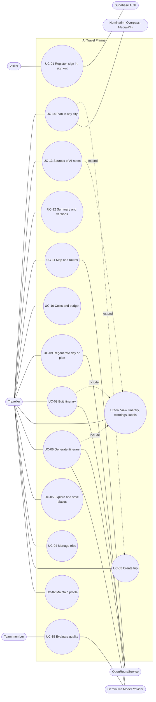

# 01 Requirements, use cases and user stories

| Item | Value |
| --- | --- |
| Course document | 01 of the IT314 set ([index](README.md)), IMD-221 |
| Owner | Nidhi Chauhan |
| Built from | `docs/spec/IMPLEMENTATION_SPEC.md` §2.1 to §2.6, [Amendment A1 §9](../spec/AMENDMENT_A1_AWS_RAG.md), [Amendment A2 §13](../spec/AMENDMENT_A2_ANY_CITY.md), [TASK_REGISTER.md](../spec/TASK_REGISTER.md), [TRACEABILITY_MATRIX.md](../spec/TRACEABILITY_MATRIX.md) and the card status table in [sprint-7.md](../progress/sprint-7.md), at `77e52ba` |
| How it was made | The tables in sections 2, 3, 5 and 6 were extracted by script from those files, so IDs, titles and acceptance criteria are quoted, not retyped. The use cases in section 4 group the requirements by actor goal |
| Related | [srs.md](../srs.md) (the full SRS of IMP-707), [12 Not implemented](12-not-implemented.md) |

## 1. Scope and catalogue

A signed-in traveller describes a trip and gets a day-wise, costed, editable itinerary. Gemini proposes the plan from a shortlist of curated places. The backend validates every place ID, recalculates every time, travel gap and price in code, labels every estimate, and saves the plan with its warnings. When Gemini fails, a rule-based planner makes a labelled plan. Retrieval-augmented generation (A1) and any-city mode (A2, behind a switch) extend the MVP.

The release has 38 catalogue items in specification §2.1: F-items numbered between F-01 and F-54, plus C-02 and C-07 to C-12. A1 adds C-13 (RAG) and A2 adds C-14 (any-city mode). Release codes: MVP = must ship, MVP-S = should ship (nine MVP-S items have cut-list switches, cut order 1 to 9), EXT = extension (all cut, IMD-65), R2, T1, PP and Stage 2 = outside the release.

| Requirement family | Count | Source |
| --- | --- | --- |
| Functional, MVP and MVP-S | 88 | §2.2 |
| Functional, RAG | 5 (FR-136 to FR-140) | A1 §9.1 |
| Functional, any-city | 5 (FR-141 to FR-145) | A2 §13.1 |
| Functional, extensions (cut) | 10 | §2.5 |
| Functional, outside the release | 37 | §2.6 |
| Non-functional | 48 + 2 (NFR-049, NFR-050) + 2 (NFR-051, NFR-052) | §2.3, A1 §9.2, A2 §13.1 |

## 2. Functional requirements (MVP and MVP-S, specification §2.2)

88 requirements in 14 groups. The Cards column is quoted from §2.2, which shortens long lists as "(+N)"; the status is computed from the cards shown. **Status** is derived from the card status table of SG-7 ([sprint-7.md](../progress/sprint-7.md)): "implemented" means every listed card is done, with or without an open evidence item. The acceptance criteria are quoted from the specification.

### AUTH — Accounts and access control

| ID | Requirement | Priority | Release | Sprint | Cards | Status | Acceptance criteria |
| --- | --- | --- | --- | --- | --- | --- | --- |
| FR-001 | Register an account | Must | MVP-S | Sprint 1 | IMP-109 | implemented | AC1: Given a valid unused email and a password of at least 8 characters, when the visitor submits the form, then an account exists and the visitor is signed in or asked to confirm the email, as configured. AC2: Given an email that already has an account, when the visitor registers, then the form shows a non-revealing message and no second account is created. AC3: Given an empty or weak password, when the form is submitted, then it is rejected with a field-level message. |
| FR-002 | Sign in, keep a session and sign out | Must | MVP-S | Sprint 1 | IMP-109 | implemented | AC1: Given valid credentials, when the traveller signs in, then the dashboard opens. AC2: Given an expired or altered token, when any protected API call is made, then the API returns 401 and the app returns to sign-in. AC3: Given the traveller has signed out, when they press Back, then no private trip data is shown. |
| FR-003 | Verify the token on every protected request | Must | MVP | Sprint 1 | IMP-108 | implemented | AC1: Given a request with a valid token, when it reaches a protected route, then the handler receives the user ID from the token. AC2: Given a request whose body names another user ID, when it is processed, then the body value is ignored. AC3: Given no token, when a protected route is called, then the API returns 401. |
| FR-004 | Maintain a short profile | Should | MVP-S | Sprint 6 | IMP-601 | implemented | AC1: Given a signed-in traveller, when they save a display name of 1 to 60 characters, then the profile shows it. AC2: Given default preferences are saved, when the traveller creates a trip, then the trip form is pre-filled with them. AC3: Given an invalid currency code, when the profile is saved, then it is rejected. |
| FR-005 | Enforce owner-only access to private data | Must | MVP | Sprint 2 | IMP-215 | implemented | AC1: Given user B knows the ID of user A's trip, when B requests it, then the API returns 404 and reveals nothing about the trip. AC2: Given a child resource such as an itinerary item, when its trip belongs to another user, then every read and write is refused. AC3: Given an automated authorization suite, when it runs in CI, then every protected endpoint is exercised with a second user. |

### TRIP — Trip setup, dashboard and management

| ID | Requirement | Priority | Release | Sprint | Cards | Status | Acceptance criteria |
| --- | --- | --- | --- | --- | --- | --- | --- |
| FR-007 | Create a trip | Must | MVP | Sprint 2 | IMP-203, IMP-212 | implemented | AC1: Given valid inputs, when the traveller submits, then a trip in draft status is created and shown on the dashboard. AC2: Given a destination outside the supported list, when the form is submitted, then it is rejected with the list of supported destinations. AC3: Given group needs such as children or reduced mobility, when the trip is saved, then they are stored and passed to planning. |
| FR-008 | Validate trip inputs | Must | MVP | Sprint 2 | IMP-203, IMP-212 | implemented | AC1: Given an end date before the start date, when the trip is submitted, then the API returns 422 with the field named. AC2: Given a trip longer than the configured maximum, when submitted, then it is rejected with the limit stated. AC3: Given a budget of zero or less, when submitted, then it is rejected. |
| FR-009 | Capture preferences and constraints | Must | MVP-S | Sprint 2 | IMP-204, IMP-212 | implemented | AC1: Given the preferences form, when the traveller saves, then each field is stored against the trip. AC2: Given must-visit places chosen from the places table, when preferences are saved, then they are stored as hard constraints. AC3: Given every preference field, when the summary is shown, then each field states whether it filters, ranks, or is only a note. |
| FR-010 | Map preferences to filters and ranking weights | Must | MVP-S | Sprint 2 | IMP-204 | implemented | AC1: Given an accessibility need, when candidates are retrieved, then places not marked suitable are filtered out. AC2: Given a relaxed pace, when ranking runs, then the weight for long visits is reduced as the mapping states. AC3: Given the mapping version changes, when a generation is recorded, then the version is stored with it. |
| FR-011 | Edit trip settings and flag a stale plan | Should | MVP-S | Sprint 5 | IMP-510 | implemented | AC1: Given an itinerary exists, when the dates change, then the itinerary shows an out-of-date banner and offers regeneration. AC2: Given only the trip title changes, when saved, then no banner appears. |
| FR-012 | Show a trip dashboard | Must | MVP-S | Sprint 6 | IMP-602 | implemented | AC1: Given a traveller with several trips, when the dashboard opens, then each trip shows title, destination, dates and status. AC2: Given no trips, when the dashboard opens, then an empty state offers to create one. AC3: Given archived trips, when the default view is shown, then they are hidden behind a filter. |
| FR-013 | Save drafts and continue later | Must | MVP | Sprint 4 | IMP-410 | implemented | AC1: Given a partly filled trip form, when the traveller leaves, then a draft is stored with the fields entered so far. AC2: Given a draft, when it is opened later, then the form is restored. |
| FR-014 | Reopen the latest saved itinerary | Must | MVP | Sprint 4 | IMP-410 | implemented | AC1: Given two saved versions, when the traveller selects Open latest, then the newest saved version opens. AC2: Given a trip with no saved itinerary, when the action is used, then the app offers generation instead of an error. |
| FR-015 | Rename, duplicate, archive and delete trips | Should | MVP-S | Sprint 6 | IMP-602 | implemented | AC1: Given a trip, when it is duplicated, then a new trip with copied days and items exists and the original is unchanged. AC2: Given a delete confirmation, when confirmed, then the trip disappears from lists but remains recoverable until the retention period ends. AC3: Given an archived trip, when opened, then it is read-only until restored. |

### PLACE — Places data and discovery

| ID | Requirement | Priority | Release | Sprint | Cards | Status | Acceptance criteria |
| --- | --- | --- | --- | --- | --- | --- | --- |
| FR-016 | Browse places for a destination | Must | MVP-S | Sprint 5 | IMP-509 | implemented | AC1: Given a supported destination, when the explore page opens, then places are listed in pages. AC2: Given any place, when displayed, then it shows its source and verification status. AC3: Given the seeded data, when shown, then the page states that data is sample and estimated. |
| FR-017 | Search and filter places | Must | MVP-S | Sprint 6 | IMP-604 | implemented | AC1: Given a category and price band, when applied, then only matching places are returned. AC2: Given no match, when filters are applied, then the page explains how to relax them. AC3: Given a distance filter, when a reference point is chosen, then results are ordered by distance. |
| FR-018 | Show place detail with labelled facts | Must | MVP-S | Sprint 6 | IMP-604 | implemented | AC1: Given a place with curated hours, when opened, then the hours show "Curated, checked on <date>". AC2: Given a place without hours, when opened, then it shows "Hours unavailable" and not a guess. AC3: Given an estimated price, when shown, then it carries an "Estimate" label. |
| FR-019 | Classify activities and suitability | Should | MVP-S | Sprint 2 | IMP-205 | implemented | AC1: Given a place with tags, when the tag filter is applied, then the place appears. AC2: Given a suitability flag with unknown data, when stored, then the flag is null and shown as unknown. |
| FR-020 | Save places to a wishlist | Should | MVP-S | Sprint 6 | IMP-605 | implemented | AC1: Given a place, when saved, then it appears in the trip's saved list. AC2: Given a saved place, when unsaved, then it is removed. AC3: Given a saved place, when generation runs, then it is treated as a preference signal for ranking but not as a must-visit unless chosen. |
| FR-022 | Load places through a provenance-preserving import | Must | MVP | Sprint 2 | IMP-205 | implemented | AC1: Given a curated file, when the import runs, then rows without source and verification status are rejected and listed. AC2: Given an import, when it completes, then a report states rows read, loaded and rejected. AC3: Given the same file imported twice, when the second import runs, then no duplicates are created. |
| FR-023 | Gate place data quality | Must | MVP | Sprint 2 | IMP-205 | implemented | AC1: Given a row with coordinates outside the destination, when imported, then it is rejected. AC2: Given opening hours in an unknown format, when imported, then the hours are stored as unavailable and the row is flagged. AC3: Given a destination with fewer places than the minimum, when the report is produced, then it states the shortfall. |

### GEN — Itinerary generation

| ID | Requirement | Priority | Release | Sprint | Cards | Status | Acceptance criteria |
| --- | --- | --- | --- | --- | --- | --- | --- |
| FR-024 | Start itinerary generation | Must | MVP | Sprint 2 | IMP-210, IMP-213, IMP-305 | implemented | AC1: Given a complete trip, when generation starts, then the API returns 202 with a generation ID. AC2: Given an incomplete trip, when generation starts, then the API returns 422 listing missing fields. AC3: Given a generation already running for the trip, when another starts, then the API returns the running job instead of creating a second. |
| FR-025 | Report generation progress and result | Must | MVP | Sprint 2 | IMP-210, IMP-213, IMP-305 | implemented | AC1: Given a running job, when the app polls, then the status and stage are returned. AC2: Given a failed job, when polled, then a user-readable reason and next step are returned. AC3: Given a job that exceeds the timeout, when polled, then it is marked failed with the timeout reason. |
| FR-026 | Build the normalized generation request | Must | MVP | Sprint 3 | IMP-303 | implemented | AC1: Given any trip, when a request is built, then it validates against the GenerationRequest schema. AC2: Given user notes, when the request is built, then notes are carried as quoted data fields and never as instructions. AC3: Given the schema version, when the request is built, then the version is recorded. |
| FR-027 | Retrieve and filter candidate places | Must | MVP | Sprint 3 | IMP-304 | implemented | AC1: Given an accessibility need, when candidates are retrieved, then unsuitable places are absent. AC2: Given a must-visit place that fails a filter, when retrieval completes, then the place stays and a conflict note is recorded. AC3: Given the result, when counted, then every candidate has a place ID from the places table. |
| FR-028 | Rank candidates | Must | MVP | Sprint 3 | IMP-304 | implemented | AC1: Given two candidates with equal price fit, when interests differ, then the better interest match ranks higher. AC2: Given the same inputs, when ranking runs twice, then the order is identical. AC3: Given the score components, when requested in debug mode, then they are logged. |
| FR-029 | Apply travel pace presets | Must | MVP-S | Sprint 5 | IMP-503 | implemented | AC1: Given a relaxed pace, when a plan is generated, then no day exceeds the relaxed activity limit. AC2: Given a changed pace, when the plan is regenerated, then the new limit applies. |
| FR-030 | Group nearby places into days | Must | MVP | Sprint 5 | IMP-503 | implemented | AC1: Given a shortlist with two distant areas, when grouped, then each area's places fall on separate days where the trip length allows. AC2: Given the grouping, when evaluated on the test trips, then average daily travel time is recorded. |
| FR-031 | Compose a structured itinerary through the active provider | Must | MVP | Sprint 3 | IMP-305 | implemented | AC1: Given the GEMINI provider is active, when generation runs, then the provider returns JSON that matches the ItineraryOutput schema. AC2: Given the MOCK provider is active, when generation runs, then a fixture itinerary is returned with no network call. AC3: Given a response with an ID outside the shortlist, when received, then it is rejected before any saving. |
| FR-032 | Validate model output against schema and place IDs | Must | MVP | Sprint 3 | IMP-306 | implemented | AC1: Given malformed JSON, when received, then it is classified as invalid output and handled by FR-057. AC2: Given a day number outside the trip, when received, then the item is rejected. AC3: Given a valid schema but an invented place ID, when received, then validation fails. |
| FR-033 | Recalculate times, durations and costs in code | Must | MVP | Sprint 3 | IMP-308 | implemented | AC1: Given a model response with its own total, when saved, then the stored total equals the backend calculation. AC2: Given an edit, when applied, then affected times and totals are recomputed in the same transaction. |
| FR-034 | Preserve explicit constraints and must-visit places | Must | MVP | Sprint 4 | IMP-406 | implemented | AC1: Given three must-visit places that fit, when generation completes, then all three are in the plan. AC2: Given a must-visit place that cannot fit, when generation completes, then a visible warning names it and the reason. |
| FR-035 | Separate AI-written text from retrieved data | Must | MVP-S | Sprint 4 | IMP-406 | implemented | AC1: Given a generated item, when displayed, then the note carries an AI-written label and the hours and price show their own source labels. AC2: Given the data model, when inspected, then AI note and retrieved fact are distinct columns. |
| FR-036 | Provide a rule-based fallback itinerary | Must | MVP | Sprint 4 | IMP-402 | implemented | AC1: Given the provider is unavailable, when generation runs, then a rule-based plan is saved and labelled as such. AC2: Given the same trip, when the rule-based planner runs twice, then both plans are identical. AC3: Given the rule-based plan, when validated, then it passes the same checks as a model plan. |
| FR-037 | Handle provider failure, timeout and quota exhaustion | Must | MVP | Sprint 4 | IMP-403 | implemented | AC1: Given a timeout, when it occurs, then the job retries within the configured limit and then falls back. AC2: Given daily quota exhaustion, when detected, then the app tells the traveller that AI generation is paused and offers the rule-based plan. AC3: Given any failure, when the job ends, then the trip data is unchanged. |
| FR-038 | Record every generation | Must | MVP | Sprint 2 | IMP-202, IMP-210 | implemented | AC1: Given a completed generation, when queried, then a record with all listed fields exists. AC2: Given usage metadata is absent, when recorded, then token fields are null and not estimated. AC3: Given a generation record, when inspected, then it contains no email, name or receipt data. |
| FR-039 | Control prompt content and size | Must | MVP | Sprint 3 | IMP-303 | implemented | AC1: Given a large shortlist, when the prompt is built, then it is truncated by rank to the configured limit. AC2: Given a prompt, when built, then it contains no account email, name or identifier, and the optional note appears only as quoted text with emails and phone numbers redacted. |

### PROV — AI provider layer

| ID | Requirement | Priority | Release | Sprint | Cards | Status | Acceptance criteria |
| --- | --- | --- | --- | --- | --- | --- | --- |
| FR-040 | Define the ModelProvider interface | Must | MVP | Sprint 1 | IMP-110, IMP-512 | implemented | AC1: Given the codebase, when searched, then vendor SDK imports appear only inside adapter modules. AC2: Given the interface, when a new adapter implements it, then the generation service runs unchanged. AC3: Given a shared contract test suite, when run against each adapter, then all operations meet the same result and error contract. |
| FR-041 | Implement the Gemini adapter | Must | MVP | Sprint 3 | IMP-301 | implemented | AC1: Given a valid key and request, when called, then it returns a parsed ItineraryOutput candidate and usage metadata. AC2: Given HTTP 429, when received, then the adapter raises a rate-limit error after bounded backoff. AC3: Given a blocked or empty response, when received, then it raises an invalid-output error with the reason. |
| FR-042 | Implement the mock adapter | Must | MVP | Sprint 2 | IMP-207 | implemented | AC1: Given AI_PROVIDER=MOCK, when generation runs, then no network call is made. AC2: Given a failure mode setting, when generation runs, then the matching shared error is raised. |
| FR-043 | Select the active provider by configuration | Must | MVP | Sprint 2 | IMP-208 | implemented | AC1: Given AI_PROVIDER=GEMINI and no key, when the backend starts, then it exits with a clear configuration error. AC2: Given an unknown value, when the backend starts, then it exits with a clear error. AC3: Given FINETUNED_MODEL before Stage 2, when selected, then start-up is refused with a message that the adapter is not enabled. |
| FR-044 | Check provider health and expose metadata | Must | MVP | Sprint 3 | IMP-302 | implemented | AC1: Given the health endpoint, when called, then it returns provider name, model identifier and status. AC2: Given a failing health check, when called, then the endpoint reports degraded and the app can still serve non-AI pages. |
| FR-045 | Keep a versioned prompt-template registry | Must | MVP | Sprint 1 | IMP-111 | implemented | AC1: Given a template change, when merged, then its version number changes. AC2: Given a generation record, when read, then it names the template version. |
| FR-046 | Limit usage and cost | Must | MVP | Sprint 5 | IMP-511 | implemented | AC1: Given a user at the daily limit, when they start generation, then the API returns 429 with the limit and the reset time. AC2: Given the global limit is reached, when any user starts generation, then the rule-based option is offered. AC3: Given usage, when reviewed, then daily counts are queryable by the team. |
| FR-047 | Handle rate limits with bounded retries | Must | MVP | Sprint 4 | IMP-401 | implemented | AC1: Given five consecutive 503 responses (IMD-146), when the limit is reached, then the circuit opens for the configured period. AC2: Given the circuit is open, when generation starts, then the fallback is used without calling the provider. |

### VAL — Validation and repair

| ID | Requirement | Priority | Release | Sprint | Cards | Status | Acceptance criteria |
| --- | --- | --- | --- | --- | --- | --- | --- |
| FR-050 | Detect schedule overlaps | Must | MVP | Sprint 4 | IMP-404 | implemented | AC1: Given two items overlapping by 15 minutes, when validated, then an overlap warning with both item IDs is produced. AC2: Given back-to-back items, when validated, then no overlap is flagged. |
| FR-051 | Detect insufficient travel gaps | Must | MVP | Sprint 4 | IMP-404 | implemented | AC1: Given a 10-minute gap and a 30-minute transfer, when validated, then a transfer warning is produced. AC2: Given an estimate from the fallback method, when the warning is shown, then it is labelled an estimate. |
| FR-052 | Detect opening-hour conflicts | Must | MVP | Sprint 5 | IMP-501 | implemented | AC1: Given a visit on a closed day, when validated, then an opening-hours warning is produced. AC2: Given a place with unavailable hours, when validated, then an "hours unverified" notice is produced and no conflict is claimed. |
| FR-053 | Detect overpacked days | Must | MVP | Sprint 5 | IMP-501 | implemented | AC1: Given a relaxed pace and a day over its limit, when validated, then a day-length warning is produced. AC2: Given a changed pace, when revalidated, then the threshold changes. |
| FR-054 | Detect budget conflicts | Must | MVP | Sprint 5 | IMP-501 | implemented | AC1: Given a total above the budget, when validated, then a budget warning with the excess is produced. AC2: Given a total within 10 percent below the budget, when validated, then a near-budget notice is produced (threshold configurable). |
| FR-055 | Detect missing constraints and invalid references | Must | MVP | Sprint 4 | IMP-404 | implemented | AC1: Given a must-visit place absent from the plan, when validated, then a warning names it. AC2: Given an item outside the trip dates, when validated, then it is rejected or flagged. |
| FR-056 | Produce structured warnings with suggested fixes | Must | MVP | Sprint 4 | IMP-405 | implemented | AC1: Given a warning, when displayed, then it names the cause and offers at least one suggested action. AC2: Given an unresolved warning, when the trip is saved, then the warning is stored with the version. |
| FR-057 | Repair within bounds | Must | MVP-S | Sprint 5 | IMP-502 | implemented | AC1: Given an overlap, when repair runs, then times are shifted deterministically without a model call. AC2: Given a failure that deterministic repair cannot fix, when the retry runs, then at most one provider call is made. AC3: Given unresolved issues after repair, when the plan is saved, then they appear as warnings. |
| FR-058 | Persist validation results | Must | MVP | Sprint 4 | IMP-405 | implemented | AC1: Given a saved version, when read, then its warnings and repair summary are returned. AC2: Given a restored version, when opened, then its stored warnings are shown and revalidation is offered. |

### EDIT — Itinerary editing

| ID | Requirement | Priority | Release | Sprint | Cards | Status | Acceptance criteria |
| --- | --- | --- | --- | --- | --- | --- | --- |
| FR-059 | View the day-wise itinerary | Must | MVP | Sprint 2 | IMP-211, IMP-309 | implemented | AC1: Given a saved itinerary, when opened, then each day lists items in time order. AC2: Given an item with an estimated cost, when shown, then it carries the Estimate label. |
| FR-060 | Reorder activities | Must | MVP | Sprint 4 | IMP-409 | implemented | AC1: Given a drag of an item to a new position, when dropped, then the order, times and totals update. AC2: Given a keyboard user, when they use the move controls, then the same result is achieved. AC3: Given a resulting conflict, when applied, then a warning appears and the edit is not hidden. |
| FR-061 | Remove an activity | Must | MVP | Sprint 4 | IMP-408 | implemented | AC1: Given a removal, when confirmed, then the day's times and totals are recomputed. AC2: Given a removed must-visit item, when applied, then a warning states it is no longer included. |
| FR-062 | Add a user-selected place | Must | MVP | Sprint 5 | IMP-504 | implemented | AC1: Given a place and a day, when added, then it is inserted at a feasible time and the day is revalidated. AC2: Given a conflict, when the place is added, then the warning is shown and the addition is kept unless the traveller cancels. |
| FR-063 | Change start time or duration | Must | MVP | Sprint 4 | IMP-408 | implemented | AC1: Given a new duration, when saved, then following start times shift or conflicts are flagged. AC2: Given a duration outside allowed limits, when submitted, then it is rejected. |
| FR-064 | Recalculate after every edit | Must | MVP | Sprint 4 | IMP-407 | implemented | AC1: Given any edit endpoint, when it succeeds, then the response contains recalculated totals. AC2: Given a failing validation step, when the edit is applied, then the data is consistent and the failure is reported. |
| FR-065 | Replace an activity with a ranked alternative | Should | MVP-S | Sprint 5 | IMP-505 | implemented | AC1: Given an activity, when Replace is chosen, then up to three alternatives are shown with cost and time differences. AC2: Given a choice, when applied, then the day is recalculated and revalidated. AC3: Given no alternative, when Replace is chosen, then a message says none fit. |
| FR-066 | Lock and unlock items | Should | MVP-S | Sprint 5 | IMP-506 | implemented | AC1: Given a locked item, when a day is regenerated, then the item stays at the same time. AC2: Given a must-visit item, when created, then it is locked by default. |
| FR-067 | Regenerate one day | Should | MVP-S | Sprint 6 | IMP-607 | implemented | AC1: Given a day with a locked item, when regenerated, then the locked item remains and other days are byte-identical. AC2: Given the regeneration, when complete, then a version snapshot taken beforehand exists. |
| FR-068 | Regenerate the whole itinerary | Should | MVP-S | Sprint 6 | IMP-607 | implemented | AC1: Given a full regeneration, when complete, then the earlier version remains restorable. AC2: Given locked items, when the whole itinerary is rebuilt, then locked items are preserved. |
| FR-069 | Reject stale edits | Should | MVP | Sprint 5 | IMP-504 | implemented | AC1: Given two browser tabs, when the second edit uses an old version number, then the API returns 409 and the app offers a reload. |

### COST — Costs and budget

| ID | Requirement | Priority | Release | Sprint | Cards | Status | Acceptance criteria |
| --- | --- | --- | --- | --- | --- | --- | --- |
| FR-071 | Estimate trip cost | Must | MVP | Sprint 3 | IMP-308 | implemented | AC1: Given known item costs and traveller count, when computed, then totals equal the documented formulas to the cent. AC2: Given a missing cost, when computed, then the total is flagged incomplete and the item uses a labelled estimate. |
| FR-072 | Collect transport allowance and stay budget | Must | MVP | Sprint 4 | IMP-411 | implemented | AC1: Given the inputs, when saved, then they appear in the cost breakdown labelled "traveller input". AC2: Given no input, when computed, then those lines are shown as unavailable and the total says so. |
| FR-073 | Show daily and category cost breakdown | Must | MVP | Sprint 5 | IMP-507 | implemented | AC1: Given an itinerary, when the breakdown opens, then day and category sums equal the trip total. AC2: Given an edit, when applied, then the breakdown updates. |
| FR-074 | Alert near and over budget | Should | MVP-S | Sprint 6 | IMP-608 | implemented | AC1: Given a total at 92 percent of budget, when displayed, then the near-budget banner shows. AC2: Given a total above budget, when displayed, then the over-budget banner shows the excess. |
| FR-075 | Include a contingency buffer | Should | MVP-S | Sprint 6 | IMP-608 | implemented | AC1: Given a 10 percent buffer, when computed, then the buffer line equals 10 percent of the estimate. AC2: Given no buffer, when computed, then the buffer line is zero. |
| FR-076 | Label price sources and verification status | Must | MVP | Sprint 4 | IMP-411 | implemented | AC1: Given any price, when displayed, then it shows Estimate, Curated or Unavailable with a date where one exists. AC2: Given the UI, when searched for "live", then no price is described as live in the MVP. |

### ROUTE — Routes and maps

| ID | Requirement | Priority | Release | Sprint | Cards | Status | Acceptance criteria |
| --- | --- | --- | --- | --- | --- | --- | --- |
| FR-078 | Estimate travel time between stops | Must | MVP | Sprint 3 | IMP-307 | implemented | AC1: Given two places, when estimated, then the result is cached for reuse. AC2: Given a cached pair, when requested again, then no external call is made. |
| FR-079 | Fall back to a distance-based estimate | Must | MVP | Sprint 2 | IMP-209 | implemented | AC1: Given the routing provider is unavailable, when estimating, then the fallback value is returned with an Estimate label. AC2: Given fallback values, when validated, then the larger buffer applies. |
| FR-080 | Show places and routes on a map | Must | MVP-S | Sprint 5 | IMP-508 | implemented | AC1: Given a day, when the map opens, then markers appear in visit order. AC2: Given a marker, when selected, then the activity detail opens. AC3: Given a map-tile failure, when it occurs, then the list view still works. |

### FOOD — Food and meal slots

| ID | Requirement | Priority | Release | Sprint | Cards | Status | Acceptance criteria |
| --- | --- | --- | --- | --- | --- | --- | --- |
| FR-083 | Include food in the plan | Should | MVP-S | Sprint 6 | IMP-606 | implemented | AC1: Given a full-day plan, when generated, then meal slots are filled from food places or left empty with a note. AC2: Given a food place, when shown, then no rating is displayed. |

### MGMT — Summary and versions

| ID | Requirement | Priority | Release | Sprint | Cards | Status | Acceptance criteria |
| --- | --- | --- | --- | --- | --- | --- | --- |
| FR-094 | Produce a final trip summary | Must | MVP | Sprint 6 | IMP-609 | implemented | AC1: Given a saved itinerary, when the summary opens, then it lists each day with times, places and travel notes. AC2: Given warnings, when shown, then unresolved ones appear in the summary. |
| FR-095 | Keep itinerary versions | Should | MVP-S | Sprint 6 | IMP-610 | implemented | AC1: Given a regeneration, when it starts, then a snapshot is stored first. AC2: Given a restore, when confirmed, then the chosen version becomes current and the replaced one stays in history. |

### UX — Experience and accessibility

| ID | Requirement | Priority | Release | Sprint | Cards | Status | Acceptance criteria |
| --- | --- | --- | --- | --- | --- | --- | --- |
| FR-114 | Provide responsive layouts | Must | MVP | Sprint 1 | IMP-104, IMP-703 | IMP-104 implemented; IMP-703 open | AC1: Given widths of 360, 768 and 1280 pixels, when the core pages load, then no horizontal scrolling or overlapped controls occur. |
| FR-115 | Support keyboard and assistive technology | Must | MVP | Sprint 5 | IMP-513, IMP-703 | IMP-513 implemented; IMP-703 open | AC1: Given only a keyboard, when the traveller completes the core journey, then every step is reachable. AC2: Given a screen reader, when the itinerary is read, then days, times and warnings are announced in order. |
| FR-116 | Show understandable states and errors | Must | MVP | Sprint 4 | IMP-412 | implemented | AC1: Given a failed request, when shown, then the message states what happened and what to do. |
| FR-117 | Show estimate labels wherever estimates appear | Must | MVP | Sprint 5 | IMP-507 | implemented | AC1: Given any screen with prices, hours or travel times, when reviewed, then each carries a label. |

### EVAL — Evaluation

| ID | Requirement | Priority | Release | Sprint | Cards | Status | Acceptance criteria |
| --- | --- | --- | --- | --- | --- | --- | --- |
| FR-118 | Maintain a versioned evaluation dataset | Must | MVP | Sprint 3 | IMP-310 | implemented | AC1: Given the dataset, when inspected, then each case has an ID, inputs, hard constraints and a version. AC2: Given a training set exists later, when compared, then no evaluation case appears in it. |
| FR-119 | Run an evaluation harness against any provider | Must | MVP | Sprint 4 | IMP-413 | implemented | AC1: Given AI_PROVIDER=MOCK, when the harness runs, then it completes offline with fixture results. AC2: Given two providers, when both run, then the metric definitions are identical. |
| FR-120 | Record evaluation runs | Must | MVP | Sprint 5 | IMP-514, IMP-705 | implemented | AC1: Given a completed run, when the run records are listed, then a record file with all fields exists. |

### PLAT — Platform

| ID | Requirement | Priority | Release | Sprint | Cards | Status | Acceptance criteria |
| --- | --- | --- | --- | --- | --- | --- | --- |
| FR-123 | Expose health and version | Must | MVP | Sprint 1 | IMP-103, IMP-112, IMP-201 | implemented | AC1: Given a deployed backend, when /health is called, then it returns status and version. AC2: Given the database is unreachable, when /health/ready is called, then it reports not ready. |
| FR-124 | Validate configuration at start-up | Must | MVP | Sprint 1 | IMP-103, IMP-105 | implemented | AC1: Given a missing database URL, when the backend starts, then it fails fast with a clear message. AC2: Given logs, when inspected, then no secret value appears. |
| FR-125 | Log requests with correlation IDs | Should | MVP | Sprint 2 | IMP-201 | implemented | AC1: Given a request, when logged, then the entry has a request ID and latency. AC2: Given a generation request, when logged, then the prompt text is not logged by default. |
| FR-126 | Rate-limit expensive endpoints | Should | MVP | Sprint 5 | IMP-511 | implemented | AC1: Given more than the allowed requests per minute, when the limit is exceeded, then the API returns 429 with a retry hint. |

### RAG — Retrieval-augmented generation (Amendment A1 §9.1, catalogue item C-13)

| ID | Requirement | Acceptance criteria | Stories | Cards | Status |
| --- | --- | --- | --- | --- | --- |
| FR-136 | Corpus ingestion with provenance | AC1: every active place and every guide that passes the gate is chunked and embedded with the configured embedding model, and each chunk resolves to its document and data source (name, licence, URL, retrieval date). AC2: a guide with missing provenance, out-of-range length or a price, opening-hour or travel-time statement fails the strict gate and is not indexed. AC3: re-running the index embeds only new or changed chunks; removed documents are deactivated, never deleted | US-166 | IMP-313, IMP-314 | implemented |
| FR-137 | Semantic retrieval with fallback | AC1: for a generation, the trip's preferences are embedded once and similar place and guide chunks of the trip's destination are retrieved by cosine similarity. AC2: semantic similarity reorders candidates inside the deterministic ranking; hard filters and must-visit places are unchanged. AC3: when embeddings are unavailable the generation proceeds with lexical ranking and records `retrieval_mode = lexical_fallback` | US-164 | IMP-315 | implemented |
| FR-138 | Grounded generation with validated citations | AC1: retrieved passages reach the model only as quoted reference data with their IDs; prices, hours and travel times never come from passages. AC2: an item cites at most three passage IDs of its own request; any other ID is dropped and counted. AC3: the saved plan records each item's citations and the generation record names the retrieval mode and embedding model | US-164 | IMP-316 | implemented |
| FR-139 | Sources shown with AI-written notes | AC1: API-24 lists, for each item, the sources it cites with title, kind, source name, licence or attribution, link and retrieval date. AC2: the itinerary page shows them next to the AI-written note; items without citations show none. AC3: source links open outside the app safely and no internal ID is shown as text | US-165 | IMP-316, IMP-317 | implemented |
| FR-140 | Retrieval evaluation | AC1: the harness reports `recall@6` of labelled guide documents and the hit rate of labelled places in the top 12, in vector and lexical mode. AC2: it reports citation validity and grounding rate of generated plans. AC3: every number names the dataset version, provider, embedding model and commit | US-167 | IMP-318 | implemented |

### LIVE — Any-city mode (Amendment A2 §13.1, catalogue item C-14)

A2 gives these requirements no acceptance-criterion column; their acceptance is ACC-20 to ACC-23 (A2 §13.3, [acceptance/any-city.md](../acceptance/any-city.md)). Cards IMP-721 to IMP-733 are on `main`; ACC-20 to ACC-23 are "pending" at `77e52ba`.

| ID | Requirement (A2 wording) | Status |
| --- | --- | --- |
| FR-141 | City search: a signed-in user searches a city name and sees up to 8 settlements (API-76) | built behind `any_city_mode`; acceptance pending |
| FR-142 | Live destination: choosing a settlement creates or reuses a live destination and imports its places in the background, with visible progress and a "not enough data" outcome naming a larger nearby city (API-77, API-78) | built behind `any_city_mode`; acceptance pending |
| FR-143 | Tier and attribution: every live destination, place and item shows the live tier, its source and the licence attribution (API-79) | built behind `any_city_mode`; acceptance pending |
| FR-144 | Unknown values: live places have no price and no opening hours; the app shows "Price unknown" and "Hours unknown" and never takes either from the model or from guide text | built behind `any_city_mode`; acceptance pending |
| FR-145 | Live guide corpus: Wikivoyage (and Wikipedia) sections enter the RAG store with licence and attribution, without prices, hours or travel times | built behind `any_city_mode`; acceptance pending |

### Extension requirements (specification §2.5): all cut (IMD-65)

| ID | Requirement | Card | Switch | Status |
| --- | --- | --- | --- | --- |
| FR-127 | Explain why a place is ranked | IMP-515 | `ranking_explain` (cut 9 of 9) | cut |
| FR-128 | Describe a trip in free text | IMP-708 | `nl_intake` (cut 8 of 9) | cut |
| FR-129 | Explain a day of the plan | IMP-709 | `day_explain` (cut 7 of 9) | cut |
| FR-130 | Optimise the order of a day | IMP-612 | `optimise_order` (cut 6 of 9) | cut |
| FR-131 | Suggest a day swap when rain is forecast | IMP-710 | `rain_swap` (cut 5 of 9) | cut |
| FR-132 | Show today's next stop | IMP-711 | `today_view` (cut 4 of 9) | cut |
| FR-133 | Suggest changes that fit the budget | IMP-712 | `budget_fit` (cut 3 of 9) | cut |
| FR-134 | Show context cards for places and destinations | IMP-713 | `context_cards` (cut 2 of 9) | cut |
| FR-088 | Generate a packing checklist | IMP-613 | `packing` (cut 1 of 9) | cut |
| FR-135 | Refine the packing list from free text | IMP-613 | `packing` (cut 1 of 9) | cut |

The 37 requirements outside the release (specification §2.6: R2, T1, PP, Stage 2) are listed in [12 Not implemented](12-not-implemented.md) §2.

## 3. Non-functional requirements (specification §2.3, A1 §9.2, A2 §13.1)

Targets stay "proposed" until measured (specification §2.3).

| ID | Area | Requirement | Target | Release | Cards | Tests |
| --- | --- | --- | --- | --- | --- | --- |
| NFR-001 | Performance | Page load on mobile | Largest Contentful Paint at most 2.5 s at the 75th percentile (proposed) | MVP | IMP-711 | TC-328 |
| NFR-002 | Performance | Non-AI API latency | p95 at most 500 ms excluding cold start (proposed) | MVP | IMP-304, IMP-309, IMP-410 (+2) | TC-329 |
| NFR-003 | Performance | Edit recalculation time | p95 at most 1.5 s (proposed) | MVP | IMP-407, IMP-408, IMP-409 (+6) | TC-330 |
| NFR-004 | Performance | Generation time | p95 at most 90 s for trips up to 7 days; timeout 120 s (proposed; to be replaced by measured values after the first baseline run in week 5, US-130) | MVP | IMP-210, IMP-301, IMP-305 (+3) | TC-018, TC-391 |
| NFR-005 | Performance | Cold-start handling | Backend wake-up procedure completed at least 10 minutes before a demo | MVP | IMP-112, IMP-710, IMP-801 (+2) | TC-377 |
| NFR-006 | Reliability | Non-AI features survive provider outage | 100 percent of non-AI endpoints pass smoke tests with MOCK failing | MVP | IMP-401, IMP-402, IMP-403 (+1) | TC-045, TC-371, TC-415 (+1) |
| NFR-007 | Reliability | Generation outcome | At least 95 percent of evaluation cases end in a saved valid plan (proposed; measure first) | MVP | IMP-402, IMP-403, IMP-502 | TC-331 |
| NFR-008 | Reliability | Data consistency | Zero partial-state failures in the fault-injection tests | MVP | IMP-210, IMP-305, IMP-407 (+5) | TC-312 |
| NFR-009 | Reliability | Backup before demo | Export completed and stored before each demo | MVP | IMP-801, IMP-803 | TC-332 |
| NFR-010 | Reliability | Degradation of outside services | Fallback estimate or list view available | MVP | IMP-307, IMP-508 | TC-317 |
| NFR-011 | Security | Authentication on protected routes | 0 unauthenticated protected routes | MVP | IMP-702 | TC-344, TC-347 |
| NFR-012 | Security | Authorization and data isolation | 0 cross-user successes in the authorization suite | MVP | IMP-106, IMP-108, IMP-203 (+8) | TC-345, TC-346, TC-375 (+1) |
| NFR-013 | Security | Secret handling | 0 secrets found by scanning | MVP | IMP-102, IMP-103, IMP-105 (+8) | TC-013, TC-025, TC-043 (+3) |
| NFR-014 | Security | Input validation | 100 percent of endpoints have request schemas | MVP | IMP-203, IMP-601, IMP-702 | TC-349, TC-350 |
| NFR-015 | Security | Transport and browser security | CORS allows only configured origins | MVP | IMP-103, IMP-112, IMP-702 | TC-351, TC-352 |
| NFR-016 | Security | Prompt-injection resistance | No injected instruction changes the set of places or costs in the injection test set | MVP | IMP-204, IMP-303, IMP-306 (+3) | TC-028, TC-357, TC-395 |
| NFR-017 | Security | Abuse limiting | Limits configured and tested | MVP | IMP-511 | TC-353 |
| NFR-018 | Security | Dependency hygiene | 0 critical findings at merge | MVP | IMP-102, IMP-702 | TC-356 |
| NFR-019 | Security | File upload safety | 100 percent of invalid files rejected in tests | R2 | — | TC-363 |
| NFR-020 | Privacy | Minimal data to the AI provider | 0 account identifiers in prompt samples; the redaction test passes on the note fixtures | MVP | IMP-301, IMP-303 | TC-014, TC-030, TC-365 |
| NFR-021 | Privacy | Privacy notice and provider disclosure | Notice shown before first generation | MVP | IMP-305, IMP-613, IMP-708 (+2) | TC-360, TC-365, TC-366 |
| NFR-022 | Privacy | Retention and deletion | Retention values documented; expired records removed; one operator deletion carried out on test data | MVP | IMP-202, IMP-602, IMP-707 | TC-359 |
| NFR-023 | Privacy | No training on private data by default | 0 user-derived records in any training export | MVP | — | TC-361 |
| NFR-024 | Privacy | No personal data in logs | 0 matches in log samples | MVP | IMP-301, IMP-403, IMP-702 | TC-025, TC-358, TC-368 |
| NFR-025 | Usability | Accessibility target | No critical automated findings; core journey completable by keyboard | MVP | IMP-212, IMP-309, IMP-409 (+3) | TC-374, TC-382, TC-383 |
| NFR-026 | Usability | Responsive layout | No horizontal scroll or clipped controls at tested widths | MVP | IMP-104, IMP-508, IMP-701 (+1) | TC-373 |
| NFR-027 | Usability | First-use success | At least 4 of 5 test users succeed within 10 minutes (proposed) | MVP | IMP-611, IMP-704, IMP-707 | TC-380, TC-381 |
| NFR-028 | Usability | Clear errors | 100 percent of error states reviewed | MVP | IMP-405, IMP-411, IMP-412 (+1) | TC-381, TC-384 |
| NFR-029 | Maintainability | Code quality gates | Gates green on every merged pull request | MVP | — | TC-333 |
| NFR-030 | Maintainability | Test coverage of business logic | Statement coverage of at least 85 percent for validator and budget modules and 70 percent for other backend modules (proposed) | MVP | IMP-308, IMP-404, IMP-501 (+4) | TC-334 |
| NFR-031 | Maintainability | Provider isolation | 0 violations | MVP | IMP-102, IMP-110, IMP-301 (+1) | TC-002 |
| NFR-032 | Maintainability | Reproducible setup | Setup within 60 minutes (proposed) | MVP | IMP-101, IMP-105, IMP-107 (+2) | TC-335 |
| NFR-033 | Maintainability | Reviewed, documented modules | Every module has a note; OpenAPI published | MVP | IMP-101, IMP-214, IMP-707 | TC-336 |
| NFR-034 | Maintainability | Migrations | CI applies all migrations to a blank database | MVP | IMP-102, IMP-106, IMP-199 (+1) | TC-337 |
| NFR-035 | Portability | Environment-only configuration | Same image runs locally and on the host | MVP | IMP-103, IMP-105, IMP-112 (+1) | TC-338 |
| NFR-036 | Portability | Browser support | Smoke test passes on each | MVP | — | TC-339 |
| NFR-037 | Cost control | Spend limits | Caps configured before first public demo | MVP | IMP-113, IMP-511, IMP-801 | TC-340, TC-430 |
| NFR-038 | Cost control | Quota awareness and caching | Cache hit rate and daily counts recorded | MVP | IMP-307 | TC-341 |
| NFR-039 | Cost control | Token budget | Average tokens per generation reported from the evaluation run | MVP | IMP-303, IMP-511, IMP-705 | TC-027, TC-396 |
| NFR-040 | AI transparency | Labelling | 100 percent of reviewed screens carry labels | MVP | IMP-205, IMP-206, IMP-501 (+5) | TC-385 |
| NFR-041 | AI transparency | No unmeasured claims | Every numeric AI claim traces to a recorded run | MVP | IMP-514, IMP-705, IMP-799 (+1) | TC-391, TC-392, TC-397 |
| NFR-042 | AI transparency | Reproducible AI runs | 100 percent of generation records complete | MVP | IMP-111, IMP-202, IMP-301 (+3) | TC-007, TC-012, TC-024 (+4) |
| NFR-043 | Model migration | Provider-neutral application contract | Contract suite passes for every adapter | MVP | IMP-110, IMP-207, IMP-512 | TC-001, TC-003, TC-008 (+4) |
| NFR-044 | Model migration | Migration safety | 0 schema changes in a switch; saved plans open after a switch | S2 | — | TC-047, TC-048 |
| NFR-045 | Model migration | Rollback | Rollback rehearsed once before any switch | S2 | IMP-610 | TC-049 |
| NFR-046 | Model migration | Evaluation parity | Criteria commit precedes the final scoring commit | MVP | IMP-310, IMP-413, IMP-514 | TC-041, TC-388, TC-389 (+2) |
| NFR-047 | Observability | Logs and health | A failed generation can be traced by request ID | MVP | IMP-201 | TC-342 |
| NFR-048 | Observability | Automated testing in CI | Green pipeline required to merge | MVP | IMP-102, IMP-199, IMP-216 (+4) | TC-343 |
| NFR-049 | Cost control | AWS spend guardrail | Budget alerts at USD 25 and 50 before staging is shared; one task per staging service; production services exist only from Sprint 8 | MVP | IMP-217, IMP-801 | TC-435 |
| NFR-050 | Performance | Retrieval overhead | Retrieval adds at most 2 s at the 95th percentile to a generation on staging (proposed; replace with the measured value) | MVP | IMP-315, IMP-399 | TC-459 |
| NFR-051 | Any-city | Import time | a live import of a city with up to 300 places completes within 120 s at the 95th percentile on staging (proposed; replaced with the measured value) | A2 | IMP-725, IMP-731 | not recorded |
| NFR-052 | Any-city | Provider etiquette | at most 1 Nominatim request per second per process, identifying User-Agent on every call, cached search results, no type-ahead | A2 | IMP-725, IMP-731 | not recorded |

## 4. Use cases

The specification and registers define **no UC IDs**. The numbers UC-01 to UC-15 are assigned in this document only. Each use case groups the functional requirements an actor uses for one goal, and the FR IDs are the binding reference.

### 4.1 Actors

| Actor | Kind | Notes |
| --- | --- | --- |
| Visitor | Primary | Not signed in; sees the landing page, sign-up and sign-in |
| Traveller | Primary | Signed-in user; owns trips, itineraries and versions |
| Team member (evaluator) | Primary | Runs `make eval` and `make rag-index` from the repository |
| Supabase Auth | Secondary system | Sign-up, sign-in and sessions; the API checks tokens with JWKS |
| Gemini (through `ModelProvider`) | Secondary system | Proposes itineraries and embeds texts; the rule-based planner replaces it on failure |
| OpenRouteService | Secondary system | Travel times; a distance estimate replaces it on failure |
| Live-data services (Nominatim, Overpass, MediaWiki) | Secondary system | Any-city mode only (A2) |

### 4.2 Use case list

| UC | Use case | Primary actor | Requirements | Main screens and endpoints |
| --- | --- | --- | --- | --- |
| UC-01 | Register, sign in and sign out | Visitor | FR-001, FR-002, FR-003, FR-005 | `/sign-up`, `/sign-in`; Supabase Auth |
| UC-02 | Maintain a profile | Traveller | FR-004 | `/profile`; API-03, API-04 |
| UC-03 | Create a trip with preferences and must-visit places | Traveller | FR-007 to FR-010, FR-013 | `/trips/new`; API-06, API-07, API-14, API-15 |
| UC-04 | Manage trips on the dashboard (draft resume, latest itinerary, rename, duplicate, archive, delete, edit settings) | Traveller | FR-011, FR-012, FR-014, FR-015 | `/dashboard`, `/trips/{id}/edit`; API-08 to API-13 |
| UC-05 | Explore, search and save places | Traveller | FR-016 to FR-020, FR-022, FR-023 | `/trips/{id}/explore`; API-16, API-17, API-19 to API-21 |
| UC-06 | Generate an itinerary | Traveller | FR-024 to FR-047 (GEN, PROV) | `/trips/{id}/generate`; API-22, API-23 |
| UC-07 | View the day-wise itinerary with warnings and labels | Traveller | FR-050 to FR-059, FR-116, FR-117 | `/trips/{id}/itinerary`; API-24, API-32 |
| UC-08 | Edit the itinerary (reorder, remove, retime, add, replace, lock) | Traveller | FR-060 to FR-066, FR-069 | `/trips/{id}/itinerary`; API-25 to API-29 |
| UC-09 | Regenerate one day or the whole itinerary | Traveller | FR-067, FR-068 | API-30, API-31 |
| UC-10 | Review costs and budget settings | Traveller | FR-071 to FR-076, FR-083 | `/trips/{id}/costs`; API-33, API-34 |
| UC-11 | View places and routes on a map | Traveller | FR-078 to FR-080 | `MapPanel` on the itinerary page |
| UC-12 | Print a summary and manage versions | Traveller | FR-094, FR-095 | `/trips/{id}/summary`, `/trips/{id}/versions`; API-35 to API-38 |
| UC-13 | See the sources behind AI-written notes | Traveller | FR-136 to FR-139 | `ItemSources` on the itinerary page; API-24 |
| UC-14 | Plan a trip in any city (switch ON) | Traveller | FR-141 to FR-145 | `CitySearch`, `ImportProgress`; API-76 to API-79 |
| UC-15 | Evaluate generation and retrieval quality | Team member | FR-118 to FR-120, FR-140 | `make eval`; `app/evaluation/run.py` |

Platform requirements FR-114, FR-115 and FR-123 to FR-126 apply to all use cases and are not drawn separately.

### 4.3 Use case diagram

Mermaid has no UML use case diagram, so this is drawn as a flowchart. Rounded boxes are actors and ellipses are use cases.

## 5. User stories backlog by sprint

Story IDs and their cards come from the "Traces to" line of each card in [TASK_REGISTER.md](../spec/TASK_REGISTER.md). **The story sentences ("As a … I want …") are not recorded in the repository**: the specification traces to them by ID only, so this backlog lists the card title as the story's scope. Status is the card's status (implemented, cut, open, or the Sprint 8 state).

### Sprint 1

| Story | Card | Scope (card title) | Status |
| --- | --- | --- | --- |
| US-001 | IMP-101 | Repository skeleton, toolchain, Makefile, CLAUDE.md and docs/progress folders | implemented |
| US-001 | IMP-102 | CI workflow (lint, types, imports, unit, guards, audit), branch protection, PR template, CODEOWNERS | implemented |
| US-002 | IMP-112 | Hello-world deployment to Vercel, Render and Supabase staging with deploy workflows | implemented |
| US-003 | IMP-103 | Backend skeleton: app factory, typed settings with start-up checks, error envelope, basic GET /health | implemented |
| US-003 | IMP-105 | Local environments: Supabase CLI stack, docker compose db, .env.example and env templates | implemented |
| US-004 | IMP-113 | Provision accounts, keys and email sender with named owners | open |
| US-008 | IMP-106 | MVP migrations 0001-0006 through Alembic, ORM models, schema-drift test, test database fixture | implemented |
| US-010 | IMP-109 | Sign-up, sign-in, sign-out and AuthGuard with Supabase Auth | implemented |
| US-011 | IMP-109 | Sign-up, sign-in, sign-out and AuthGuard with Supabase Auth | implemented |
| US-012 | IMP-108 | Backend token verification and CurrentUser dependency, test token helper | implemented |
| US-034 | IMP-110 | ModelProvider interface, shared AI schemas gr-1 and io-1, provider error types | implemented |
| US-039 | IMP-111 | Versioned prompt-template registry | implemented |
| US-122 | IMP-104 | Web skeleton: Next.js app, Tailwind and shadcn/ui, responsive AppShell, query provider, state components | implemented |
| US-151 | IMP-114 | Stakeholder interviews round 1 and recorded findings | open |
| US-152 | IMP-115 | Seed-data plan and choice of the two demo destinations | implemented |

### Sprint 2

| Story | Card | Scope (card title) | Status |
| --- | --- | --- | --- |
| US-002 | IMP-217 | AWS staging foundation: RDS PostgreSQL, ECR, SSM, ECS Express services, OIDC deploy role and budget | implemented |
| US-002 | IMP-218 | Web container and AWS deploy workflows with the release task | implemented |
| US-004 | IMP-217 | AWS staging foundation: RDS PostgreSQL, ECR, SSM, ECS Express services, OIDC deploy role and budget | implemented |
| US-005 | IMP-201 | Readiness endpoint and structured request logging with request IDs | implemented |
| US-006 | IMP-201 | Readiness endpoint and structured request logging with request IDs | implemented |
| US-007 | IMP-214 | OpenAPI contract v1 export, generated web client and contract check | implemented |
| US-012 | IMP-219 | Supabase Auth with an AWS database: auth stub bootstrap and user row mirroring | implemented |
| US-013 | IMP-215 | Two-user authorization suite for every owned route | implemented |
| US-016 | IMP-203 | Trips API: create, list and read a trip with validation | implemented |
| US-016 | IMP-212 | Trip wizard and preference form | implemented |
| US-017 | IMP-204 | Preferences and must-visit places API with mapping to filters and ranking weights | implemented |
| US-017 | IMP-212 | Trip wizard and preference form | implemented |
| US-018 | IMP-204 | Preferences and must-visit places API with mapping to filters and ranking weights | implemented |
| US-024 | IMP-205 | Provenance-preserving place import with quality gate, categories and destinations API | implemented |
| US-025 | IMP-205 | Provenance-preserving place import with quality gate, categories and destinations API | implemented |
| US-026 | IMP-206 | Curate and load demo destination 1 | implemented |
| US-028 | IMP-205 | Provenance-preserving place import with quality gate, categories and destinations API | implemented |
| US-035 | IMP-207 | Mock provider with scenario-based failure injection | implemented |
| US-036 | IMP-208 | Provider factory and configuration-based selection | implemented |
| US-053 | IMP-202 | Generation record repository and lifecycle helpers (ai_generations) | implemented |
| US-088 | IMP-209 | Distance-based travel-time estimate (pure) | implemented |
| US-153 | IMP-210 | Walking-skeleton generation job: start and poll with MOCK, save a validated plan | implemented |
| US-153 | IMP-211 | Itinerary read endpoint and latest-itinerary lookup (minimal) | implemented |
| US-153 | IMP-213 | Generate page with progress and read-only itinerary view (skeleton) | implemented |
| US-153 | IMP-216 | Walking-skeleton end-to-end test and staging deployment | implemented |
| US-163 | IMP-217 | AWS staging foundation: RDS PostgreSQL, ECR, SSM, ECS Express services, OIDC deploy role and budget | implemented |
| US-163 | IMP-218 | Web container and AWS deploy workflows with the release task | implemented |
| US-163 | IMP-219 | Supabase Auth with an AWS database: auth stub bootstrap and user row mirroring | implemented |
| US-166 | IMP-311 | RAG store: pgvector, corpus and chunk tables, item citations and retrieval record (migration 0007) | implemented |

### Sprint 3

| Story | Card | Scope (card title) | Status |
| --- | --- | --- | --- |
| US-037 | IMP-301 | Gemini adapter with structured output, error mapping and recorded-response tests | implemented |
| US-041 | IMP-302 | Provider metadata and health in readiness | implemented |
| US-045 | IMP-303 | Normalized generation request and prompt content and size control | implemented |
| US-046 | IMP-304 | Candidate retrieval, hard-constraint filters and ranking | implemented |
| US-047 | IMP-304 | Candidate retrieval, hard-constraint filters and ranking | implemented |
| US-048 | IMP-305 | Full generation pipeline through the active provider with job progress | implemented |
| US-049 | IMP-305 | Full generation pipeline through the active provider with job progress | implemented |
| US-050 | IMP-306 | Output validation: schema and place IDs | implemented |
| US-051 | IMP-308 | Deterministic recalculation of times, durations and trip cost estimate | implemented |
| US-052 | IMP-303 | Normalized generation request and prompt content and size control | implemented |
| US-068 | IMP-309 | Day-wise itinerary view with labels | implemented |
| US-080 | IMP-308 | Deterministic recalculation of times, durations and trip cost estimate | implemented |
| US-087 | IMP-307 | OpenRouteService client with route cache and fallback | implemented |
| US-127 | IMP-310 | Evaluation dataset version 1 (15 trips) | implemented |
| US-164 | IMP-312 | Embedding operation on ModelProvider: Gemini and deterministic MOCK embeddings | implemented |
| US-164 | IMP-314 | Destination guides for demo destination 1 | implemented |
| US-164 | IMP-315 | Hybrid retrieval: semantic place scores and guide passages with lexical fallback | implemented |
| US-164 | IMP-316 | Grounded generation: passages in the request, validated citations, saved sources | implemented |
| US-165 | IMP-316 | Grounded generation: passages in the request, validated citations, saved sources | implemented |
| US-165 | IMP-317 | Sources on itinerary items | implemented |
| US-166 | IMP-313 | Corpus ingestion and indexing: place and guide documents, chunking, embedding, `make rag-index` | implemented |
| US-166 | IMP-314 | Destination guides for demo destination 1 | implemented |

### Sprint 4

| Story | Card | Scope (card title) | Status |
| --- | --- | --- | --- |
| US-019 | IMP-410 | Drafts and reopening the latest saved itinerary | implemented |
| US-020 | IMP-410 | Drafts and reopening the latest saved itinerary | implemented |
| US-038 | IMP-401 | Retries with backoff and circuit breaker in the Gemini adapter | implemented |
| US-056 | IMP-406 | Preserve explicit constraints and must-visit places; label AI-written text | implemented |
| US-057 | IMP-406 | Preserve explicit constraints and must-visit places; label AI-written text | implemented |
| US-058 | IMP-402 | Rule-based fallback planner and saved sample itineraries | implemented |
| US-059 | IMP-403 | Provider failure, timeout and quota handling end to end with fallback notice | implemented |
| US-061 | IMP-404 | Validator: overlaps, travel gaps, missing constraints and invalid references | implemented |
| US-064 | IMP-404 | Validator: overlaps, travel gaps, missing constraints and invalid references | implemented |
| US-065 | IMP-405 | Structured warnings with suggested fixes, persisted with the plan, warnings panel | implemented |
| US-067 | IMP-405 | Structured warnings with suggested fixes, persisted with the plan, warnings panel | implemented |
| US-069 | IMP-409 | Reorder by drag and by keyboard | implemented |
| US-070 | IMP-408 | Remove an activity and change start time or duration | implemented |
| US-072 | IMP-408 | Remove an activity and change start time or duration | implemented |
| US-073 | IMP-407 | Edit transaction core: recalculate and revalidate every edit atomically with plan revision | implemented |
| US-081 | IMP-411 | Transport allowance, stay budget and price source labels | implemented |
| US-083 | IMP-411 | Transport allowance, stay budget and price source labels | implemented |
| US-124 | IMP-412 | Loading, empty and error states on every MVP screen | implemented |
| US-128 | IMP-413 | Evaluation harness (command line) | implemented |
| US-140 | IMP-414 | End-to-end journey test on staging | implemented |
| US-167 | IMP-318 | Retrieval evaluation: recall, hit rate, citation validity and grounding rate | implemented |

### Sprint 5

| Story | Card | Scope (card title) | Status |
| --- | --- | --- | --- |
| US-009 | IMP-511 | Rate limits and daily generation caps | implemented |
| US-021 | IMP-510 | Edit trip settings and flag a stale plan | implemented |
| US-029 | IMP-509 | Browse places with source labels | implemented |
| US-040 | IMP-511 | Rate limits and daily generation caps | implemented |
| US-042 | IMP-512 | Provider contract test suite for all adapters | implemented |
| US-054 | IMP-503 | Pace presets and grouping nearby places into days | implemented |
| US-055 | IMP-503 | Pace presets and grouping nearby places into days | implemented |
| US-062 | IMP-501 | Opening-hours check, overpacked days and budget conflicts | implemented |
| US-063 | IMP-501 | Opening-hours check, overpacked days and budget conflicts | implemented |
| US-066 | IMP-502 | Bounded repair with at most one model retry | implemented |
| US-071 | IMP-504 | Add a user-selected place and reject stale edits | implemented |
| US-074 | IMP-504 | Add a user-selected place and reject stale edits | implemented |
| US-075 | IMP-505 | Replace an activity with a ranked alternative | implemented |
| US-076 | IMP-506 | Lock and unlock items | implemented |
| US-082 | IMP-507 | Daily and category cost breakdown; estimate labels on every screen | implemented |
| US-089 | IMP-508 | Map with numbered markers and list fallback | implemented |
| US-123 | IMP-513 | Keyboard and assistive-technology support | implemented |
| US-125 | IMP-507 | Daily and category cost breakdown; estimate labels on every screen | implemented |
| US-129 | IMP-514 | Evaluation run records and first Gemini baseline | implemented |
| US-130 | IMP-514 | Evaluation run records and first Gemini baseline | implemented |
| US-154 | IMP-515 | Explain the ranking: "Why this place?" panel | cut |

### Sprint 6

| Story | Card | Scope (card title) | Status |
| --- | --- | --- | --- |
| US-014 | IMP-601 | Profile page and API | implemented |
| US-022 | IMP-602 | Trip dashboard with rename, duplicate, archive and delete | implemented |
| US-023 | IMP-602 | Trip dashboard with rename, duplicate, archive and delete | implemented |
| US-027 | IMP-603 | Curate and load demo destination 2 | open |
| US-030 | IMP-604 | Search, filters and place detail with labelled facts | implemented |
| US-031 | IMP-604 | Search, filters and place detail with labelled facts | implemented |
| US-032 | IMP-605 | Saved places (wishlist) | implemented |
| US-060 | IMP-606 | Food places and meal slots | implemented |
| US-077 | IMP-607 | Regenerate one day around locks and the whole itinerary | implemented |
| US-078 | IMP-607 | Regenerate one day around locks and the whole itinerary | implemented |
| US-084 | IMP-608 | Budget alerts and contingency buffer | implemented |
| US-085 | IMP-608 | Budget alerts and contingency buffer | implemented |
| US-096 | IMP-613 | Packing checklist with AI free-text refinement | cut |
| US-109 | IMP-609 | Final trip summary and print view | implemented |
| US-110 | IMP-610 | Itinerary versions: save, list and restore | implemented |
| US-142 | IMP-611 | Usability session 1 and recorded findings | open |
| US-157 | IMP-612 | Optimise day order to cut travel time | cut |
| US-162 | IMP-613 | Packing checklist with AI free-text refinement | cut |

### Sprint 7

| Story | Card | Scope (card title) | Status |
| --- | --- | --- | --- |
| US-126 | IMP-703 | Accessibility check on real devices and fixes | open |
| US-131 | IMP-705 | Final evaluation baseline and cost report | implemented |
| US-132 | IMP-706 | Stage 2 readiness package (documents only) | implemented |
| US-141 | IMP-701 | End-to-end regression suite for all primary scenarios | implemented |
| US-143 | IMP-704 | Usability session 2 and fixes of the top issues | open |
| US-144 | IMP-702 | Authorization and security test pass | implemented |
| US-145 | IMP-707 | SRS, architecture, test plan, user guide and deployment guide | implemented |
| US-146 | IMP-707 | SRS, architecture, test plan, user guide and deployment guide | implemented |
| US-155 | IMP-708 | Natural-language trip intake with confirmation | cut |
| US-156 | IMP-709 | "Why this plan" explanations for each day | cut |
| US-158 | IMP-710 | Rain-aware day swapping with the Open-Meteo forecast | cut |
| US-159 | IMP-711 | "Today" companion view for trip days | cut |
| US-160 | IMP-712 | Budget-fit suggestions when a plan is over budget | cut |
| US-161 | IMP-713 | Destination and place context cards from Wikivoyage and Wikipedia | cut |

### Sprint 8

| Story | Card | Scope (card title) | Status |
| --- | --- | --- | --- |
| US-147 | IMP-801 | Production deployment, smoke tests, release-candidate tag, demo script and backup video | drafts only |
| US-148 | IMP-804 | Final report and presentation | drafts only |
| US-149 | IMP-803 | Pre-demo checklist | drafts only |
| US-150 | IMP-802 | Fix severe defects found in rehearsal (regression-tested) | not started |

Cards IMP-721 to IMP-733 (any-city mode, A2) trace to FR-141 to FR-145 and NFR-051, NFR-052 and carry no story ID.

## 6. Completeness check against TRACEABILITY_MATRIX

- Requirements in the specification (88 MVP, 10 EXT, 5 RAG): 103. Rows in the matrix: 103. Missing from the matrix: none. In the matrix but not in the specification: none.
- Sprint column differences between §2.2 and the matrix: none.
- **Mismatch 1.** The A2 requirements FR-141, FR-142, FR-143, FR-144, FR-145 (and C-14, NFR-051, NFR-052) are not in the matrix. The matrix was generated before Amendment A2 and says it is regenerated, not edited by hand.
- **Mismatch 2.** Stories traced by cards but absent from the matrix: US-001, US-002, US-004, US-007, US-008, US-026, US-027, US-130, US-132, US-140, US-141, US-142, US-143, US-144, US-145, US-146, US-147, US-148, US-149, US-150, US-151, US-152, US-153, US-163 (24 IDs). The matrix reaches stories only through its FR rows, so a story that no FR row names is missing from it. Stories in the matrix but on no card: none.
- Story IDs on cards: 125. Story IDs in the matrix: 101.
