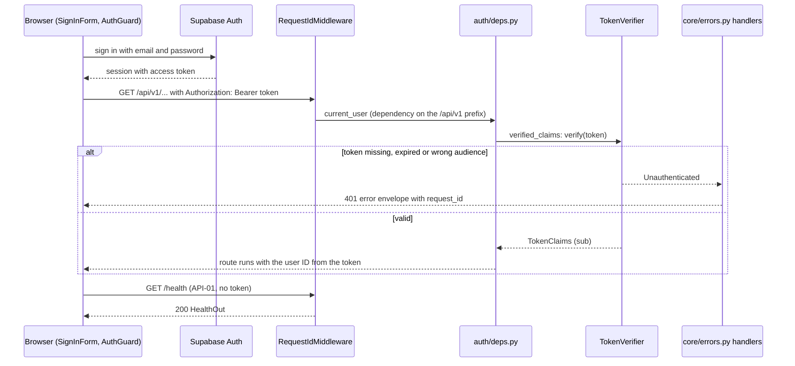
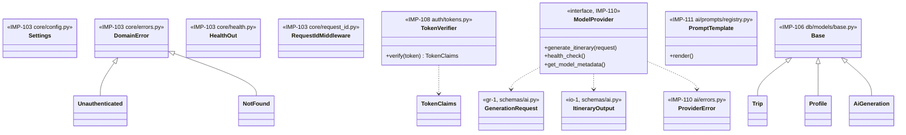

# Sprint 1 (week 1): Foundation and contracts

| Item | Value |
| --- | --- |
| Course document | 02 Sprint details ([index](../README.md)), IMD-221 |
| Owner | Malhar Mer |
| Sources | [docs/progress/sprint-1.md](../../progress/sprint-1.md) (compiled by IMP-199, RUN-017, 2 November 2026), [gates.md SG-1](../../progress/gates.md), TASK_REGISTER "Sprint 1", the code at `77e52ba` |

## Goal

Gate card IMP-199 sets the goal: "The team demonstrates on a clean clone that the skeleton runs locally end to end and that the contracts Sprint 2 depends on are merged, and records the result in docs/progress/gates.md."

## Cards merged

One row per task part, as recorded in the sprint index. Points are the part's points from the task register.

| Card | Title | Part | Owner | Points | Status | Part record |
| --- | --- | --- | --- | --- | --- | --- |
| IMP-101 | Repository skeleton, toolchain, Makefile, CLAUDE.md and docs/progress folders | Repo tree, Makefile, toolchain pins, CLAUDE.md, progress folders (repo-tree-makefile) | Kirtan (lead) | 2 | merged (PR #1, RUN-001) | [IMP-101-repo-tree-makefile.md](../../progress/parts/IMP-101-repo-tree-makefile.md) |
| IMP-101 | Repository skeleton, toolchain, Makefile, CLAUDE.md and docs/progress folders | API pyproject (ruff, mypy, pytest) and test socket guard (api-pyproject-guard) | Het | 1 | merged (PR #2, RUN-002) | [IMP-101-api-pyproject-guard.md](../../progress/parts/IMP-101-api-pyproject-guard.md) |
| IMP-102 | CI workflow (lint, types, imports, unit, guards, audit), branch protection, PR template, CODEOWNERS | Whole task | Kirtan | 2 | merged (PR #3, RUN-003 and RUN-003b) | [IMP-102-whole-task.md](../../progress/parts/IMP-102-whole-task.md) |
| IMP-103 | Backend skeleton: app factory, typed settings with start-up checks, error envelope, basic GET /health | Whole task | Manal | 2 | merged (PR #190, RUN-004) | [IMP-103-whole-task.md](../../progress/parts/IMP-103-whole-task.md) |
| IMP-104 | Web skeleton: Next.js app, Tailwind and shadcn/ui, responsive AppShell, query provider, state components | Whole task | Manasvi | 5 | merged (PR #192, RUN-006) | [IMP-104-whole-task.md](../../progress/parts/IMP-104-whole-task.md) |
| IMP-105 | Local environments: Supabase CLI stack, docker compose db, .env.example and env templates | Whole task | Malhar | 1 | merged (PR #191, RUN-005); TC-335 measured: about 100 minutes, target 60 (NFR-032 target not met) | [IMP-105-whole-task.md](../../progress/parts/IMP-105-whole-task.md) |
| IMP-106 | MVP migrations 0001-0006 through Alembic, ORM models, schema-drift test, test database fixture | SQL migrations 0001-0006 through Alembic, constraints and indexes (sql-migrations) | Malhar (lead) | 3 | merged (PR #193, RUN-007) | [IMP-106-sql-migrations.md](../../progress/parts/IMP-106-sql-migrations.md) |
| IMP-106 | MVP migrations 0001-0006 through Alembic, ORM models, schema-drift test, test database fixture | ORM models, schema-drift test, test database fixture (orm-drift-fixture) | Jeel | 2 | merged (PR #193, RUN-007) | [IMP-106-orm-drift-fixture.md](../../progress/parts/IMP-106-orm-drift-fixture.md) |
| IMP-107 | SAMPLE fixture destination and minimal seed command | Whole task | Jeel | 2 | merged (PR #197, RUN-011) | [IMP-107-whole-task.md](../../progress/parts/IMP-107-whole-task.md) |
| IMP-108 | Backend token verification and CurrentUser dependency, test token helper | Whole task | Het | 2 | merged (PR #196, RUN-010) | [IMP-108-whole-task.md](../../progress/parts/IMP-108-whole-task.md) |
| IMP-109 | Sign-up, sign-in, sign-out and AuthGuard with Supabase Auth | Whole task | Krrish | 4 | merged (PR #194, RUN-008 and RUN-008b) | [IMP-109-whole-task.md](../../progress/parts/IMP-109-whole-task.md) |
| IMP-110 | ModelProvider interface, shared AI schemas gr-1 and io-1, provider error types | Whole task | Nidhi | 5 | merged (PR #195, RUN-009) | [IMP-110-whole-task.md](../../progress/parts/IMP-110-whole-task.md) |
| IMP-111 | Versioned prompt-template registry | Whole task | Manya | 2 | merged (PR #198, RUN-012) | [IMP-111-whole-task.md](../../progress/parts/IMP-111-whole-task.md) |
| IMP-112 | Hello-world deployment to Vercel, Render and Supabase staging with deploy workflows | Whole task | Kirtan | 5 | merged (PR #202, RUN-016): local half (image, smoke, workflows that skip) done; **hosted half blocked by IMP-113, owner Kirtan, 2026-11-02** | [IMP-112-whole-task.md](../../progress/parts/IMP-112-whole-task.md) |
| IMP-113 | Provision accounts, keys and email sender with named owners | GitHub, Vercel, Render, Supabase accounts and secrets register (accounts-secrets-register) | Kirtan (lead) | 1 | merged as template (PR #200, RUN-014, merged 2026-11-02 08:51 UTC); outcome pending member (Kirtan) | [IMP-113-accounts-secrets-register.md](../../progress/parts/IMP-113-accounts-secrets-register.md) |
| IMP-113 | Provision accounts, keys and email sender with named owners | OpenRouteService key and email sender (ors-email-sender) | Junaid | 1 | merged as template (PR #200, RUN-014); outcome pending member (Junaid) | [IMP-113-ors-email-sender.md](../../progress/parts/IMP-113-ors-email-sender.md) |
| IMP-113 | Provision accounts, keys and email sender with named owners | Gemini API key, model ID and data-use terms (gemini-key-terms) | Nidhi | 1 | merged as template (PR #200, RUN-014); outcome pending member (Nidhi) | [IMP-113-gemini-key-terms.md](../../progress/parts/IMP-113-gemini-key-terms.md) |
| IMP-114 | Stakeholder interviews round 1 and recorded findings | Run stakeholder interviews round 1 | Junaid (lead) | 2 | draft PR open (#201), pending member | none |
| IMP-114 | Stakeholder interviews round 1 and recorded findings | Interview guide and recorded findings | Krrish | 1 | draft PR open (#201), pending member | none |
| IMP-115 | Seed-data plan and choice of the two demo destinations | Whole task | Malhar | 3 | merged (PR #199, 5 November 2026) | none |
| IMP-199 | Sprint 1 gate SG-1: runnable skeleton and contracts in place | Whole task | Kirtan | 0 | PR open (RUN-017) | [IMP-199-whole-task.md](../../progress/parts/IMP-199-whole-task.md) |

**Points (from the sprint index).** Sprint 1 plans 47 points over 21 parts. 38 were credited at the gate, including IMP-112's 5 points, which are provisional. Pending: IMP-113 3, IMP-114 3 and IMP-115 3.

## Gate result

**SG-1: pass with listed gaps** (RUN-017, IMP-199, Kirtan, 2 November 2026). Local sign-up, sign-in and sign-out passed on the Supabase local stack (`make e2e ARGS='auth'`, 20 passed). The hosted deployment was recorded as blocked by IMP-113 (owner Kirtan). TC-335, the setup-guide walkthrough, took about 100 minutes against a target of 60 (NFR-032, not met). The details are in [gates.md](../../progress/gates.md).

## Sequence diagram: a protected request (IMP-103, IMP-108, IMP-109)

## Class diagram: classes added in Sprint 1

Each file was added by the card named. The names are the current names at `77e52ba`.

Also in Sprint 1, outside `app/`: the Makefile and toolchain (IMP-101), the CI workflow `ci.yml` (IMP-102), the web skeleton with `AppShell` and the state components (IMP-104), and the six MVP migrations 0001 to 0006 (IMP-106).
