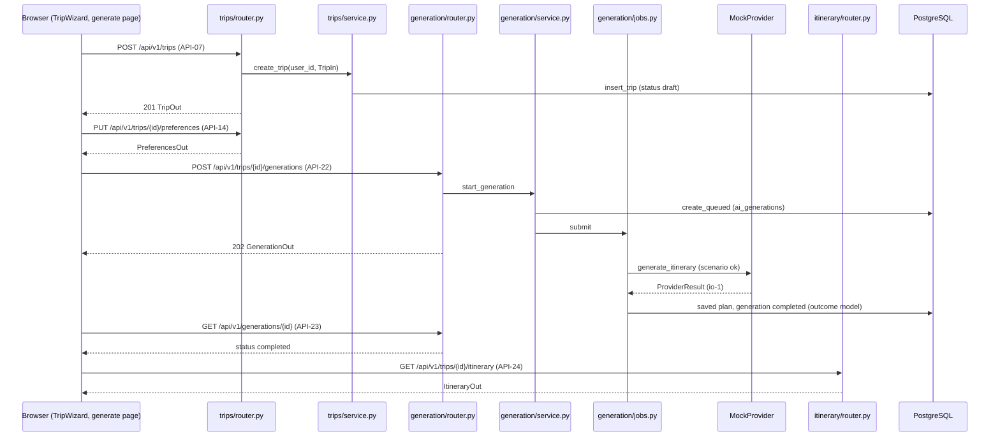

# Sprint 2 (week 2): Walking skeleton

| Item | Value |
| --- | --- |
| Course document | 02 Sprint details ([index](../README.md)), IMD-221 |
| Owner | Malhar Mer |
| Sources | [docs/progress/sprint-2.md](../../progress/sprint-2.md) (compiled by IMP-299, RUN-044, 6 November 2026), [gates.md SG-2](../../progress/gates.md), the code at `77e52ba` |

## Goal

Gate card IMP-299 sets the goal: "The team demonstrates blueprint Gate 1 on staging, tags API contract v1 and records the result."

## Cards merged

| Card | Title | Part | Owner | Points | Status | Part record |
| --- | --- | --- | --- | --- | --- | --- |
| IMP-201 | Readiness endpoint and structured request logging with request IDs | whole-task | Kirtan | 3 | merged (#231) | [IMP-201-whole-task.md](../../progress/parts/IMP-201-whole-task.md) |
| IMP-202 | Generation record repository and lifecycle helpers (ai_generations) | whole-task | Jeel | 2 | merged (#209) | [IMP-202-whole-task.md](../../progress/parts/IMP-202-whole-task.md) |
| IMP-203 | Trips API: create, list and read a trip with validation | whole-task | Manal | 3 | merged (#204) | [IMP-203-whole-task.md](../../progress/parts/IMP-203-whole-task.md) |
| IMP-204 | Preferences and must-visit places API with mapping to filters and ranking weights | whole-task | Manal | 4 | merged (#207) | [IMP-204-whole-task.md](../../progress/parts/IMP-204-whole-task.md) |
| IMP-205 | Provenance-preserving place import with quality gate, categories and destinations API | import-quality-gate | Malhar (lead) | 4 | merged (#205) | [IMP-205-import-quality-gate.md](../../progress/parts/IMP-205-import-quality-gate.md) |
| IMP-205 | Provenance-preserving place import with quality gate, categories and destinations API | places-api-search | Jeel | 3 | merged (#205, #206) | [IMP-205-places-api-search.md](../../progress/parts/IMP-205-places-api-search.md) |
| IMP-206 | Curate and load demo destination 1 | lead-curation | Jeel (lead) | 4 | merged; staging load open ([gates.md](../../progress/gates.md#open-items)) (#242) | [IMP-206-lead-curation.md](../../progress/parts/IMP-206-lead-curation.md) |
| IMP-206 | Curate and load demo destination 1 | hours-prices | Malhar | 4 | merged (#242) | [IMP-206-hours-prices.md](../../progress/parts/IMP-206-hours-prices.md) |
| IMP-207 | Mock provider with scenario-based failure injection | whole-task | Manya | 2 | merged (#208) | [IMP-207-whole-task.md](../../progress/parts/IMP-207-whole-task.md) |
| IMP-208 | Provider factory and configuration-based selection | whole-task | Nidhi | 2 | merged (#210) | [IMP-208-whole-task.md](../../progress/parts/IMP-208-whole-task.md) |
| IMP-209 | Distance-based travel-time estimate (pure) | whole-task | Junaid | 2 | merged (#211) | [IMP-209-whole-task.md](../../progress/parts/IMP-209-whole-task.md) |
| IMP-210 | Walking-skeleton generation job: start and poll with MOCK, save a validated plan | whole-task | Het | 1 | merged (#232) | [IMP-210-whole-task.md](../../progress/parts/IMP-210-whole-task.md) |
| IMP-211 | Itinerary read endpoint and latest-itinerary lookup (minimal) | whole-task | Het | 1 | merged (#236) | [IMP-211-whole-task.md](../../progress/parts/IMP-211-whole-task.md) |
| IMP-212 | Trip wizard and preference form | whole-task | Manasvi | 3 | merged (#235) | [IMP-212-whole-task.md](../../progress/parts/IMP-212-whole-task.md) |
| IMP-213 | Generate page with progress and read-only itinerary view (skeleton) | whole-task | Krrish | 1 | merged (#239) | [IMP-213-whole-task.md](../../progress/parts/IMP-213-whole-task.md) |
| IMP-214 | OpenAPI contract v1 export, generated web client and contract check | whole-task | Kirtan | 3 | merged; tag `contract-v1` open ([gates.md](../../progress/gates.md#open-items)) (#227) | [IMP-214-whole-task.md](../../progress/parts/IMP-214-whole-task.md) |
| IMP-215 | Two-user authorization suite for every owned route | whole-task | Junaid | 3 | merged (#233) | [IMP-215-whole-task.md](../../progress/parts/IMP-215-whole-task.md) |
| IMP-216 | Walking-skeleton end-to-end test and staging deployment | whole-task | Kirtan | 1 | merged; staging walk-through open ([gates.md](../../progress/gates.md#open-items)) (#246) | [IMP-216-whole-task.md](../../progress/parts/IMP-216-whole-task.md) |
| IMP-217 | AWS staging foundation: RDS PostgreSQL, ECR, SSM, ECS Express services, OIDC deploy role and budget | whole-task | Kirtan | 4 | merged; no AWS resource exists yet; live steps open ([gates.md](../../progress/gates.md#open-items)) (#243) | [IMP-217-whole-task.md](../../progress/parts/IMP-217-whole-task.md) |
| IMP-218 | Web container and AWS deploy workflows with the release task | deploy-workflows | Junaid (lead) | 2 | merged; TC-437, TC-438, staging smoke and CORS open ([gates.md](../../progress/gates.md#open-items)) (#245) | [IMP-218-deploy-workflows.md](../../progress/parts/IMP-218-deploy-workflows.md) |
| IMP-218 | Web container and AWS deploy workflows with the release task | web-image | Manasvi | 2 | merged; deployment on AWS open ([gates.md](../../progress/gates.md#open-items)) (#245) | [IMP-218-web-image.md](../../progress/parts/IMP-218-web-image.md) |
| IMP-219 | Supabase Auth with an AWS database: auth stub bootstrap and user row mirroring | whole-task | Het | 2 | merged (#229) | [IMP-219-whole-task.md](../../progress/parts/IMP-219-whole-task.md) |
| IMP-311 | RAG store: pgvector, corpus and chunk tables, item citations and retrieval record (migration 0007) | whole-task | Malhar | 3 | merged (#228) | [IMP-311-whole-task.md](../../progress/parts/IMP-311-whole-task.md) |

IMP-311 (the RAG store, Amendment A1) is a Sprint 3 card that merged in Sprint 2, so it is listed here.

**Points (from the sprint index).** Sprint 2 plans 59 points over 23 parts on 20 cards, plus the gate card IMP-299 (0 points). All 23 parts are merged, and none is open or blocked.

## Gate result

**SG-2: pass with listed gaps** (RUN-044, IMP-299, Kirtan, 6 November 2026). A signed-in user creates a trip, generates with MOCK and sees the saved plan (`make e2e ARGS='journey'`, 4 passed). The Ahmedabad seed loaded 103 places (minimum 100). Contract v1 is declared. **Nothing was shown on AWS staging yet.** The staging criteria became an open item for Kirtan, due before SG-3. The tag `contract-v1` was not created at the gate (open item, operator).

## Sequence diagram: walking skeleton with MOCK (IMP-203, IMP-210, IMP-211, IMP-213)

## Class diagram: classes added in Sprint 2

```mermaid
classDiagram
    class records {
        <<module, IMP-202>>
        +check_transition()
        +request_hash()
    }
    class TripDraft {
        <<IMP-203 trips/domain.py>>
    }
    class TripIn
    class TripOut
    class MappedPreferences {
        <<IMP-204 trips/preference_mapping.py>>
    }
    class HardFilters
    class RankingWeights
    class LoadReport {
        <<IMP-205 places/import_pipeline.py>>
    }
    class GateResult {
        <<IMP-205 places/quality_gate.py>>
    }
    class MockProvider {
        <<IMP-207>>
        +scenario
        +generate_itinerary()
    }
    class factory {
        <<module, IMP-208>>
        +get_provider()
    }
    class TravelEstimate {
        <<IMP-209 routing/estimate.py>>
    }
    class Job {
        <<IMP-210 generation/pipeline.py>>
    }
    class jobs {
        <<module, IMP-210>>
        +submit()
        +run()
        +reap_forever()
    }
    class ContractV1Shapes {
        <<IMP-214: ItineraryOut, LatestItineraryOut, SourceRef, Finding, ValidationSummary, BudgetSettingsPatch>>
    }
    class auth_stub {
        <<module, IMP-219>>
        +apply_if_missing()
    }
    class RagDocument {
        <<IMP-311 db/models/rag.py>>
    }
    class RagChunk
    class ModelProvider {
        <<interface>>
    }
    ModelProvider <|.. MockProvider
    factory ..> MockProvider
    MappedPreferences --> HardFilters
    MappedPreferences --> RankingWeights
    jobs ..> Job
    RagDocument "1" --> "many" RagChunk
```

Also in Sprint 2: the OpenAPI contract v1 and generated web client (IMP-214), the two-user authorization suite `tests/authz/` (IMP-215), the AWS staging foundation and deploy workflows (IMP-217, IMP-218), and the migration `0007_rag_store` (IMP-311).
