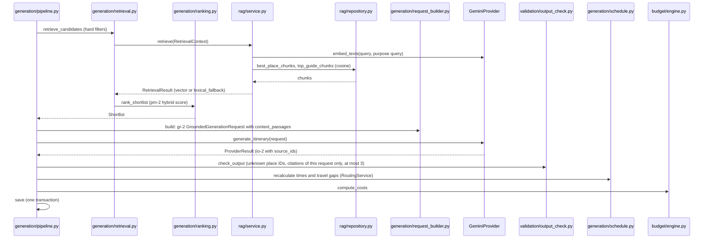

# Sprint 3 (week 3): Gemini vertical slice

| Item | Value |
| --- | --- |
| Course document | 02 Sprint details ([index](../README.md)), IMD-221 |
| Owner | Malhar Mer |
| Sources | [docs/progress/sprint-3.md](../../progress/sprint-3.md) (compiled by IMP-399, RUN-055, 7 November 2026), [gates.md SG-3](../../progress/gates.md), the code at `77e52ba` |

## Goal

Gate card IMP-399 sets the goal: "Sprint gate SG-3 (blueprint Gate 2) is decided and recorded: a Gemini-generated itinerary for a seeded trip is visible on staging after schema and place-ID validation and backend recalculation, or the documented fallback rule is applied."

## Cards merged

| Card | Title | Part | Owner | Points | Status | Part record |
| --- | --- | --- | --- | --- | --- | --- |
| IMP-301 | Gemini adapter with structured output, error mapping and recorded-response tests | gemini-adapter | Nidhi (lead) | 5 | merged (#249) | [IMP-301-gemini-adapter.md](../../progress/parts/IMP-301-gemini-adapter.md) |
| IMP-301 | Gemini adapter with structured output, error mapping and recorded-response tests | spike-recordings | Manya | 3 | merged (#249) | [IMP-301-spike-recordings.md](../../progress/parts/IMP-301-spike-recordings.md) |
| IMP-302 | Provider metadata and health in readiness | whole-task | Kirtan | 2 | merged (#250) | [IMP-302-whole-task.md](../../progress/parts/IMP-302-whole-task.md) |
| IMP-303 | Normalized generation request and prompt content and size control | whole-task | Manya | 5 | merged (#249) | [IMP-303-whole-task.md](../../progress/parts/IMP-303-whole-task.md) |
| IMP-304 | Candidate retrieval, hard-constraint filters and ranking | candidate-filters | Malhar (lead) | 4 | merged (#248) | [IMP-304-candidate-filters.md](../../progress/parts/IMP-304-candidate-filters.md) |
| IMP-304 | Candidate retrieval, hard-constraint filters and ranking | ranking | Jeel | 4 | merged (#248) | [IMP-304-ranking.md](../../progress/parts/IMP-304-ranking.md) |
| IMP-305 | Full generation pipeline through the active provider with job progress | pipeline | Nidhi (lead) | 4 | merged (#250) | [IMP-305-pipeline.md](../../progress/parts/IMP-305-pipeline.md) |
| IMP-305 | Full generation pipeline through the active provider with job progress | job-progress | Het | 2 | merged (#250) | [IMP-305-job-progress.md](../../progress/parts/IMP-305-job-progress.md) |
| IMP-305 | Full generation pipeline through the active provider with job progress | privacy-progress | Krrish | 2 | merged (#250) | [IMP-305-privacy-progress.md](../../progress/parts/IMP-305-privacy-progress.md) |
| IMP-306 | Output validation: schema and place IDs | output-validation | Manya (lead) | 3 | merged; D3 code change due (IMD-126) (#251) | [IMP-306-output-validation.md](../../progress/parts/IMP-306-output-validation.md) |
| IMP-306 | Output validation: schema and place IDs | injection-cases | Junaid | 2 | merged (#251) | [IMP-306-injection-cases.md](../../progress/parts/IMP-306-injection-cases.md) |
| IMP-307 | OpenRouteService client with route cache and fallback | whole-task | Junaid | 3 | merged (#248) | [IMP-307-whole-task.md](../../progress/parts/IMP-307-whole-task.md) |
| IMP-308 | Deterministic recalculation of times, durations and trip cost estimate | budget-costs | Manal (lead) | 5 | merged (#252) | [IMP-308-budget-costs.md](../../progress/parts/IMP-308-budget-costs.md) |
| IMP-308 | Deterministic recalculation of times, durations and trip cost estimate | schedule | Het | 3 | merged (#252) | [IMP-308-schedule.md](../../progress/parts/IMP-308-schedule.md) |
| IMP-309 | Day-wise itinerary view with labels | day-view | Manasvi (lead) | 4 | merged (#253) | [IMP-309-day-view.md](../../progress/parts/IMP-309-day-view.md) |
| IMP-309 | Day-wise itinerary view with labels | read-fields | Het | 1 | merged (#253) | [IMP-309-read-fields.md](../../progress/parts/IMP-309-read-fields.md) |
| IMP-310 | Evaluation dataset version 1 (15 trips) | whole-task | Junaid | 3 | merged (#248) | [IMP-310-whole-task.md](../../progress/parts/IMP-310-whole-task.md) |
| IMP-312 | Embedding operation on ModelProvider: Gemini and deterministic MOCK embeddings | whole-task | Nidhi | 3 | merged (#250) | [IMP-312-whole-task.md](../../progress/parts/IMP-312-whole-task.md) |
| IMP-313 | Corpus ingestion and indexing: place and guide documents, chunking, embedding, `make rag-index` | whole-task | Manal | 3 | merged; staging index open ([gates.md](../../progress/gates.md#open-items-1)) (#251) | [IMP-313-whole-task.md](../../progress/parts/IMP-313-whole-task.md) |
| IMP-314 | Destination guides for demo destination 1 | guides | Krrish (lead) | 2 | merged (#253) | [IMP-314-guides.md](../../progress/parts/IMP-314-guides.md) |
| IMP-314 | Destination guides for demo destination 1 | review | Malhar | 1 | merged (#253) | [IMP-314-review.md](../../progress/parts/IMP-314-review.md) |
| IMP-315 | Hybrid retrieval: semantic place scores and guide passages with lexical fallback | whole-task | Jeel | 3 | merged (#252) | [IMP-315-whole-task.md](../../progress/parts/IMP-315-whole-task.md) |
| IMP-316 | Grounded generation: passages in the request, validated citations, saved sources | grounding | Manya (lead) | 3 | merged (#254) | [IMP-316-grounding.md](../../progress/parts/IMP-316-grounding.md) |
| IMP-316 | Grounded generation: passages in the request, validated citations, saved sources | saved-sources | Het | 1 | merged (#254) | [IMP-316-saved-sources.md](../../progress/parts/IMP-316-saved-sources.md) |
| IMP-317 | Sources on itinerary items | whole-task | Manasvi | 2 | merged; D12 code change due (IMD-135) (#255) | [IMP-317-whole-task.md](../../progress/parts/IMP-317-whole-task.md) |

**Points (from the sprint index).** Sprint 3 plans 73 points over 25 parts on 16 cards, plus the gate card IMP-399 (2 points). All 25 parts are merged. IMP-311 is listed under Sprint 2, where it merged.

## Gate result

**SG-3: pass with listed gaps** (RUN-055, IMP-399, Nidhi, 7 November 2026). A Gemini-generated, validated and recalculated plan was shown on the operator's local stack, with `retrieval_mode = vector` and a cited passage ("Sources (1)"). `make live-smoke` passed 2 tests (TC-029 and the live embedding test). API-33 totals equal the engine output (TC-140). **Nothing was shown on AWS staging**, so `make smoke`, the NFR-050 retrieval p95 and the staging index line moved to SG-4 (Kirtan). Team decisions D1 to D13 were recorded as IMD-124 to IMD-136.

## Sequence diagram: grounded Gemini generation (IMP-305, IMP-315, IMP-316)

## Class diagram: classes added in Sprint 3

```mermaid
classDiagram
    class ModelProvider {
        <<interface>>
        +embed_texts(texts, purpose, titles)
    }
    class GeminiProvider {
        <<IMP-301, IMP-312>>
        +generate_itinerary()
        +embed_texts()
    }
    class GroundedGenerationRequest {
        <<gr-2, IMP-316>>
    }
    class GroundedItineraryOutput {
        <<io-2, IMP-316>>
    }
    class ContextPassage
    class EmbeddingResult {
        <<IMP-312>>
    }
    class Candidate {
        <<IMP-304 generation/retrieval.py>>
    }
    class RankingContext {
        <<IMP-304 generation/ranking.py>>
    }
    class Shortlist
    class ScoreParts
    class OutputCheckResult {
        <<IMP-306>>
    }
    class OrsClient {
        <<IMP-307>>
        +route()
    }
    class RouteCacheRepository {
        <<IMP-307>>
    }
    class RoutingService {
        +travel()
    }
    class CostSummary {
        <<IMP-308 budget/engine.py>>
    }
    class SchedulablePlace {
        <<IMP-308 generation/schedule.py>>
    }
    class Chunk {
        <<IMP-313 rag/chunker.py>>
    }
    class CorpusDocument {
        <<IMP-313 rag/documents.py>>
    }
    class IndexReport {
        <<IMP-313 rag/service.py>>
    }
    class RetrievedChunk {
        <<IMP-315 rag/mmr.py>>
    }
    class SourceRef {
        <<IMP-316 itinerary/schemas.py>>
    }
    ModelProvider <|.. GeminiProvider
    ModelProvider ..> EmbeddingResult
    GroundedGenerationRequest --> ContextPassage
    RankingContext ..> ScoreParts
    RoutingService --> OrsClient
    RoutingService --> RouteCacheRepository
    CorpusDocument ..> Chunk
```

On the web side, Sprint 3 added the day-wise itinerary view with labels (IMP-309) and the `ItemSources` disclosure (IMP-317). IMP-310 added evaluation dataset v1 (15 trips), and IMP-314 added the Ahmedabad destination guides.
