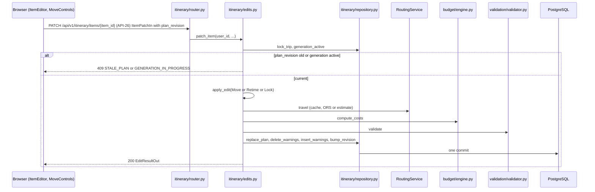
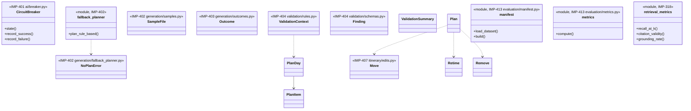

# Sprint 4 (week 4): Core itinerary reliability

| Item | Value |
| --- | --- |
| Course document | 02 Sprint details ([index](../README.md)), IMD-221 |
| Owner | Malhar Mer |
| Sources | [docs/progress/sprint-4.md](../../progress/sprint-4.md) (compiled by IMP-499, RUN-064, 14 November 2026), [gates.md SG-4](../../progress/gates.md), [cut-list-checkpoint.md](../../decisions/cut-list-checkpoint.md), the code at `77e52ba` |

## Goal

Gate card IMP-499 sets the goal: "Sprint gate SG-4 (blueprint Gate 3) and the cut-list checkpoint are decided and recorded: the whole journey works on staging, a provider failure yields a labelled fallback plan, edits recalculate atomically, and any required cuts are applied by flag."

## Cards merged

| Card | Title | Part | Owner | Points | Status | Part record |
| --- | --- | --- | --- | --- | --- | --- |
| IMP-401 | Retries with backoff and circuit breaker in the Gemini adapter | whole-task | Nidhi (lead) | 3 | merged (#261) | [IMP-401-whole-task.md](../../progress/parts/IMP-401-whole-task.md) |
| IMP-402 | Rule-based fallback planner and saved sample itineraries | fallback-planner | Malhar (lead) | 3 | merged (#261) | [IMP-402-fallback-planner.md](../../progress/parts/IMP-402-fallback-planner.md) |
| IMP-402 | Rule-based fallback planner and saved sample itineraries | sample-itineraries | Jeel | 2 | merged; **Ahmedabad samples open** (#270) | [IMP-402-sample-itineraries.md](../../progress/parts/IMP-402-sample-itineraries.md) |
| IMP-403 | Provider failure, timeout and quota handling end to end with fallback notice | failure-outcomes | Nidhi (lead) | 2 | merged (#267) | [IMP-403-failure-outcomes.md](../../progress/parts/IMP-403-failure-outcomes.md) |
| IMP-403 | Provider failure, timeout and quota handling end to end with fallback notice | fallback-notice | Krrish | 1 | merged; wording fixed in RUN-059 (IMD-154) (#267) | [IMP-403-fallback-notice.md](../../progress/parts/IMP-403-fallback-notice.md) |
| IMP-404 | Validator: overlaps, travel gaps, missing constraints and invalid references | schedule-rules | Manal (lead) | 4 | merged (#259) | [IMP-404-schedule-rules.md](../../progress/parts/IMP-404-schedule-rules.md) |
| IMP-404 | Validator: overlaps, travel gaps, missing constraints and invalid references | reference-rules | Junaid | 3 | merged (#259) | [IMP-404-reference-rules.md](../../progress/parts/IMP-404-reference-rules.md) |
| IMP-405 | Structured warnings with suggested fixes, persisted with the plan, warnings panel | persist-warnings | Jeel | 2 | merged (#267) | [IMP-405-persist-warnings.md](../../progress/parts/IMP-405-persist-warnings.md) |
| IMP-405 | Structured warnings with suggested fixes, persisted with the plan, warnings panel | warnings-panel | Manasvi (lead) | 2 | merged (#267) | [IMP-405-warnings-panel.md](../../progress/parts/IMP-405-warnings-panel.md) |
| IMP-406 | Preserve explicit constraints and must-visit places; label AI-written text | must-visit-constraints | Manya (lead) | 3 | merged (#261) | [IMP-406-must-visit-constraints.md](../../progress/parts/IMP-406-must-visit-constraints.md) |
| IMP-406 | Preserve explicit constraints and must-visit places; label AI-written text | ai-text-labels | Krrish | 1 | merged (#261) | [IMP-406-ai-text-labels.md](../../progress/parts/IMP-406-ai-text-labels.md) |
| IMP-407 | Edit transaction core: recalculate and revalidate every edit atomically with plan revision | whole-task | Het (lead) | 5 | merged (#267) | [IMP-407-whole-task.md](../../progress/parts/IMP-407-whole-task.md) |
| IMP-408 | Remove an activity and change start time or duration | remove-retime-ops | Het (lead) | 2 | merged (#268) | [IMP-408-remove-retime-ops.md](../../progress/parts/IMP-408-remove-retime-ops.md) |
| IMP-408 | Remove an activity and change start time or duration | item-editor | Manasvi | 2 | merged; removal toast and focus fixed in RUN-063b (#268, #272) | [IMP-408-item-editor.md](../../progress/parts/IMP-408-item-editor.md) |
| IMP-409 | Reorder by drag and by keyboard | move-op | Het | 2 | merged (#268) | [IMP-409-move-op.md](../../progress/parts/IMP-409-move-op.md) |
| IMP-409 | Reorder by drag and by keyboard | move-controls | Manasvi (lead) | 3 | merged (#268) | [IMP-409-move-controls.md](../../progress/parts/IMP-409-move-controls.md) |
| IMP-410 | Drafts and reopening the latest saved itinerary | draft-latest-api | Manal (lead) | 2 | merged (#260) | [IMP-410-draft-latest-api.md](../../progress/parts/IMP-410-draft-latest-api.md) |
| IMP-410 | Drafts and reopening the latest saved itinerary | draft-resume-ui | Krrish | 2 | merged; dashboard "New trip" fixed in RUN-067 (#260, #273) | [IMP-410-draft-resume-ui.md](../../progress/parts/IMP-410-draft-resume-ui.md) |
| IMP-411 | Transport allowance, stay budget and price source labels | budget-labels-api | Manal (lead) | 2 | merged (#260) | [IMP-411-budget-labels-api.md](../../progress/parts/IMP-411-budget-labels-api.md) |
| IMP-411 | Transport allowance, stay budget and price source labels | budget-form-badges | Krrish | 2 | merged (#260) | [IMP-411-budget-form-badges.md](../../progress/parts/IMP-411-budget-form-badges.md) |
| IMP-412 | Loading, empty and error states on every MVP screen | whole-task | Manasvi (lead) | 3 | merged (#260) | [IMP-412-whole-task.md](../../progress/parts/IMP-412-whole-task.md) |
| IMP-413 | Evaluation harness (command line) | whole-task | Manya (lead) | 3 | merged (#259) | [IMP-413-whole-task.md](../../progress/parts/IMP-413-whole-task.md) |
| IMP-318 | Retrieval evaluation: recall, hit rate, citation validity and grounding rate | whole-task | Junaid (lead) | 2 | merged (#271) | [IMP-318-whole-task.md](../../progress/parts/IMP-318-whole-task.md) |
| IMP-414 | End-to-end journey test on staging | journey-staging | Krrish (lead) | 3 | merged (#272) | [IMP-414-journey-staging.md](../../progress/parts/IMP-414-journey-staging.md) |
| IMP-414 | End-to-end journey test on staging | journey-fixtures-report | Junaid | 2 | merged (#272) | [IMP-414-journey-fixtures-report.md](../../progress/parts/IMP-414-journey-fixtures-report.md) |

**Points (from the sprint index).** Sprint 4 plans 61 points over 25 parts on 15 cards (IMP-401 to IMP-414 and IMP-318), plus the gate card IMP-499 (2 points). All 25 parts are merged, and none is blocked or cut. One story is half finished: the Ahmedabad half of FR-036 AC3 in IMP-402 sample-itineraries.

## Gate result

**SG-4: pass with listed gaps** (RUN-064, 14 November 2026). The results:

- Sign-up to a saved, edited itinerary passes on the local stack in CI (E2E `4 passed`).
- A provider failure produces a labelled fallback plan, shown by API tests (`make test-api ARGS='-k generation_failures'`, 30 passed).
- Edits recalculate in one transaction (IMP-407, TC-206, TC-207, TC-312).
- `make check` and the E2E job were green on `main`.

On AWS staging, only the deploy, `/health`, the draft check and a configuration-error run were shown. The journey, the timeout fallback demo and `make smoke` waited for the staging window of 18 November 2026 (IMD-137). The cut-list checkpoint applied no cut (IMD-167).

## Sequence diagram: one edit transaction (IMP-407, IMP-408)

## Class diagram: classes added in Sprint 4

On the web side, Sprint 4 added `WarningsPanel` and `FallbackNotice` (IMP-403, IMP-405), `ItemEditor` and `MoveControls` with keyboard reordering (IMP-408, IMP-409), draft resume on the dashboard (IMP-410), and the budget form and price badges (IMP-411). The API shapes `LatestItineraryOut` and `BudgetSettingsPatch` used by IMP-410 and IMP-411 were declared earlier, with contract v1 (IMP-214). Sprint 4 also added loading, empty and error states on every MVP screen (IMP-412).
