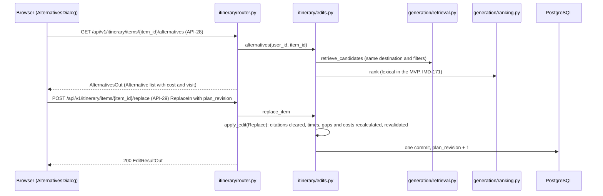
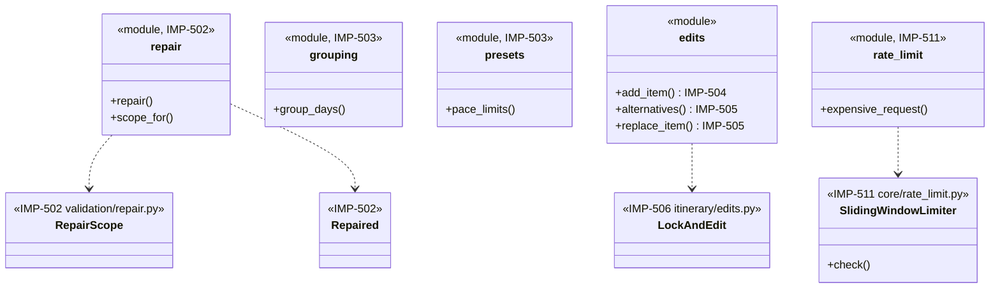

# Sprint 5 (week 5): Core trip management

| Item | Value |
| --- | --- |
| Course document | 02 Sprint details ([index](../README.md)), IMD-221 |
| Owner | Jeel Fefar |
| Sources | [docs/progress/sprint-5.md](../../progress/sprint-5.md) (compiled by IMP-599, 15 November 2026), [gates.md SG-5](../../progress/gates.md), the code at `77e52ba` |

## Goal

Gate card IMP-599 sets the goal: "Sprint 5 gate SG-5 is passed and recorded: validation, repair, editing, costs, map and limits work together on staging with MOCK and GEMINI."

## Cards merged

| Card | Title | Part | Owner | Points | Status | Part record |
| --- | --- | --- | --- | --- | --- | --- |
| IMP-501 | Opening-hours check, overpacked days and budget conflicts | hours-checks | Junaid (lead) | 3 | merged (#276) | [IMP-501-hours-checks.md](../../progress/parts/IMP-501-hours-checks.md) |
| IMP-501 | Opening-hours check, overpacked days and budget conflicts | budget-conflict | Manal | 2 | merged (#276) | [IMP-501-budget-conflict.md](../../progress/parts/IMP-501-budget-conflict.md) |
| IMP-502 | Bounded repair with at most one model retry | whole-task | Nidhi (lead) | 5 | merged (#275) | [IMP-502-whole-task.md](../../progress/parts/IMP-502-whole-task.md) |
| IMP-503 | Pace presets and grouping nearby places into days | pace-grouping | Manya (lead) | 6 | merged (#275) | [IMP-503-pace-grouping.md](../../progress/parts/IMP-503-pace-grouping.md) |
| IMP-503 | Pace presets and grouping nearby places into days | pace-control | Manasvi | 1 | merged (#276) | [IMP-503-pace-control.md](../../progress/parts/IMP-503-pace-control.md) |
| IMP-504 | Add a user-selected place and reject stale edits | add-place-api | Het (lead) | 3 | merged (#275) | [IMP-504-add-place-api.md](../../progress/parts/IMP-504-add-place-api.md) |
| IMP-504 | Add a user-selected place and reject stale edits | place-picker | Malhar | 2 | merged (#276) | [IMP-504-place-picker.md](../../progress/parts/IMP-504-place-picker.md) |
| IMP-505 | Replace an activity with a ranked alternative | replace-api | Het (lead) | 3 | merged (#275) | [IMP-505-replace-api.md](../../progress/parts/IMP-505-replace-api.md) |
| IMP-505 | Replace an activity with a ranked alternative | alternatives-dialog | Krrish | 2 | merged (#276) | [IMP-505-alternatives-dialog.md](../../progress/parts/IMP-505-alternatives-dialog.md) |
| IMP-506 | Lock and unlock items | lock-api | Het (lead) | 2 | merged (#276) | [IMP-506-lock-api.md](../../progress/parts/IMP-506-lock-api.md) |
| IMP-506 | Lock and unlock items | lock-toggle | Krrish | 1 | merged (#276) | [IMP-506-lock-toggle.md](../../progress/parts/IMP-506-lock-toggle.md) |
| IMP-507 | Daily and category cost breakdown; estimate labels on every screen | breakdown-api | Manal (lead) | 3 | merged (#275) | [IMP-507-breakdown-api.md](../../progress/parts/IMP-507-breakdown-api.md) |
| IMP-507 | Daily and category cost breakdown; estimate labels on every screen | costs-page | Manasvi | 2 | merged (#276) | [IMP-507-costs-page.md](../../progress/parts/IMP-507-costs-page.md) |
| IMP-508 | Map with numbered markers and list fallback | whole-task | Manasvi (lead) | 5 | merged; map worker fixed in RUN-071b (#275, #277, #278) | [IMP-508-whole-task.md](../../progress/parts/IMP-508-whole-task.md) |
| IMP-509 | Browse places with source labels | whole-task | Jeel (lead) | 3 | merged (#275) | [IMP-509-whole-task.md](../../progress/parts/IMP-509-whole-task.md) |
| IMP-510 | Edit trip settings and flag a stale plan | settings-api | Manal (lead) | 1 | merged (#275) | [IMP-510-settings-api.md](../../progress/parts/IMP-510-settings-api.md) |
| IMP-510 | Edit trip settings and flag a stale plan | edit-page | Krrish | 1 | merged (#276) | [IMP-510-edit-page.md](../../progress/parts/IMP-510-edit-page.md) |
| IMP-511 | Rate limits and daily generation caps | whole-task | Kirtan (lead) | 5 | merged (#276) | [IMP-511-whole-task.md](../../progress/parts/IMP-511-whole-task.md) |
| IMP-512 | Provider contract test suite for all adapters | whole-task | Junaid (lead) | 3 | merged (#275) | [IMP-512-whole-task.md](../../progress/parts/IMP-512-whole-task.md) |
| IMP-513 | Keyboard and assistive-technology support | whole-task | Krrish (lead) | 3 | merged; contrast and focus fixed in RUN-071 and RUN-071c (#277, #278) | [IMP-513-whole-task.md](../../progress/parts/IMP-513-whole-task.md) |
| IMP-514 | Evaluation run records and first Gemini baseline | run-records | Manya (lead) | 2 | merged (#275, #276) | [IMP-514-run-records.md](../../progress/parts/IMP-514-run-records.md) |
| IMP-514 | Evaluation run records and first Gemini baseline | gemini-baseline | Nidhi | 1 | merged (#277) | [IMP-514-gemini-baseline.md](../../progress/parts/IMP-514-gemini-baseline.md) |
| IMP-515 | Explain the ranking: "Why this place?" panel | — | Jeel (lead), Krrish | 4 | **cut** (IMD-65, IMD-186); `ranking_explain` off | none |

IMP-515 ("Why this place?") is an extension and was cut by IMD-65 and IMD-186. It has no part record.

**Points (from the sprint index).** Sprint 5 plans 63 points on 15 cards. IMP-515 (4 points) is cut, so 59 points over 22 parts on 14 cards are in scope, plus the gate card IMP-599 (0 points). All 22 parts are merged, and none is blocked.

## Gate result

**SG-5: pass with listed gaps** (IMD-186; IMP-599, Kirtan, 15 November 2026). What was shown:

- `make check` and `make e2e` were green.
- The provider contract suite passed for MOCK and recorded GEMINI (IMP-512).
- The first Gemini baseline run record exists: `eval/results/20261114T104200Z-gemini/run.json`, dataset `trips` v1.
- No severity 1 defect was known.

Staging was off (IMD-137). The staging journey, `make smoke`, the timeout fallback and the 429 cap on staging were **not verifiable** and moved to the staging window of 18 November 2026.

## Sequence diagram: replace an activity with a ranked alternative (IMP-505)

## Class diagram: classes added in Sprint 5

The shapes `Alternative`, `AlternativesOut`, `DayCostLine` and `CategoryCostLine` used in Sprint 5 were declared with contract v1 (IMP-214). On the web side, Sprint 5 added `PlacePicker` (IMP-504), `AlternativesDialog` (IMP-505), the lock toggle (IMP-506), the costs page with `CostBreakdown` (IMP-507), `MapPanel` and `MapListFallback` (IMP-508), the places browser with source labels (IMP-509), and keyboard and screen-reader support (IMP-513).
