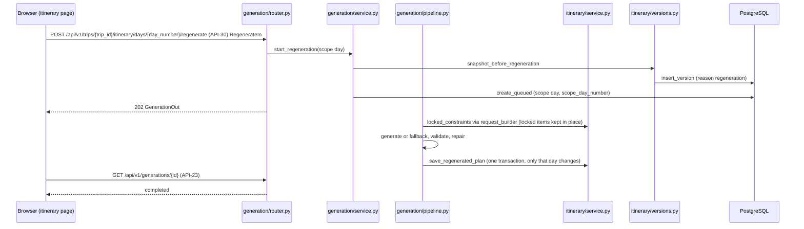
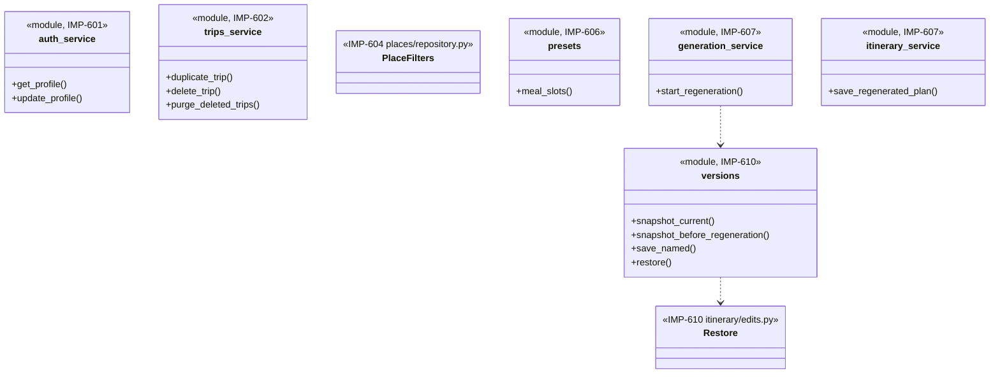

# Sprint 6 (week 6): MVP completion and feature freeze

| Item | Value |
| --- | --- |
| Course document | 02 Sprint details ([index](../README.md)), IMD-221 |
| Owner | Jeel Fefar |
| Sources | [docs/progress/sprint-6.md](../../progress/sprint-6.md) (compiled by IMP-699, RUN-080, 16 November 2026), [gates.md SG-6](../../progress/gates.md), [deferred.md](../../progress/deferred.md), the code at `77e52ba` |

## Goal

Gate card IMP-699 sets the goal: "Sprint 6 gate SG-6 is passed and recorded: every MVP and MVP-S requirement is implemented or explicitly cut, and the feature freeze is in force."

## Cards merged

| Card | Title | Part | Owner | Points | Status | Part record |
| --- | --- | --- | --- | --- | --- | --- |
| IMP-601 | Profile page and API | whole-task | Het (lead) | 2 | merged (#281) | [IMP-601-whole-task.md](../../progress/parts/IMP-601-whole-task.md) |
| IMP-602 | Trip dashboard with rename, duplicate, archive and delete | trip-actions-api | Manal (lead) | 6 | merged (#281) | [IMP-602-trip-actions-api.md](../../progress/parts/IMP-602-trip-actions-api.md) |
| IMP-602 | Trip dashboard with rename, duplicate, archive and delete | dashboard | Manasvi | 2 | merged (#281) | [IMP-602-dashboard.md](../../progress/parts/IMP-602-dashboard.md) |
| IMP-603 | Curate and load demo destination 2 | — | Junaid (lead), Manya, Kirtan | 5 | **waiting for data** (members' curated files due Thu 19 November 2026, IMD-201) | none |
| IMP-604 | Search, filters and place detail with labelled facts | search-api | Malhar (lead) | 4 | merged (#281) | [IMP-604-search-api.md](../../progress/parts/IMP-604-search-api.md) |
| IMP-604 | Search, filters and place detail with labelled facts | filter-bar | Manasvi | 2 | merged (#281) | [IMP-604-filter-bar.md](../../progress/parts/IMP-604-filter-bar.md) |
| IMP-604 | Search, filters and place detail with labelled facts | detail-drawer | Jeel | 1 | merged (#281) | [IMP-604-detail-drawer.md](../../progress/parts/IMP-604-detail-drawer.md) |
| IMP-605 | Saved places (wishlist) | whole-task | Jeel (lead) | 3 | merged (#281) | [IMP-605-whole-task.md](../../progress/parts/IMP-605-whole-task.md) |
| IMP-606 | Food places and meal slots | meal-retrieval | Malhar (lead) | 3 | merged (#281) | [IMP-606-meal-retrieval.md](../../progress/parts/IMP-606-meal-retrieval.md) |
| IMP-606 | Food places and meal slots | meal-builder | Manya | 2 | merged (#281) | [IMP-606-meal-builder.md](../../progress/parts/IMP-606-meal-builder.md) |
| IMP-607 | Regenerate one day around locks and the whole itinerary | regen-api | Het (lead) | 4 | merged (#282) | [IMP-607-regen-api.md](../../progress/parts/IMP-607-regen-api.md) |
| IMP-607 | Regenerate one day around locks and the whole itinerary | day-scope | Nidhi | 4 | merged (#282) | [IMP-607-day-scope.md](../../progress/parts/IMP-607-day-scope.md) |
| IMP-607 | Regenerate one day around locks and the whole itinerary | regen-controls | Krrish | 2 | merged (#282) | [IMP-607-regen-controls.md](../../progress/parts/IMP-607-regen-controls.md) |
| IMP-608 | Budget alerts and contingency buffer | alerts-contingency | Manal (lead) | 2 | merged (#281) | [IMP-608-alerts-contingency.md](../../progress/parts/IMP-608-alerts-contingency.md) |
| IMP-608 | Budget alerts and contingency buffer | budget-alert | Krrish | 2 | merged (#281) | [IMP-608-budget-alert.md](../../progress/parts/IMP-608-budget-alert.md) |
| IMP-609 | Final trip summary and print view | summary-api | Het | 1 | merged (#281) | [IMP-609-summary-api.md](../../progress/parts/IMP-609-summary-api.md) |
| IMP-609 | Final trip summary and print view | summary-page | Krrish (lead) | 2 | merged (#281) | [IMP-609-summary-page.md](../../progress/parts/IMP-609-summary-page.md) |
| IMP-610 | Itinerary versions: save, list and restore | version-snapshots | Jeel (lead) | 6 | merged (#281) | [IMP-610-version-snapshots.md](../../progress/parts/IMP-610-version-snapshots.md) |
| IMP-610 | Itinerary versions: save, list and restore | restore-retention | Malhar | 2 | merged (#281) | [IMP-610-restore-retention.md](../../progress/parts/IMP-610-restore-retention.md) |
| IMP-611 | Usability session 1 and recorded findings | prepare | Junaid (lead), Krrish | 3 (pending) | **templates merged; session pending** (IMD-201) (#281) | [IMP-611-prepare.md](../../progress/parts/IMP-611-prepare.md) |
| IMP-612 | Optimise day order to cut travel time | — | Het (lead), Junaid, Manasvi | 8 | **cut** (IMD-65, IMD-186); `optimise_order` off by decision | none |
| IMP-613 | Packing checklist with AI free-text refinement | — | Kirtan (lead), Nidhi, Manya | 9 | **cut** (IMD-65); `packing` off by decision | none |

IMP-612 (optimise day order) and IMP-613 (packing checklist) are extensions, cut by IMD-65. IMP-603 (demo destination 2) has no part record and is still open (see [12 Not implemented](../12-not-implemented.md)).

**Points (from the sprint index).** Sprint 6 plans 75 points on 13 cards. IMP-612 (8) and IMP-613 (9) are cut, so 58 points are in scope. 50 points over 19 parts on 9 cards are merged. Pending: IMP-603 (5 points) and IMP-611 (3 points).

## Gate result

**SG-6: pass with listed gaps** (IMD-201; RUN-080, IMP-699, Kirtan, 16 November 2026). What was shown:

- All 88 of 88 MVP and MVP-S requirements are done with tests or listed as cut.
- `make check` was green.
- The full journey with all switches on passed (TC-369, E2E run 43807014448).
- The floor journey with all nine cut-list switches off passed (TC-372).
- No MVP route answers 501.
- The feature freeze is in force from Sprint 7.

Staging items were **not verifiable** (staging off) and were due in one window by 18 November 2026.

## Sequence diagram: regenerate one day around locked items (IMP-607, IMP-610)

## Class diagram: classes added in Sprint 6

The API shapes `ProfilePatch`, `TripPatch`, `TripSummaryOut`, `VersionOut`, `VersionCreateIn`, `RegenerateIn` and `Contingency` were declared with contract v1 (IMP-214). `Alert` (budget alerts) is in `budget/engine.py` since IMP-308. On the web side, Sprint 6 added `ProfileForm` (IMP-601), `TripCard` and `TripActionsMenu` on the dashboard (IMP-602), `PlaceFilterBar` and `PlaceDetailDrawer` (IMP-604), `SavedPlacesPanel` (IMP-605), `BudgetAlert` (IMP-608), `PrintLayout` on `/summary` (IMP-609) and `VersionList` on `/versions` (IMP-610).
