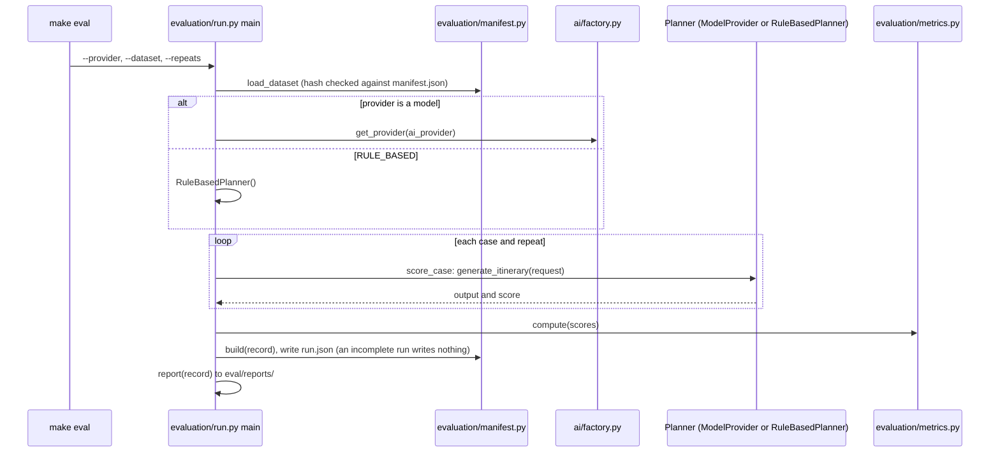
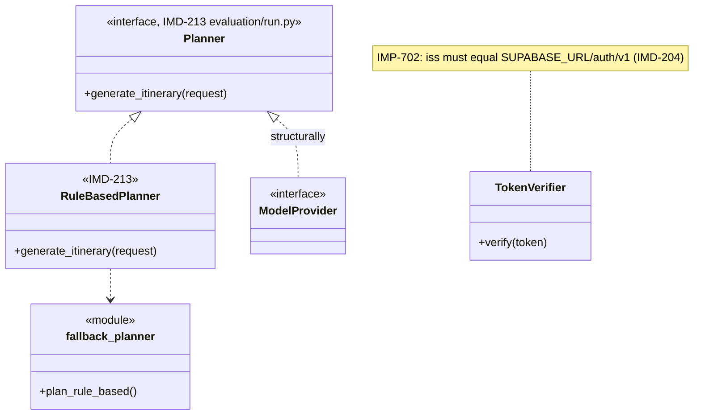

# Sprint 7 (week 7): Quality and usability

| Item | Value |
| --- | --- |
| Course document | 02 Sprint details ([index](../README.md)), IMD-221 |
| Owner | Jeel Fefar |
| Sources | [docs/progress/sprint-7.md](../../progress/sprint-7.md) (compiled by IMP-799, RUN-087, 22 November 2026, candidate `4fe514c`), [gates.md SG-7](../../progress/gates.md), the code at `77e52ba` |

## Goal

Gate card IMP-799 sets the goal: "Sprint 7 gate SG-7 is passed: a release candidate is tagged on a green main, acceptance scenarios ACC-01 to ACC-18 have been re-run on staging, no severity-1 defect is open, and every Sprint 1 to 7 task is done or listed open with an owner."

## Cards merged

| Card | Title | Part | Owner | Points | Status | Part record |
| --- | --- | --- | --- | --- | --- | --- |
| IMP-701 | End-to-end regression suite for all primary scenarios | whole-task | Krrish (lead) | 3 | merged (#287) | [IMP-701-whole-task.md](../../progress/parts/IMP-701-whole-task.md) |
| IMP-702 | Authorization and security test pass | authz-injection | Junaid (lead) | 2 | merged (#287) | [IMP-702-authz-injection.md](../../progress/parts/IMP-702-authz-injection.md) |
| IMP-702 | Authorization and security test pass | auth-fixes | Het | 2 | merged (#287) | [IMP-702-auth-fixes.md](../../progress/parts/IMP-702-auth-fixes.md) |
| IMP-702 | Authorization and security test pass | headers-secret-scan | Kirtan | 1 | merged (#287) | [IMP-702-headers-secret-scan.md](../../progress/parts/IMP-702-headers-secret-scan.md) |
| IMP-703 | Accessibility check on real devices and fixes | prepare | Krrish (lead) | 0 (3 pending) | merged (prepare only); **device and screen-reader sessions pending** (#289, #291) | [IMP-703-prepare.md](../../progress/parts/IMP-703-prepare.md) |
| IMP-704 | Usability session 2 and fixes of the top issues | — | Manasvi (lead), Junaid | 3 (pending) | **not started** (needs IMP-611 session 1) | none |
| IMP-705 | Final evaluation baseline and cost report | whole-task | Nidhi | 1 | merged (#289, #291) | [IMP-705-whole-task.md](../../progress/parts/IMP-705-whole-task.md) |
| IMP-706 | Stage 2 readiness package (documents only) | whole-task | Manya | 3 | merged; record PARTIAL (blueprint content to confirm) (#289) | [IMP-706-whole-task.md](../../progress/parts/IMP-706-whole-task.md) |
| IMP-707 | SRS, architecture, test plan, user guide and deployment guide | srs | Malhar (lead) | 2 | merged (#289) | [IMP-707-srs.md](../../progress/parts/IMP-707-srs.md) |
| IMP-707 | SRS, architecture, test plan, user guide and deployment guide | architecture-api | Manal | 1 | merged (#289) | [IMP-707-architecture-api.md](../../progress/parts/IMP-707-architecture-api.md) |
| IMP-707 | SRS, architecture, test plan, user guide and deployment guide | test-plan | Junaid | 1 | merged (#289) | [IMP-707-test-plan.md](../../progress/parts/IMP-707-test-plan.md) |
| IMP-707 | SRS, architecture, test plan, user guide and deployment guide | user-guide | Jeel | 1 | merged; record PARTIAL (16 screenshot placeholders, new-member trial open) (#289) | [IMP-707-user-guide.md](../../progress/parts/IMP-707-user-guide.md) |
| IMP-707 | SRS, architecture, test plan, user guide and deployment guide | deployment-guide | Kirtan | 1 | merged; record PARTIAL (AWS and Supabase steps and clean-account trial open) (#289) | [IMP-707-deployment-guide.md](../../progress/parts/IMP-707-deployment-guide.md) |
| IMP-708 | Natural-language trip intake with confirmation | — | Nidhi (lead), Manya, Manal, Manasvi | 8 | **cut** (IMD-65); `nl_intake` not built | none |
| IMP-709 | "Why this plan" explanations for each day | — | Nidhi (lead), Het, Manya | 5 | **cut** (IMD-65); `day_explain` not built | none |
| IMP-710 | Rain-aware day swapping with the Open-Meteo forecast | — | Manal (lead), Malhar, Krrish | 7 | **cut** (IMD-65); `rain_swap` not built | none |
| IMP-711 | "Today" companion view for trip days | — | Manasvi (lead), Het | 3 | **cut** (IMD-65); `today_view` not built | none |
| IMP-712 | Budget-fit suggestions when a plan is over budget | — | Junaid (lead), Jeel, Krrish | 7 | **cut** (IMD-65); `budget_fit` not built | none |
| IMP-713 | Destination and place context cards from Wikivoyage and Wikipedia | — | Malhar (lead), Jeel, Kirtan | 6 | **cut** (IMD-65); `context_cards` not built | none |
| IMP-799 | Sprint 7 gate SG-7: release candidate | whole-task | Kirtan | 2 (pending) | **provisional**: not passed yet (this PR) | [IMP-799-whole-task.md](../../progress/parts/IMP-799-whole-task.md) |

IMP-708 to IMP-713 are extensions, cut by IMD-65; none was built. IMP-704 (usability session 2) has not started.

**Points (from the sprint index).** Sprint 7 plans 62 points on 14 cards. IMP-708 to IMP-713 (36 points) are cut, so 26 points are in scope. 18 points over 11 parts on 5 cards are merged: IMP-701 3, IMP-702 5, IMP-705 1, IMP-706 3 and IMP-707 6. Pending: IMP-703 (3), IMP-704 (3) and the gate card IMP-799 (2, provisional).

## Gate result

**SG-7: not passed yet (provisional)** (RUN-087, 22 November 2026, candidate `4fe514c`). The criteria do not all hold:

- There is no tag `v1.0-rc1`.
- The candidate is not deployed to staging.
- `make smoke` and the ACC-01 to ACC-18 re-run on staging have not been run.
- The accessibility and usability sessions are pending.

No tag was created. Every staging criterion is an open item for Kirtan's staging window, which was due 26 November 2026. A later SG-7 result is not recorded at `77e52ba`.

## Sequence diagram: final evaluation run (IMP-705, IMD-213)

`make eval PROVIDER=<provider> DATASET=<version>` runs `python -m app.evaluation.run`. With `--provider RULE_BASED` the harness runs the rule-based planner instead of a model (IMD-213).

## Class diagram: classes added in Sprint 7

The feature freeze (IMD-201) was in force, so Sprint 7 added few classes. Most of its work was tests and documents.

Sprint 7 also added:

- The E2E regression suite in `apps/web/e2e/` (IMP-701).
- The authorization and security pass, which added the token issuer check of IMD-204 to `auth/tokens.py` (IMP-702).
- The Stage 2 readiness package in `docs/stage2/` (IMP-706).
- The SRS, architecture, test plan, user guide and deployment guide (IMP-707).
