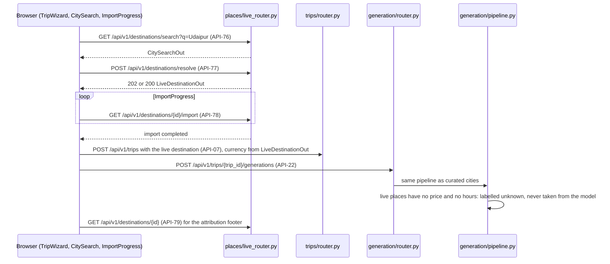

# Sprint 8 (week 8): Release and demonstration

| Item | Value |
| --- | --- |
| Course document | 02 Sprint details ([index](../README.md)), IMD-221 |
| Owner | Jeel Fefar |
| Sources | TASK_REGISTER "Sprint 8", [Amendment A2 §12](../../spec/AMENDMENT_A2_ANY_CITY.md), the part records `IMP-72*`, `IMP-73*`, `IMP-80*` in [docs/progress/parts/](../../progress/parts/), [gates.md SG-8](../../progress/gates.md), [acceptance/any-city.md](../../acceptance/any-city.md), the code at `77e52ba` |
| State | Written on 28 November 2026, while Sprint 8 is running. No `docs/progress/sprint-8.md` index exists yet, and gate SG-8 is "not run" |

## Goal

Gate card IMP-899 sets the goal: "Sprint 8 gate SG-8 is passed: the tagged release is running in production, the demo has been given or is ready with all backups, the final checklist CHK-01 to CHK-23 is closed or has recorded exceptions, and the submission is complete."

## Planned against done

### Planned Sprint 8 cards (task register, 16 points)

| Card | Title | Parts (points) | Done at `77e52ba` |
| --- | --- | --- | --- |
| IMP-801 | Production deployment, smoke tests, release-candidate tag, demo script and backup video | Kirtan 4, Nidhi 1 | **Drafts only.** [IMP-801-demo-script-draft](../../progress/parts/IMP-801-demo-script-draft.md) (Nidhi: demo script, rehearsal log and README drafts) and [IMP-801-release-notes-draft](../../progress/parts/IMP-801-release-notes-draft.md) (Kirtan: v1.0-mvp release notes draft). Production deployment, production smoke tests, the release tag and the backup video are not recorded |
| IMP-802 | Fix severe defects found in rehearsal (regression-tested) | Junaid 2, Kirtan 1, Nidhi 1, Manasvi 1 | **Not started.** No commit and no part record. The card needs the rehearsal of IMP-801 first |
| IMP-803 | Pre-demo checklist | Malhar 1, Jeel 1 | **Drafts only.** [IMP-803-checklist-db-fallback](../../progress/parts/IMP-803-checklist-db-fallback.md) (Malhar: template, database and fallback rows) and [IMP-803-checklist-data-accounts](../../progress/parts/IMP-803-checklist-data-accounts.md) (Jeel: data, accounts and itinerary rows). The checklist is not yet run |
| IMP-804 | Final report and presentation | Malhar 1, Jeel 1, Manya 1 | **Drafts only.** [report-data-architecture](../../progress/parts/IMP-804-report-data-architecture.md) (Malhar), [report-ai-chapter](../../progress/parts/IMP-804-report-ai-chapter.md) (Manya) and [presentation-outline](../../progress/parts/IMP-804-presentation-outline.md) (Jeel). Human completion and the claims-check review are pending |
| IMP-899 | Sprint 8 gate SG-8: release, demo and submission | Kirtan 1 | **Not run** ([gates.md](../../progress/gates.md) SG-8: "Status: not run") |

### Work added in the Sprint 8 week: any-city mode (IMD-210, IMD-215)

Amendment A2 added cards IMP-721 to IMP-733 at 0 points each, outside the contribution plan (A2 §12). Their branches carry the prefix `S7-` (for example `feat/S7-C1a-any-city-foundation`). Their commits on `main` are dated 23 to 25 November 2026. IMD-215 lifted the feature freeze for this work only, until 27 November 2026 23:59 IST.

| Card | Title | Part | Owner | Points | Status | Part record |
| --- | --- | --- | --- | --- | --- | --- |
| IMP-721 | Migration 0008: live destination columns | migration-sql | Malhar | 0 | on `main` (record present) | [IMP-721-migration-sql.md](../../progress/parts/IMP-721-migration-sql.md) |
| IMP-721 | Migration 0008: live destination columns | orm-tests | Jeel | 0 | on `main` (record present) | [IMP-721-orm-tests.md](../../progress/parts/IMP-721-orm-tests.md) |
| IMP-722 | Switch `any_city_mode`, settings and the any-city contract | whole-task | Het | 0 | on `main` (record present) | [IMP-722-whole-task.md](../../progress/parts/IMP-722-whole-task.md) |
| IMP-723 | Live-data providers: Nominatim, Overpass and MediaWiki clients, fakes, throttle and isolation | providers | Manal | 0 | on `main` (record present) | [IMP-723-providers.md](../../progress/parts/IMP-723-providers.md) |
| IMP-723 | Live-data providers: Nominatim, Overpass and MediaWiki clients, fakes, throttle and isolation | throttle-isolation | Junaid | 0 | on `main` (record present) | [IMP-723-throttle-isolation.md](../../progress/parts/IMP-723-throttle-isolation.md) |
| IMP-724 | Normaliser, country table and minimum-places gate | countries | Malhar | 0 | on `main` (record present) | [IMP-724-countries.md](../../progress/parts/IMP-724-countries.md) |
| IMP-724 | Normaliser, country table and minimum-places gate | normaliser | Jeel | 0 | on `main` (record present) | [IMP-724-normaliser.md](../../progress/parts/IMP-724-normaliser.md) |
| IMP-725 | Live import service, job runner, API-76 to API-79 and trip rule | jobs-cli | Manal | 0 | on `main` (record present) | [IMP-725-jobs-cli.md](../../progress/parts/IMP-725-jobs-cli.md) |
| IMP-725 | Live import service, job runner, API-76 to API-79 and trip rule | live-import-hardening | Manal | 0 | on `main` (record present) | [IMP-725-live-import-hardening.md](../../progress/parts/IMP-725-live-import-hardening.md) |
| IMP-725 | Live import service, job runner, API-76 to API-79 and trip rule | service-routes | Het | 0 | on `main` (record present) | [IMP-725-service-routes.md](../../progress/parts/IMP-725-service-routes.md) |
| IMP-726 | Live guide corpus from Wikivoyage and Wikipedia | attribution-api | Het | 0 | on `main` (record present) | [IMP-726-attribution-api.md](../../progress/parts/IMP-726-attribution-api.md) |
| IMP-726 | Live guide corpus from Wikivoyage and Wikipedia | live-embed-backfill | Nidhi | 0 | on `main` (record present) | [IMP-726-live-embed-backfill.md](../../progress/parts/IMP-726-live-embed-backfill.md) |
| IMP-726 | Live guide corpus from Wikivoyage and Wikipedia | whole-task | Nidhi | 0 | on `main` (record present) | [IMP-726-whole-task.md](../../progress/parts/IMP-726-whole-task.md) |
| IMP-727 | Prompt v4 and live-plan generation checks | whole-task | Manya | 0 | on `main` (record present) | [IMP-727-whole-task.md](../../progress/parts/IMP-727-whole-task.md) |
| IMP-728 | Web: city search, import progress and the switch | draft-destination | Manasvi | 0 | on `main` (record present) | [IMP-728-draft-destination.md](../../progress/parts/IMP-728-draft-destination.md) |
| IMP-728 | Web: city search, import progress and the switch | whole-task | Manasvi | 0 | on `main` (record present) | [IMP-728-whole-task.md](../../progress/parts/IMP-728-whole-task.md) |
| IMP-728 | Web: city search, import progress and the switch | wording | Manasvi | 0 | on `main` (record present) | [IMP-728-wording.md](../../progress/parts/IMP-728-wording.md) |
| IMP-729 | Web: tier label, source badges, unknown chips and attribution | live-attribution-coverage | Krrish | 0 | on `main` (record present) | [IMP-729-live-attribution-coverage.md](../../progress/parts/IMP-729-live-attribution-coverage.md) |
| IMP-729 | Web: tier label, source badges, unknown chips and attribution | whole-task | Krrish | 0 | on `main` (record present) | [IMP-729-whole-task.md](../../progress/parts/IMP-729-whole-task.md) |
| IMP-730 | E2E `@live`, the CI switch-ON job and the ON/OFF record | e2e-repeat-429 | Krrish | 0 | on `main` (record present) | [IMP-730-e2e-repeat-429.md](../../progress/parts/IMP-730-e2e-repeat-429.md) |
| IMP-730 | E2E `@live`, the CI switch-ON job and the ON/OFF record | whole-task | Krrish | 0 | on `main` (record present) | [IMP-730-whole-task.md](../../progress/parts/IMP-730-whole-task.md) |
| IMP-731 | Security: any-city authorization, injection corpus and etiquette review | whole-task | Junaid | 0 | on `main` (record present) | [IMP-731-whole-task.md](../../progress/parts/IMP-731-whole-task.md) |
| IMP-732 | Evaluation `trips/live-v1` | gemini-commands | Manya | 0 | on `main` (record present) | [IMP-732-gemini-commands.md](../../progress/parts/IMP-732-gemini-commands.md) |
| IMP-732 | Evaluation `trips/live-v1` | gemini-v4-result | Manya | 0 | on `main` (record present) | [IMP-732-gemini-v4-result.md](../../progress/parts/IMP-732-gemini-v4-result.md) |
| IMP-732 | Evaluation `trips/live-v1` | whole-task | Manya | 0 | on `main` (record present) | [IMP-732-whole-task.md](../../progress/parts/IMP-732-whole-task.md) |
| IMP-733 | Documents: acceptance record, guides, report addendum and environment | documents | Nidhi | 0 | on `main` (record present) | [IMP-733-documents.md](../../progress/parts/IMP-733-documents.md) |
| IMP-733 | Documents: acceptance record, guides, report addendum and environment | environment | Kirtan | 0 | on `main` (record present) | [IMP-733-environment.md](../../progress/parts/IMP-733-environment.md) |
| IMP-733 | Documents: acceptance record, guides, report addendum and environment | infra-templates-runbook | Kirtan | 0 | on `main` (record present) | [IMP-733-infra-templates-runbook.md](../../progress/parts/IMP-733-infra-templates-runbook.md) |
| IMP-733 | Documents: acceptance record, guides, report addendum and environment | rc-switch-readiness | Nidhi | 0 | on `main` (record present) | [IMP-733-rc-switch-readiness.md](../../progress/parts/IMP-733-rc-switch-readiness.md) |

The part records still show the status written when their pull requests were opened (`PR_OPEN candidate`). The records and the code they describe are on `main` at `77e52ba`, so this table lists them as on `main`.

**Acceptance of any-city mode.** [acceptance/any-city.md](../../acceptance/any-city.md) lists ACC-20 to ACC-23 as "pending (Kirtan staging window, 28 Nov)". The release switch state (CHK-26) is "to be recorded at the cutoff". By IMD-220, production ships with the switch ON only if those checks pass on staging. Otherwise the final report says "built but disabled".

## Gate result

**SG-8: not run** at `77e52ba`.

## Sequence diagram: planning a trip in a live city (IMP-725, IMP-728, IMP-727)

Udaipur is one of the demo cities named by IMD-220 (d).

## Class diagram: classes added in the Sprint 8 week

```mermaid
classDiagram
    class GeocodingProvider {
        <<interface, IMP-723>>
    }
    class PlacesProvider {
        <<interface, IMP-723>>
    }
    class GuideSourceProvider {
        <<interface, IMP-723>>
    }
    class NominatimGeocoder
    class OverpassPlaces
    class MediaWikiGuides
    class Throttle {
        <<IMP-723 livedata/throttle.py>>
    }
    class LiveProviders {
        <<IMP-723 livedata/factory.py>>
    }
    class Country {
        <<IMP-724 livedata/countries.py>>
    }
    class NormaliseResult {
        <<IMP-724 livedata/normalise.py>>
    }
    class LivePlace
    class CitySearchOut {
        <<IMP-725 places/live_schemas.py>>
    }
    class LiveDestinationOut
    class ImportState
    class DestinationDetailOut
    class Attribution
    class ResolveResult {
        <<IMP-725 places/live_service.py>>
    }
    class CannotImportError {
        <<IMP-725 places/live_import.py>>
    }
    class LiveGuideBuild {
        <<IMP-726 rag/live_guides.py>>
    }
    class LiveIndexReport {
        <<IMP-726 rag/service.py>>
    }
    GeocodingProvider <|.. NominatimGeocoder
    PlacesProvider <|.. OverpassPlaces
    GuideSourceProvider <|.. MediaWikiGuides
    LiveProviders --> GeocodingProvider
    LiveProviders --> PlacesProvider
    LiveProviders --> GuideSourceProvider
    NormaliseResult --> LivePlace
    LiveDestinationOut --> ImportState
    DestinationDetailOut --> Attribution
```

Also in the Sprint 8 week:

- Migration `0008_live_destinations` (IMP-721).
- The prompt template `itinerary_generate/v4` (IMP-727), which is not activated (IMD-220 (e)).
- On the web side: `CitySearch`, `ImportProgress`, `TierBadge` and `LiveAttribution` (IMP-728, IMP-729), plus OpenStreetMap source badges in the existing `SourceBadge` (IMP-309).
- The E2E spec `live-city.spec.ts` (IMP-730).
