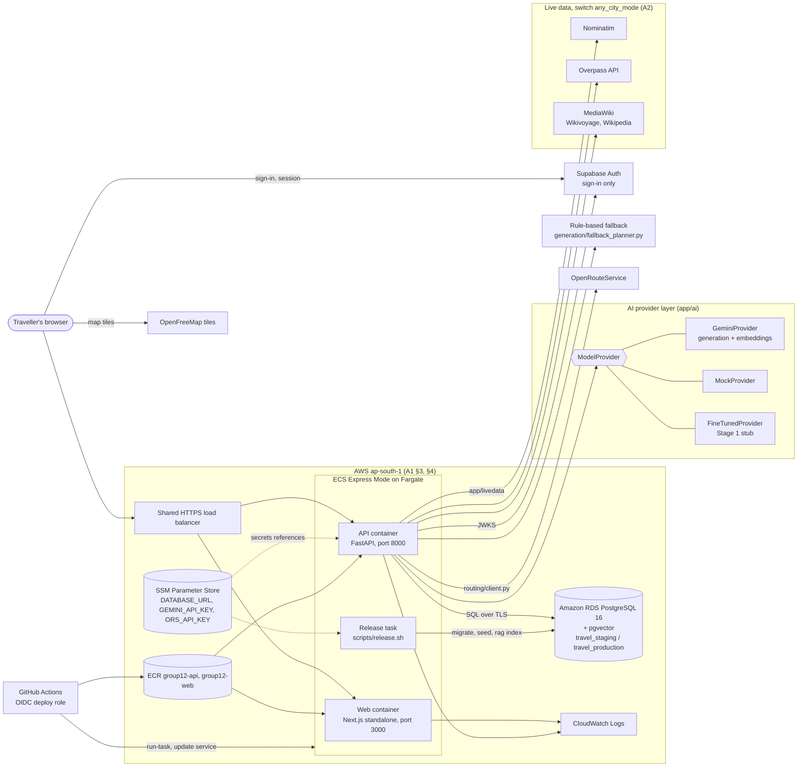
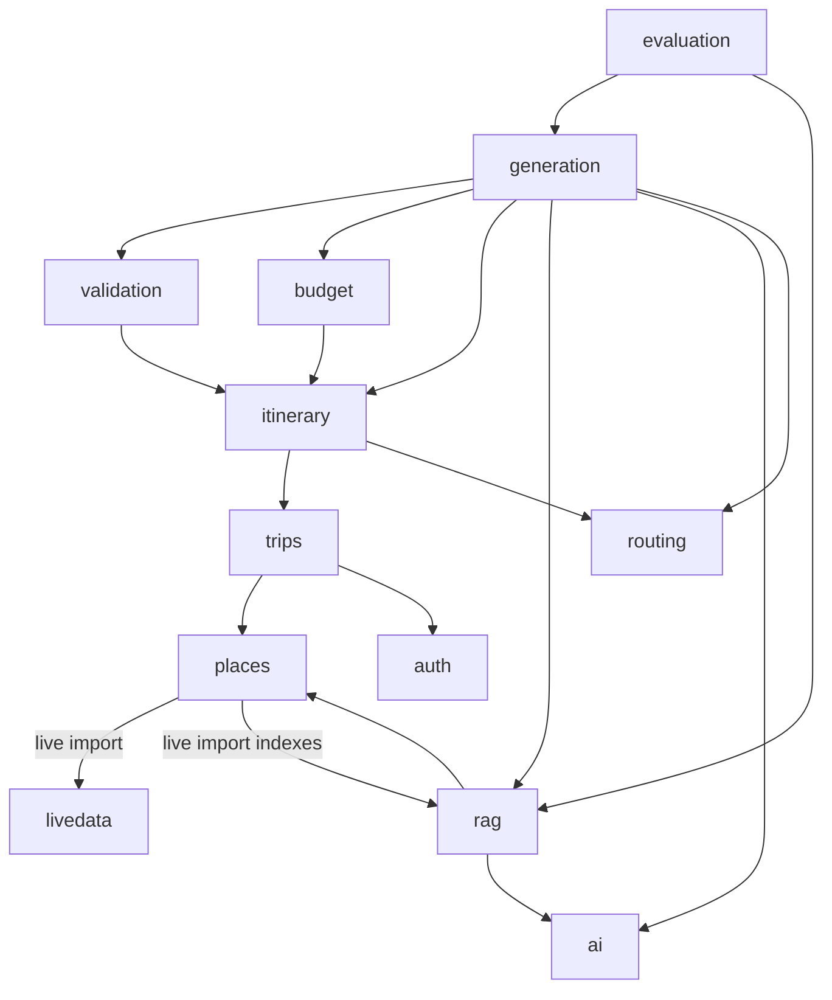
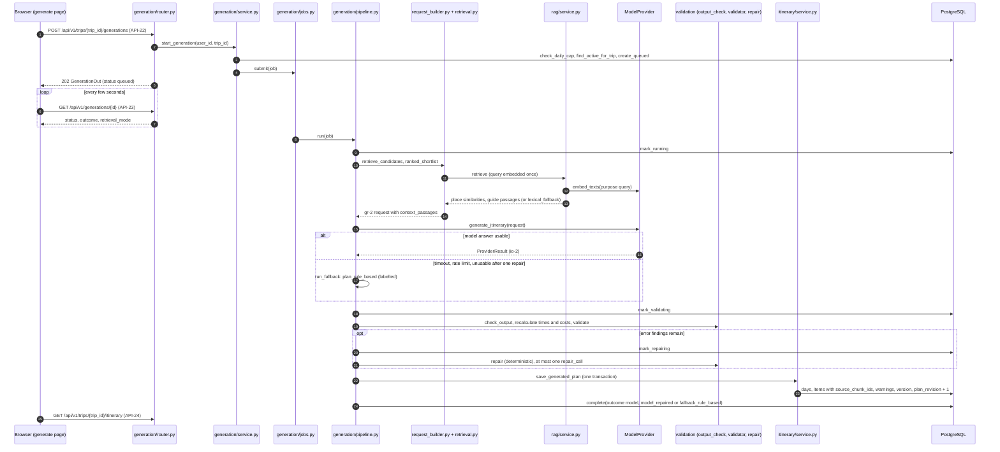
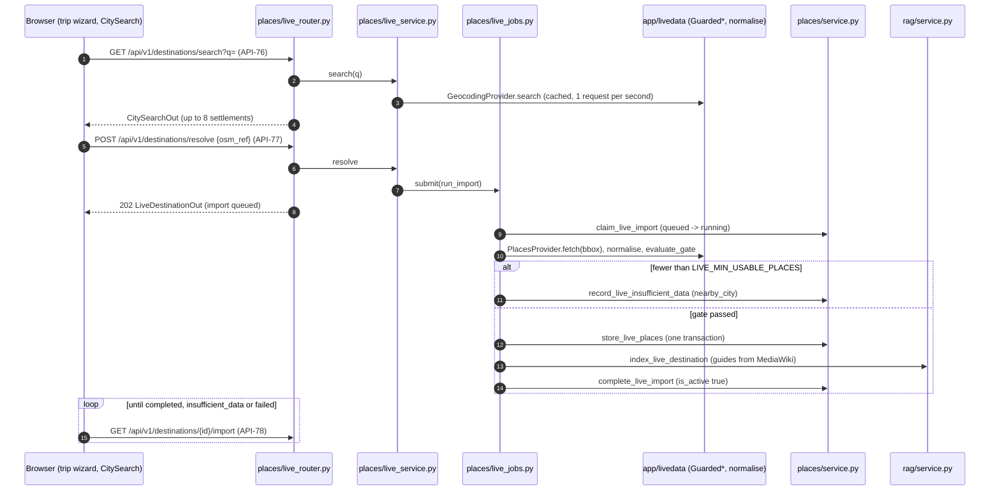

# 03 System design

| Item | Value |
| --- | --- |
| Course document | 03 of the IT314 set ([index](README.md)), IMD-221 |
| Owner | Het Lathiya |
| Scope | The combined architecture of Sprints 1 to 8: the MVP (specification v1.3), AWS hosting and RAG (Amendment A1) and any-city mode (Amendment A2) |
| Built from | `main` at `77e52ba`: `apps/api/app/`, `apps/web/`, `apps/api/migrations/sql/`, `infra/aws/services/*.tmpl`, `.github/workflows/`, and [docs/architecture.md](../architecture.md), which gives the deployment, RAG and ER details |

## 1. Overview

The system is a modular monolith with two deployable containers:

- **Web**: a Next.js App Router application in `apps/web`. It serves pages, holds no secret and never computes prices, totals, times or travel gaps (CLAUDE.md §4 rule 5).
- **API**: a FastAPI application in `apps/api`. It is the only component that reaches the database, the AI provider, routing and the live-data providers.

Supabase Auth is used for sign-in only (IMD-100, IMD-101). Data lives in PostgreSQL 16 with pgvector: Amazon RDS in staging and production, and the Supabase CLI stack locally (IMD-115).

## 2. Component and deployment diagram

| Component | Code or resource | Notes |
| --- | --- | --- |
| Web | `apps/web/app/`, `apps/web/components/`, `apps/web/lib/api/client.ts` (openapi-fetch over the generated `schema.d.ts`) | Only the four `NEXT_PUBLIC_*` values reach the browser |
| API | `apps/api/app/main.py` `create_app()`; routers mounted under `/api/v1` with the `current_user` dependency | `/health` (API-01) and `/health/ready` (API-02) are outside the prefix |
| Database | Migrations `0001_helpers` to `0008_live_destinations` in `apps/api/migrations/sql/` | 17 tables; `0008` adds live columns to `destinations` only (A2 §4) |
| Auth | `app/auth/tokens.py` `TokenVerifier`, `app/auth/deps.py` `current_user` | JWKS on hosted Supabase (IMD-123); the user ID comes only from the verified token |
| AI provider | `app/ai/providers/base.py` `ModelProvider`; `app/ai/factory.py` `get_provider` picks `GEMINI`, `MOCK` or `FINETUNED_MODEL` from `AI_PROVIDER` | `google-genai` is imported only in `gemini.py` |
| Rule-based fallback | `app/generation/fallback_planner.py` `plan_rule_based` | Used when the model fails or its answer stays unusable (§8 of the specification) |
| Routing | `app/routing/service.py` `RoutingService`, `app/routing/client.py` `OrsClient`, `app/routing/estimate.py` | Route cache in `route_cache`; distance estimate when ORS is down |
| Live data (A2) | `app/livedata/` (MOD-B19): `NominatimGeocoder`, `OverpassPlaces`, `MediaWikiGuides`, fakes, `throttle.py` | Mounted only when the switch `any_city_mode` is ON (`main.py`); `LIVE_DATA_PROVIDER` is `FAKE` or `LIVE` |
| Hosting | `infra/aws/` (run only by the AWS account owner), `.github/workflows/deploy-staging.yml`, `deploy-production.yml` | Release task runs `sh scripts/release.sh` before any service update |

The detailed AWS resource table, environment table and deploy sequence are in [architecture.md §2](../architecture.md).

## 3. Layers and rules

Every backend module follows routers → services → domain and repositories → clients and adapters (CLAUDE.md §4). `make imports` enforces it with the contracts in `apps/api/.importlinter`.

| Layer | Example files | Rule |
| --- | --- | --- |
| Router | `trips/router.py`, `itinerary/router.py`, `places/live_router.py` | No business rules and no SQL |
| Service | `trips/service.py`, `generation/pipeline.py`, `places/live_service.py` | Transactions and orchestration |
| Domain (pure) | `trips/domain.py`, `generation/ranking.py`, `budget/engine.py`, `validation/rules.py`, `livedata/normalise.py` | No I/O, no FastAPI, SQLAlchemy, HTTP client or SDK |
| Repository | `*/repository.py`, `db/models/` | Every owned query takes `user_id` |
| Client or adapter | `ai/providers/*`, `routing/client.py`, `livedata/providers/*` | Imported only through their factory or owning service |

Other rules: one writer per table; a resource owned by someone else answers 404 `NOT_FOUND`, never 403; vector queries live only in `app/rag/repository.py`.

## 4. Module map

Modules may call only modules of a lower rank (specification §3.9, A1 §8.1, A2 §8).

| Rank | Module | Folder | Writes |
| --- | --- | --- | --- |
| 0 | MOD-B01 core, MOD-D01 db, shared schemas | `app/core`, `app/db`, `app/schemas` | none |
| 1 | MOD-B02 auth | `app/auth` | `profiles` |
| 1 | MOD-B04 places (curated and live) | `app/places` | `destinations`, `data_sources`, `places`, `place_opening_hours` |
| 1 | MOD-B05 AI provider | `app/ai` | none |
| 1 | MOD-B10 routing | `app/routing` | `route_cache` |
| 1 | MOD-B19 live data (A2) | `app/livedata` | none (MOD-B04 and MOD-B18 store what it returns) |
| 2 | MOD-B03 trips | `app/trips` | `trips` (except `plan_revision`), `trip_preferences`, `trip_places` |
| 2 | MOD-B18 RAG | `app/rag` | `rag_documents`, `rag_chunks` |
| 3 | MOD-B08 itinerary | `app/itinerary` | `itinerary_days`, `itinerary_items`, `itinerary_warnings`, `itinerary_versions`, `trips.plan_revision` |
| 4 | MOD-B09 budget | `app/budget` | `budget_settings` |
| 4 | MOD-B07 validation | `app/validation` | none (findings written through MOD-B08) |
| 5 | MOD-B06 generation | `app/generation` | `ai_generations` |
| 6 | MOD-B15 evaluation | `app/evaluation` | files under `eval/` only |

The extension modules prep, weather and context are cut (IMD-65); `app/` has no such folders.

Arrows point to the callee. The live import in `places/live_jobs.py` calls `rag.service.index_live_destination` to index live guides (A2 §6.2 step 5).

## 5. Data flow of one generation

Generation is an asynchronous in-process job (IMD-12). API-22 creates one `ai_generations` row and answers 202; the browser polls API-23. `generation/jobs.py` runs the job with a 120 s timeout (`PIPELINE_TIMEOUT_S`) and a reaper that fails jobs older than 150 s (`STALE_AFTER`).

The twelve pipeline steps and the RAG retrieval rules are tabled in [architecture.md §6 and §7](../architecture.md). Quota and configuration errors end in `failed`, and the page offers a rule-based plan.

## 6. Data flow of a live city import (any-city mode, A2)

## 7. Cross-cutting concerns

| Concern | Where | Rule |
| --- | --- | --- |
| Errors | `app/core/errors.py` `DomainError` subclasses, `error_response` | One error envelope for every error (specification §6.3) |
| Request IDs and logs | `app/core/request_id.py` `RequestIdMiddleware`; `app/core/logging.py` `RedactionFilter`, `JsonFormatter` | No key, token, prompt body or personal data in logs |
| Rate limits and caps | `app/core/rate_limit.py` `SlidingWindowLimiter`, `expensive_request`; `generation/service.py` `check_daily_cap` | 429 `RATE_LIMITED` or `AI_QUOTA_REACHED` |
| Switches | `app/core/flags.py` `is_enabled`, `FEATURES_DISABLED` | `any_city_mode` is ON only with `!any_city_mode` listed (A2 §3.1) |
| Settings | `app/core/config.py` `Settings`, `check_settings` | Staging and production refuse to start with a missing `GEMINI_*` value, with MOCK in production, or with `LIVE_DATA_PROVIDER=FAKE` while any-city mode is ON |
| Breakers | `app/ai/breaker.py` `CircuitBreaker` | Used by the Gemini adapter and by the Nominatim and Overpass guards in `livedata/throttle.py` |

## 8. Where the built system differs from the design

[architecture.md §11](../architecture.md) lists 13 differences between the documented design and the built system, A-01 to A-13. Any-city mode adds one fact. Whether production runs with the switch ON is decided at IMP-801 by the IMD-220 conditions. That result is not recorded at `77e52ba`.
