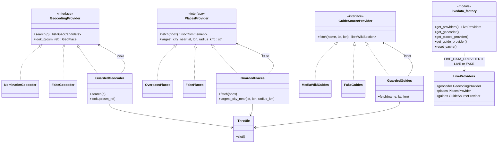
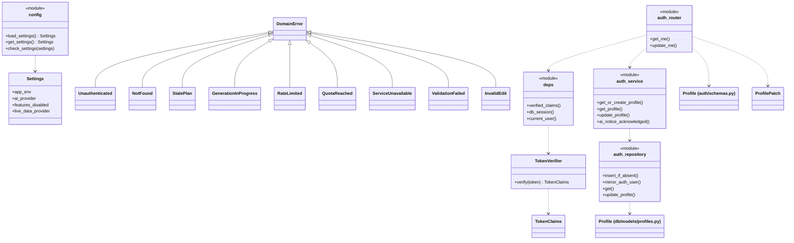
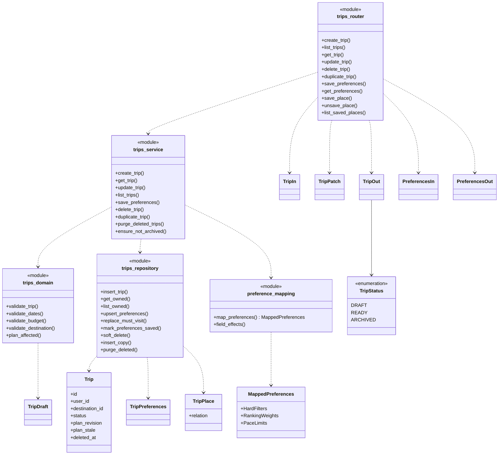
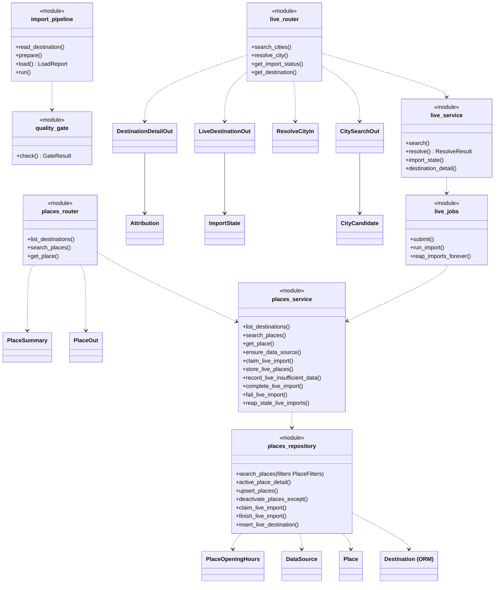
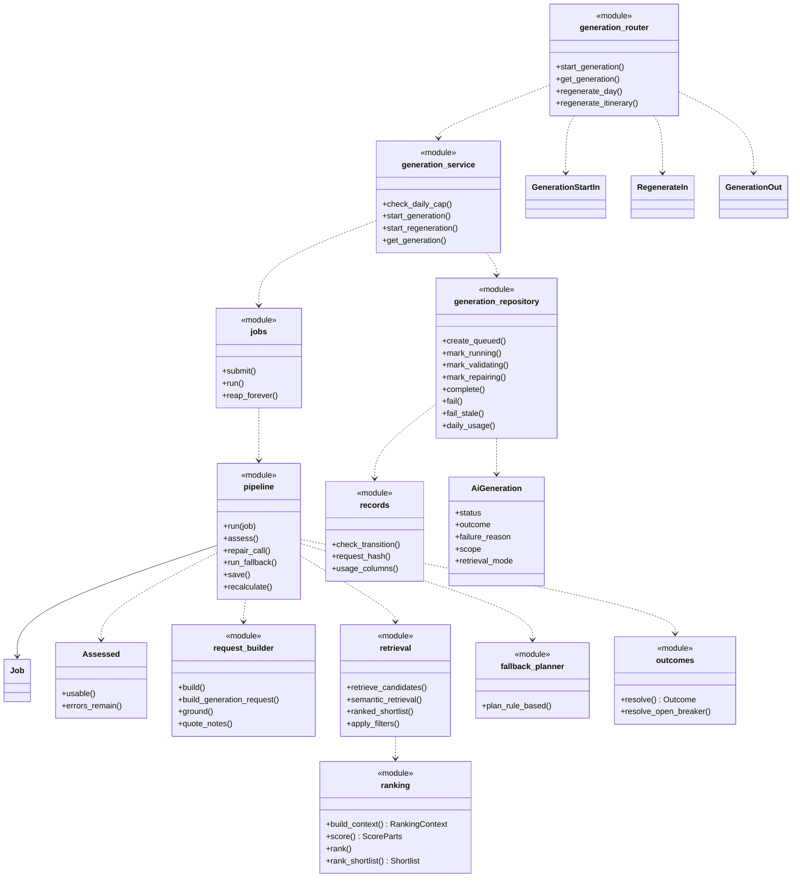
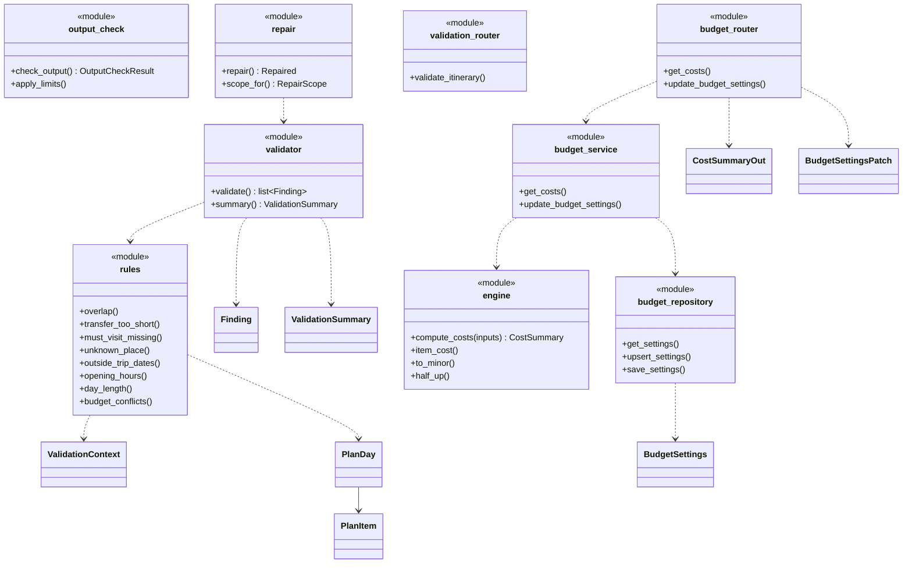
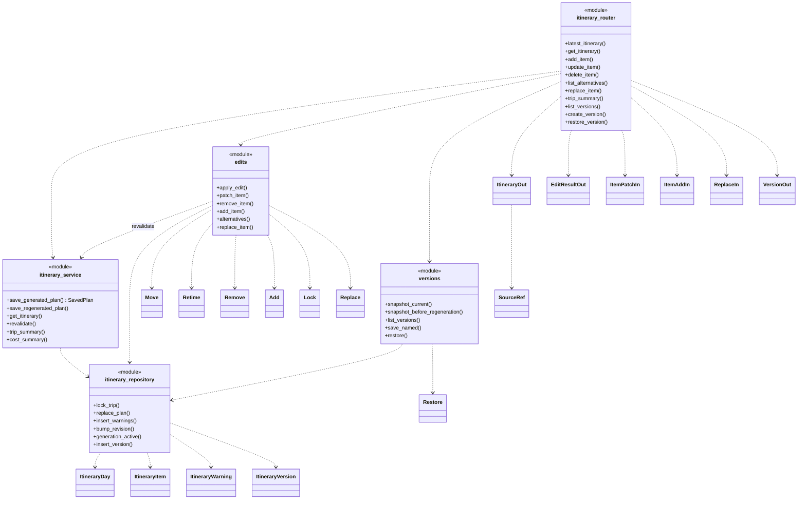
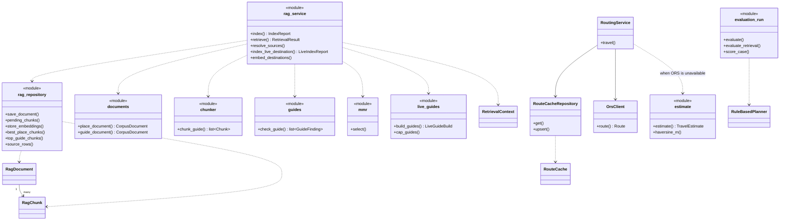
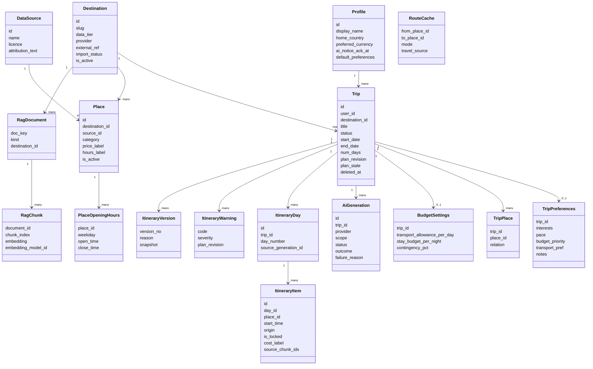

# 04 Object design

| Item | Value |
| --- | --- |
| Course document | 04 of the IT314 set ([index](README.md)), IMD-221 |
| Owner | Manal Patel |
| Built from | `apps/api/app/` at `77e52ba` (every class and function name below is in that code) |
| Related | [03 System design](03-system-design.md), [11 Design diagrams](11-design-diagrams.md), [srs.md §9](../srs.md) (columns, constraints, indexes) |

## 1. How to read the diagrams

The backend is Python, and most routers, services and repositories are **modules of functions**, not classes. The diagrams show such a module as a class with the stereotype `<<module>>`. Its "methods" are the module's public functions. Real classes (Pydantic schemas, SQLAlchemy models, dataclasses, Protocols) are shown with their real names. Python `Protocol` classes are shown as `<<interface>>`.

Arrows: `..>` means "calls or uses", `--|>` means "implements or inherits", and `-->` means "holds a reference to".

## 2. Key interfaces

### 2.1 ModelProvider and its adapters (MOD-B05)

`ModelProvider` (`app/ai/providers/base.py`) is the only way the system talks to a model (CLAUDE.md §8). `app/ai/factory.py` is the only module that imports a concrete adapter.

```mermaid
classDiagram
    class ModelProvider {
        <<interface>>
        +name ProviderName
        +embedding_model_id str
        +generate_itinerary(request) ProviderResult
        +modify_itinerary(request) ProviderResult
        +embed_texts(texts, purpose, titles) EmbeddingResult
        +health_check() HealthStatus
        +get_model_metadata() ModelMetadata
    }
    class GeminiProvider {
        +generation_settings()
        +generate_itinerary(request)
        +embed_texts(texts, purpose, titles)
    }
    class MockProvider {
        +scenario
        +generate_itinerary(request)
        +embed_texts(texts, purpose, titles)
    }
    class FineTunedProvider {
        +generate_itinerary(request)
        +embed_texts(texts, purpose, titles)
    }
    class factory {
        <<module>>
        +get_provider() ModelProvider
        +get_model_provider()
        +breaker_for(provider) CircuitBreaker
        +reset_provider_cache()
        +startup_provider()
    }
    class CircuitBreaker {
        +open_reason
        +state()
        +record_success()
        +record_failure(reason)
    }
    class ProviderResult~T~ {
        +output T
        +usage UsageMetadata
        +finish_reason
        +latency_ms int
        +provider_request_id
        +notes list
    }
    class EmbeddingResult {
        +vectors list
        +model_id str
        +usage UsageMetadata
        +latency_ms int
    }
    class ProviderError
    class ProviderTimeout
    class ProviderRateLimited
    class ProviderQuotaExhausted
    class ProviderConfigError
    class ProviderInvalidOutput
    ModelProvider <|.. GeminiProvider
    ModelProvider <|.. MockProvider
    ModelProvider <|.. FineTunedProvider
    factory ..> GeminiProvider : builds when AI_PROVIDER=GEMINI
    factory ..> MockProvider : builds when MOCK
    factory ..> FineTunedProvider : builds when FINETUNED_MODEL
    factory --> CircuitBreaker
    ModelProvider ..> ProviderResult
    ModelProvider ..> EmbeddingResult
    ProviderError <|-- ProviderTimeout
    ProviderError <|-- ProviderRateLimited
    ProviderError <|-- ProviderQuotaExhausted
    ProviderError <|-- ProviderConfigError
    ProviderError <|-- ProviderInvalidOutput
```

The other error types in `app/ai/errors.py` are `ProviderUnavailable`, `ProviderAuthError` and `ProviderBadRequest`. Each carries a `failure_reason` from the `ai_generations` check list (IMP-110). The shared contracts are in `app/schemas/ai.py`: `GenerationRequest` (gr-1), `GroundedGenerationRequest` (gr-2), `ItineraryOutput` (io-1), `GroundedItineraryOutput` (io-2), `ContextPassage`, `ShortlistPlace` and `ModificationRequest`.

### 2.2 Live-data providers (MOD-B19, Amendment A2)

The data classes in `app/livedata/providers/base.py` are `BBox`, `GeoCandidate`, `GeoPlace`, `OsmElement` and `WikiSection`. The errors are `LiveDataError`, `LiveDataUnavailable`, `LiveDataRateLimited` and `LiveDataTimeout`. The fakes are refused outside `APP_ENV` local and test (`_build_fake` raises `ConfigError`).

### 2.3 Other interfaces

| Interface | File | Used by |
| --- | --- | --- |
| `Located`, `RoutablePlace` (Protocols) | `app/routing/service.py` | `RoutingService.travel`, `travel_time` |
| `RankablePlace`, `Rankable` (Protocols) | `app/generation/ranking.py` | `rank`, `rank_shortlist` over generation and alternatives candidates |
| `PricedPlace` (Protocol) | `app/budget/engine.py` | `item_cost`, `compute_costs` |
| `Planner` (Protocol) | `app/evaluation/run.py` | `RuleBasedPlanner` and provider runs of the evaluation harness |
| `SigningKeySource` | `app/auth/tokens.py` | `TokenVerifier` (JWKS or HS256) |

## 3. Class diagrams per backend module

### 3.1 core and auth (MOD-B01, MOD-B02)

`app/core/errors.py` also defines `Conflict`, `Internal` and `EndpointNotImplemented`. `register_error_handlers` maps every `DomainError` to the error envelope (`ErrorEnvelope` in `app/schemas/common.py`).

### 3.2 trips (MOD-B03)

### 3.3 places, curated and live (MOD-B04)

`app/places/vocabulary.py` holds the enumerations `Category`, `OfferedCategory`, `Tag`, `SuitabilityFlag` and `VerificationStatus`. `app/places/live_import.py` is the import CLI (`main`, `import_destination`, `CannotImportError`).

### 3.4 generation (MOD-B06)

Also in the module: `grouping.py` (`group_days`), `schedule.py` (`recalculate`, `SchedulablePlace`, `Routing`), `presets.py` (`pace_limits`, `meal_slots`) and `samples.py` (`list_samples`, `load_sample`).

### 3.5 validation and budget (MOD-B07, MOD-B09)

### 3.6 itinerary (MOD-B08)

### 3.7 rag, routing and evaluation (MOD-B18, MOD-B10, MOD-B15)

## 4. ORM models (`app/db/models/`)

One file per owning module (IMP-106). Column names are the SQL column names.

All models inherit `Base` (`app/db/models/base.py`). The full column list, constraints and indexes are in [srs.md §9](../srs.md).

## 5. Design patterns used

| Pattern | Where in the code | Why |
| --- | --- | --- |
| Strategy, adapter | `ModelProvider` with `GeminiProvider`, `MockProvider`, `FineTunedProvider`; the three live-data Protocols with OSM, MediaWiki and fake implementations | The pipeline does not change when the provider changes (US-034, IMP-110) |
| Factory | `app/ai/factory.py` `get_provider`; `app/livedata/factory.py` `get_providers` | Only the factory imports a concrete adapter (import-linter contract 3) |
| Decorator or proxy | `GuardedGeocoder`, `GuardedPlaces`, `GuardedGuides` wrap an `inner` provider with `Throttle` and `CircuitBreaker` | Spacing and breakers without changing the adapters (A2 §7.3) |
| Circuit breaker | `app/ai/breaker.py` `CircuitBreaker` | Stops calls after consecutive failures (IMD-146, A2 §7.1) |
| Repository | every `repository.py`; `RouteCacheRepository` | SQL stays out of services and routers; every owned query takes `user_id` |
| Unit of work | `app/db/session.py` `transaction()` | One transaction per edit and per generation save (CLAUDE.md §7) |
| State machine | `app/generation/records.py` `TRANSITIONS`, `check_transition` | Only allowed generation status changes, see [11 Design diagrams](11-design-diagrams.md) |
| Command | `app/itinerary/edits.py` `Move`, `Retime`, `Remove`, `Add`, `Lock`, `Replace`, `LockAndEdit`, `Restore` passed to `apply_edit` | One edit path that recalculates and revalidates |
| Dependency injection | FastAPI `Depends`: `current_user`, `db_session`, `get_model_provider`, `get_submit`, `get_providers` | Tests override providers and job runners |
| Template registry | `app/ai/prompts/registry.py` `PromptTemplate`, `load`, `load_all` | Versioned prompts (`v1` to `v4`), one active by `PROMPT_TEMPLATE_VERSION` |
| Middleware | `app/core/request_id.py` `RequestIdMiddleware` | A request ID on every log line and error |
| Test double (fake) | `MockProvider` scenarios, `FakeGeocoder`, `FakePlaces`, `FakeGuides` | Tests never call Gemini or the live services |
