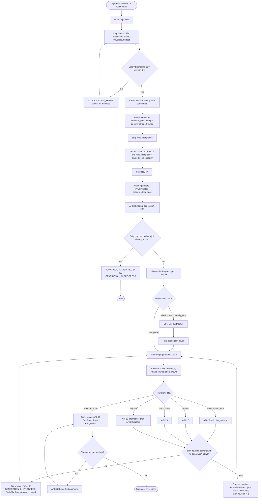
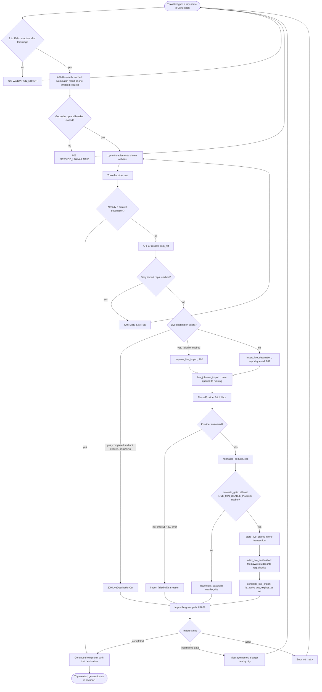
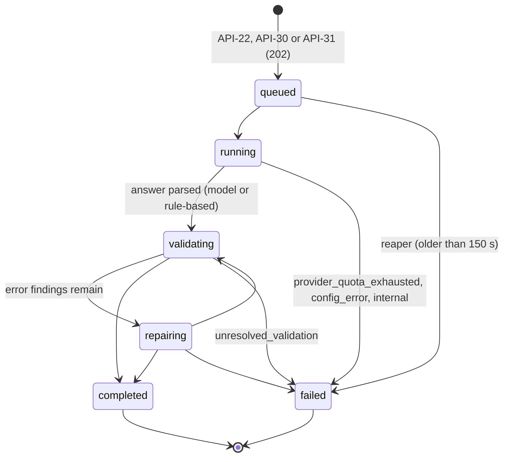
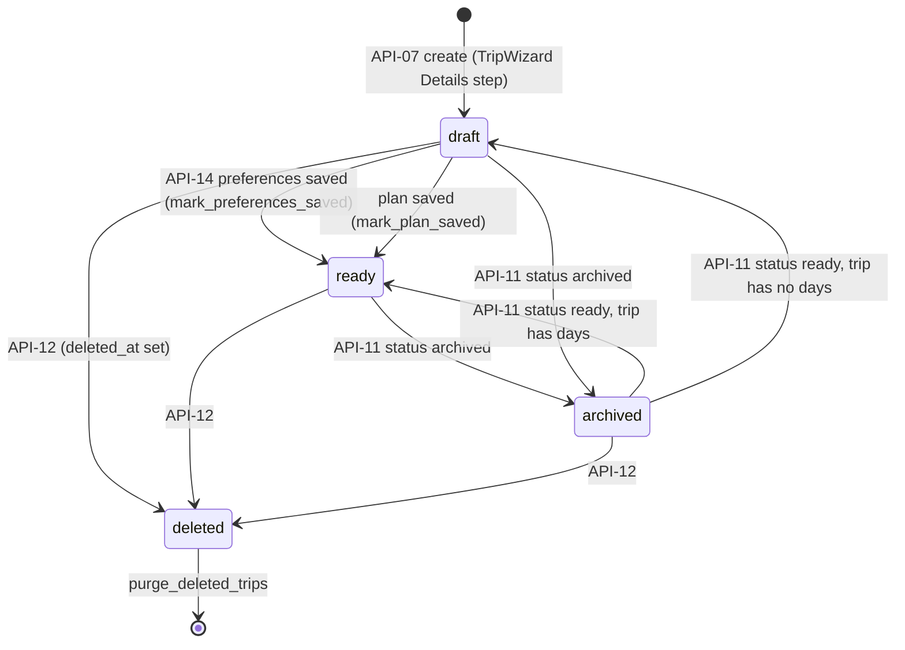
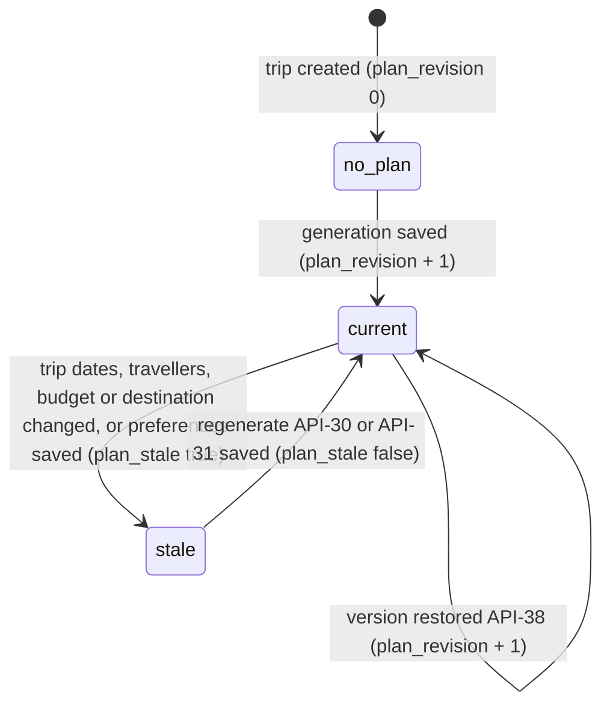
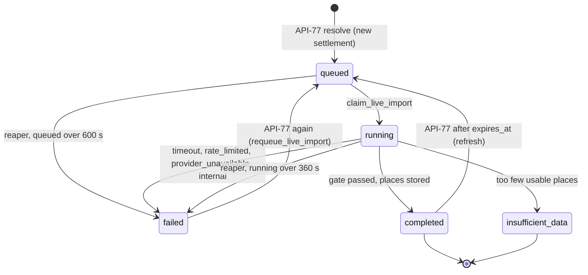

# 11 Design diagrams: activity and state

| Item | Value |
| --- | --- |
| Course document | 11 of the IT314 set ([index](README.md)), IMD-221 |
| Owner | Manal Patel |
| Built from | `apps/api/app/` and `apps/web/` at `77e52ba`; status values from migrations `0003`, `0004` and `0008` |
| Related | [03 System design](03-system-design.md) (sequence diagrams), [04 Object design](04-object-design.md) |

Activity diagrams are drawn as Mermaid flowcharts. Rounded nodes are start and end points, and diamonds are decisions.

## 1. Activity: create a trip, generate, edit, view costs

Screens: `/trips/new` (`TripWizard`), `/trips/{tripId}/generate`, `/trips/{tripId}/itinerary`, `/trips/{tripId}/costs`. Endpoints are named by their API IDs.

Rules shown here come from the code:

- `TripWizard` saves each step before the next one opens. A saved draft reopens at its first incomplete step with `/trips/new?draft=<id>`.
- `trips/repository.py` `mark_preferences_saved` turns a `draft` into `ready` (IMD-25).
- Every edit goes through `itinerary/edits.py` `apply_edit` in one transaction.

## 2. Activity: any-city import (switch `any_city_mode` ON, A2)

If the guide source fails, the places are still stored and the import completes without guide documents (IMD-218). A failed refresh of an active live destination keeps its earlier places (IMD-217).

## 3. State: generation job (`ai_generations.status`)

Source: `app/generation/records.py` `TRANSITIONS`, enforced by `check_transition`. The check list is in migration `0004_ai_and_plan.sql`.

| Field | Values (migration 0004) |
| --- | --- |
| `status` | `queued`, `running`, `validating`, `repairing`, `completed`, `failed` |
| `outcome` | `model`, `model_repaired`, `fallback_rule_based`, `failed` |
| `scope` | `full`, `day` (with `scope_day_number`), `edit` |
| `repair_attempts` | 0 or 1 (at most one model repair call) |

`ACTIVE_STATUSES` are `queued`, `running`, `validating` and `repairing`. While one is active, edits answer 409 `GENERATION_IN_PROGRESS`.

## 4. State: trip and draft (`trips.status`, `deleted_at`)

Source: `trips/schemas.py` `TripStatus`, `trips/repository.py` (`insert_trip`, `mark_preferences_saved`, `soft_delete`), `trips/service.py` `update_trip`, `duplicate_trip`, and `itinerary/repository.py` `mark_plan_saved`.

`deleted` is not a status value. It means `deleted_at` is set, and every trip query filters `deleted_at IS NULL`. API-13 creates a copy that is `ready` when the source has preferences, otherwise `draft` (IMD-25). An archived trip refuses changes (`ensure_not_archived`).

## 5. State: saved itinerary (plan revision and stale flag)

Source: `trips.plan_revision`, `trips.plan_stale`, `itinerary/repository.py` `bump_revision`, `mark_plan_saved`, and `trips/service.py` `update_trip` (FR-011).

An edit that sends an old `plan_revision` changes nothing and answers 409 `STALE_PLAN`. `itinerary_versions.reason` records why a snapshot was taken: `generation`, `regeneration`, `edit`, `restore`, `fallback` or `manual`.

## 6. State: live destination import (`destinations.import_status`, A2)

Source: migration `0008_live_destinations.sql`, `places/live_jobs.py`, `places/live_service.py` `_existing`, `places/repository.py` `requeue_live_import`.

A live destination stays `is_active = false` until its first import is `completed`. Before that, API-16 answers 404 for it.
