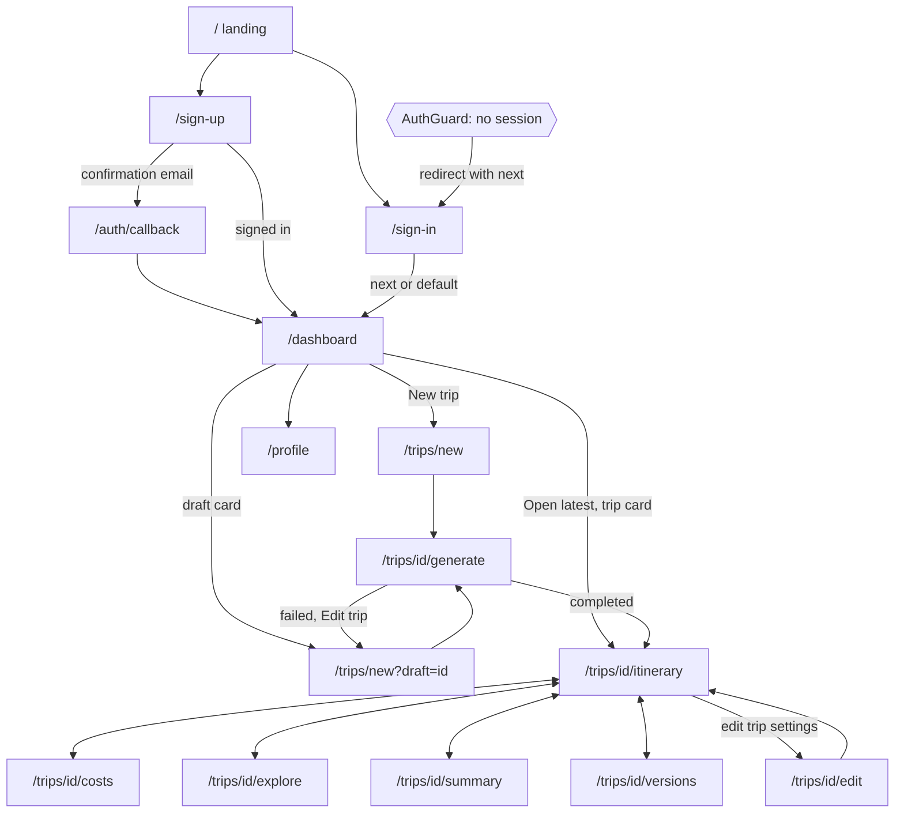

# 13 UI/UX

| Item | Value |
| --- | --- |
| Course document | 13 of the IT314 set ([index](README.md)), IMD-221 |
| Owner | Manasvi Rathore |
| Built from | `apps/web/app/`, `apps/web/components/`, `apps/web/app/globals.css`, [docs/guides/ui-design.md](../guides/ui-design.md) (IMD-118), [docs/guides/keyboard-map.md](../guides/keyboard-map.md), the IMP-513 and IMP-703 records, at `77e52ba` |

## 1. Screen inventory

Every route in `apps/web/app/`. Routes under `(app)` are wrapped by `app/(app)/layout.tsx`: `AuthGuard` → `AppShell` → page. The root `app/layout.tsx` wraps everything in `Providers` (`QueryClientProvider`, `Toaster`).

| Route | File | Purpose (from the file's own comment) | Component tree (main components) |
| --- | --- | --- | --- |
| `/` | `(public)/page.tsx` | Landing page (§7.5.1). Public, no API call | `AppShell` → `Button`, `Link` (sign-in, sign-up) |
| `/sign-in` | `(public)/sign-in/page.tsx` | Sign-in (§7.5.2); the form streams in behind `Suspense` | `AppShell` → `Suspense` → `SignInForm` → `AuthCard`, `Input`, `PasswordInput`, `Label`, `FieldError`, `Button` |
| `/sign-up` | `(public)/sign-up/page.tsx` | Sign-up (§7.5.2) | `AppShell` → `Suspense` → `SignUpForm` → `AuthCard`, `Input`, `PasswordInput`, `FieldError`, `Button` |
| `/auth/callback` | `auth/callback/route.ts` | Route handler, not a page: the Supabase confirmation-email link lands here (§7.2, §7.5.2) | none |
| `/dashboard` | `(app)/dashboard/page.tsx` | New trip, Open latest (API-09) and the traveller's trips (API-08) as cards with actions; archived trips only behind Show archived (FR-012 to FR-015) | `TripCard` → `TripActionsMenu`; `EmptyState`, `ErrorState`, `LoadingSkeleton`, `Button` |
| `/profile` | `(app)/profile/page.tsx` | Name, home currency and defaults (FR-004; API-03, API-04) | `ProfileForm` → `ChipMultiSelect`, `SegmentedChoice`, `Field`; `ErrorState`, `LoadingSkeleton` |
| `/trips/new` | `(app)/trips/new/page.tsx` | Trip wizard (§7.5.4); `?draft=<trip id>` reopens a saved draft (FR-013, IMP-410) | `TripWizard` → `TripStepper`; steps `TripDetailsStep` (→ `CitySearch`, `ChipMultiSelect`, `Field`), `PreferenceForm` (→ `SegmentedChoice`, `ChipMultiSelect`), `PlacesStep`, `ReviewStep`; `BudgetSettingsForm`, `LiveAttribution` |
| `/trips/{tripId}/edit` | `(app)/trips/[tripId]/edit/page.tsx` | The same wizard on an existing trip (FR-011) | `TripWizard editId` |
| `/trips/{tripId}/explore` | `(app)/trips/[tripId]/explore/page.tsx` | Active places of the destination from API-16, each with its source and verification status (FR-016) | `PlaceFilterBar`, `PlaceCard` (→ `SourceBadge`), `PlaceDetailDrawer` (→ `Dialog`, `SourceBadge`), `SavedPlacesPanel`, `TierBadge`, `LiveAttribution` |
| `/trips/{tripId}/generate` | `(app)/trips/[tripId]/generate/page.tsx` | Starts one generation (API-22) and keeps its ID in `?generation=` so a reload resumes polling (FR-024, FR-025) | `PrivacyNotice`, `GenerationProgress` (→ `PausedAiNotice`, `ErrorState`), `Button` |
| `/trips/{tripId}/itinerary` | `(app)/trips/[tripId]/itinerary/page.tsx` | Day-wise itinerary; day tabs below 768 px; the map loads on the client only (IMP-508) | `FallbackNotice`, `StalePlanBanner`, `WarningsPanel`, `Tabs`, `DayColumn` → `ItineraryItemCard` → `MoveControls`, `ItemEditor`, `AlternativesDialog`, `ItemSources`, `AiBadge`, `SourceBadge`; `PlacePicker` (→ `PlaceCard`); `MapPanel` (→ `MapListFallback`); `GenerationProgress`, `ConfirmDialog`, `TierBadge`, `LiveAttribution` |
| `/trips/{tripId}/costs` | `(app)/trips/[tripId]/costs/page.tsx` | Daily and category costs and budget settings (API-33, API-34); with `any_city_mode` ON it also reads the trip and API-79 (A2 §9.2) | `BudgetAlert`, `CostBreakdown` (→ `SourceBadge`), `BudgetSettingsForm`, `SourceBadge`, `TierBadge`, `LiveAttribution` |
| `/trips/{tripId}/summary` | `(app)/trips/[tripId]/summary/page.tsx` | API-35 as a printable page; Print uses the browser (IMP-609) | `PrintLayout` (→ `AiBadge`, `SourceBadge`), `LiveAttribution` |
| `/trips/{tripId}/versions` | `(app)/trips/[tripId]/versions/page.tsx` | History, Save version and Restore (API-36 to API-38, IMP-610) | `VersionList` (→ `ConfirmDialog`), `Input`, `Label`, `Button` |

Shared state components in `components/states/`: `EmptyState`, `ErrorState`, `LoadingSkeleton` and `ConfirmDialog` (IMP-104, IMP-412). The browser calls the API only through `lib/api/client.ts` and the query hooks in `lib/api/queries.ts`. Any-city calls use `lib/api/anyCityClient.ts`.

## 2. Navigation flow

`AppShell` (`components/shell/AppShell.tsx`) shows the links Trips (`/dashboard`) and Profile (`/profile`). Inside a trip it also shows Itinerary, Costs, Explore, Summary and Versions; Versions appears only when the `versions` switch is on. `AuthGuard` sends a signed-out user to `/sign-in` with `next`.

## 3. Design system notes

The binding guide is [docs/guides/ui-design.md](../guides/ui-design.md) (IMD-118). New or changed screens must follow it (CLAUDE.md §11).

### 3.1 Tailwind tokens

`apps/web/app/globals.css` imports Tailwind (`@import "tailwindcss"`), `tw-animate-css` and `shadcn/tailwind.css`. It defines the colour tokens on `:root` as oklch values, each commented with the guide's hex value. `@theme inline` maps them to Tailwind colour names. Components use only the token names (`bg-primary`, `text-muted-foreground`, `bg-success-soft`, `min-h-touch`), never raw colours, and a token change needs a guide update in the same pull request.

| Token group | Tokens (hex from the comments) |
| --- | --- |
| Base | `--background` #FAFAF9, `--foreground` #1C1917, `--card`, `--popover`, `--border` #E7E5E4, `--input` #948E89, `--ring` #0F766E, `--overlay` |
| Brand | `--primary` #0F766E, `--primary-hover` #115E59, `--secondary` #F0FDFA, `--secondary-foreground` #134E4A, `--muted` #F5F5F4, `--muted-foreground` #57534E, `--accent` |
| Destructive | `--destructive` #B91C1C, `--destructive-soft` #FEF2F2, `--destructive-soft-hover` #FEE2E2 (IMD-183) |
| Semantic soft pairs | `--success-foreground` #15803D / `--success-soft` #F0FDF4, `--warning-foreground` #B45309 / `--warning-soft` #FFFBEB, `--info-foreground` #1D4ED8 / `--info-soft` #EFF6FF, `--ai-foreground` #6D28D9 / `--ai-soft` #F5F3FF |
| Shape | `--radius` 0.75rem |

### 3.2 Components

- **`components/ui/`** (shadcn/ui primitives): `button`, `card`, `dialog`, `dropdown-menu`, `input`, `label`, `skeleton`, `sonner` (toasts) and `tabs`.
- **`components/labels/`** (labels the product requires): `AiBadge` (AI-written notes), `SourceBadge` (price and data source labels), `TierBadge` and `LiveAttribution` (live tier and licence attribution, A2 §9).
- **Other areas**: `auth`, `costs`, `generation`, `itinerary`, `map`, `places`, `profile`, `shell`, `states`, `trips` and `versions`.

### 3.3 Content and data rules

- The browser displays what the API returns. It never computes prices, totals, times or travel gaps (CLAUDE.md §4 rule 5).
- Dates are written like "Sat 14 Nov", times in 24-hour form ("09:30") and durations like "1 h 30 min". There are no exclamation marks (ui-design.md §17).
- Every estimate carries a label (FR-117). AI-written text carries the AI badge (FR-035).

## 4. Accessibility

### 4.1 Rules (ui-design.md §16)

- WCAG 2.1 AA contrast for text, and 3:1 for component boundaries.
- Visible focus on every interactive element: a 2 px ring in the `ring` colour with a 2 px offset, on `focus-visible` only.
- Touch targets of at least 44 px.
- One `h1` per page, with headings in order.
- Progress is announced with `aria-live="polite"`. Only blocking errors use assertive announcements.
- Colour never carries meaning alone.

`AppShell` also has a skip link to the main content (`MAIN_CONTENT_ID`). Keyboard reordering of items uses `MoveControls` (IMP-409). The keyboard order of every screen is in [keyboard-map.md](../guides/keyboard-map.md).

### 4.2 Evidence

| Card | What exists | Status |
| --- | --- | --- |
| IMP-513 Keyboard and assistive-technology support | [IMP-513-whole-task.md](../progress/parts/IMP-513-whole-task.md) with its RUN-070b, RUN-071, RUN-071 contrast, RUN-071b and RUN-071c sections: warning severity headings, axe logging, the dashboard "Open latest" contrast, Button colour-only animation, and focus returning to the moved item's controls | merged; open item TC-382 screen-reader pass (with IMP-703) |
| IMP-703 Accessibility check on real devices and fixes | [IMP-703-prepare.md](../progress/parts/IMP-703-prepare.md): local RUN-083b runs of `make e2e ARGS='journey'` (4 passed) and `make e2e ARGS='keyboard'` (4 passed), with every `axe scan` line `[]` and no serious or critical violation. The report template is [accessibility-sprint7.md](../test-reports/accessibility-sprint7.md) | PARTIAL: device and screen-reader sessions (TC-382) not run; the report's sections 2 to 5 are empty |
| E2E checks | `apps/web/e2e/axe.ts`, `keyboard.spec.ts` (TC-374), `journey.spec.ts` (TC-383), `smoke.spec.ts` ("/dashboard fits the viewport" at 360 and 768 px, IMD-207) | run in CI by the E2E workflow |

## 5. Screenshots

Screenshots already in the repository:

| Screen | Files |
| --- | --- |
| App shell (IMP-104) | [1280 px](../progress/parts/IMP-104-whole-task-1280.png), [360 px](../progress/parts/IMP-104-whole-task-360.png) |
| Sign-up errors (IMP-109) | [360 px](../progress/parts/IMP-109-whole-task-signup-errors-360.png) |
| Trip wizard steps (IMP-212) | `docs/progress/parts/IMP-212-screens/`: [1-details-360](../progress/parts/IMP-212-screens/1-details-360.png), [1-details-1280](../progress/parts/IMP-212-screens/1-details-1280.png), [2-preferences-360](../progress/parts/IMP-212-screens/2-preferences-360.png), [2-preferences-1280](../progress/parts/IMP-212-screens/2-preferences-1280.png), [3-places-360](../progress/parts/IMP-212-screens/3-places-360.png), [3-places-1280](../progress/parts/IMP-212-screens/3-places-1280.png), [4-review-360](../progress/parts/IMP-212-screens/4-review-360.png), [4-review-1280](../progress/parts/IMP-212-screens/4-review-1280.png) |
| Generate page and read-only itinerary (IMP-213) | `docs/progress/parts/IMP-213-screens/`: [1-generate-idle-360](../progress/parts/IMP-213-screens/1-generate-idle-360.png), [1-generate-idle-1280](../progress/parts/IMP-213-screens/1-generate-idle-1280.png), [2-generate-running-360](../progress/parts/IMP-213-screens/2-generate-running-360.png), [2-generate-running-1280](../progress/parts/IMP-213-screens/2-generate-running-1280.png), [3-generate-completed-360](../progress/parts/IMP-213-screens/3-generate-completed-360.png), [3-generate-completed-1280](../progress/parts/IMP-213-screens/3-generate-completed-1280.png), [4-itinerary-360](../progress/parts/IMP-213-screens/4-itinerary-360.png), [4-itinerary-1280](../progress/parts/IMP-213-screens/4-itinerary-1280.png) |
| Privacy notice (IMP-305) | [1280 px](../progress/parts/IMP-305-privacy-screens/notice-1280.png), [360 px](../progress/parts/IMP-305-privacy-screens/notice-360.png) |
| Day-wise itinerary (IMP-309) | [1280 px](../progress/parts/IMP-309-day-view-screens/itinerary-1280.png), [375 px](../progress/parts/IMP-309-day-view-screens/itinerary-375.png) |
| Item sources (IMP-317) | [1280 px](../progress/parts/IMP-317-screens/item-sources-1280.png), [375 px](../progress/parts/IMP-317-screens/item-sources-375.png) |
| Local Gemini itinerary with "Sources (1)" (SG-3) | [sg3-local-gemini-itinerary.png](../progress/gates/sg3-local-gemini-itinerary.png) |

No screenshot is in the repository for: dashboard, profile, explore, costs, summary, versions, warnings panel, item editor, move controls, alternatives dialog, map, city search and import progress. These are **to be added at demo**.
