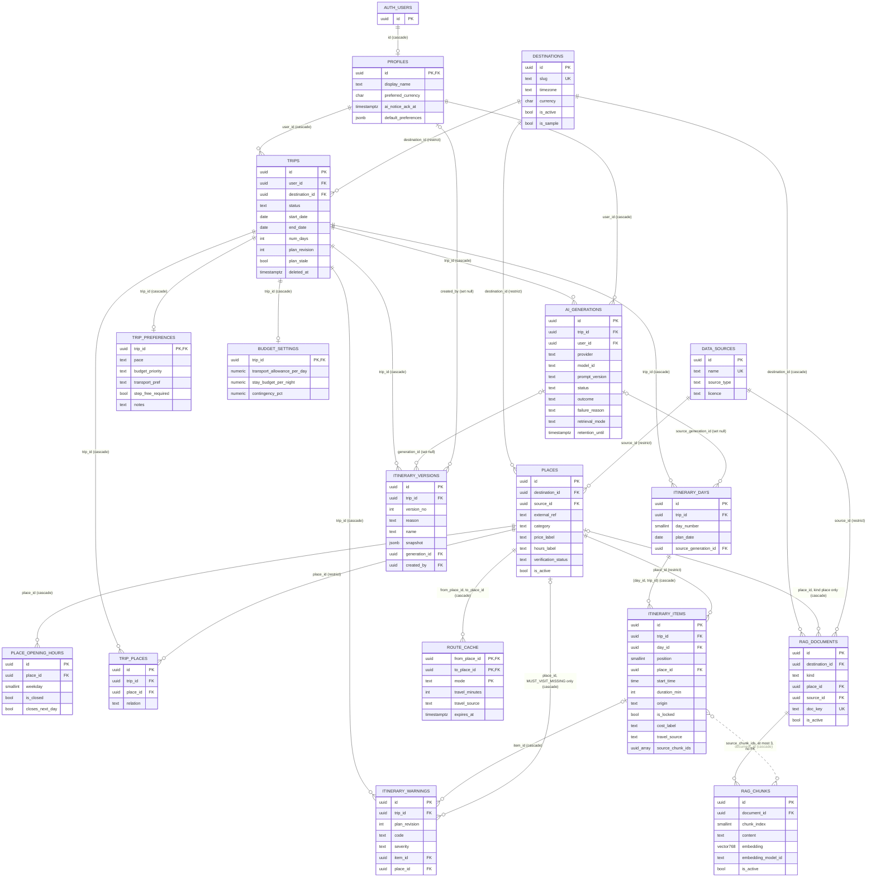

# Software Requirements Specification: AI Travel Planner

| Item | Value |
| --- | --- |
| Document | Software Requirements Specification (SRS) with the data model section |
| Owner | Malhar Mer (IMP-707 lead, part "SRS and data model section") |
| Version | 1.0 (draft for SG-7), 19 November 2026 |
| Card | IMP-707, US-145, NFR-022, NFR-027, NFR-032, NFR-033 |
| Built from | `docs/spec/IMPLEMENTATION_SPEC.md` v1.3 §1, §2, §3 and §5; `docs/spec/AMENDMENT_A1_AWS_RAG.md` (A1) §2, §3, §5, §6, §9; `docs/spec/DECISION_REGISTER.md`; the migrations in `apps/api/migrations/sql/`; the progress records in `docs/progress/` |
| Repository state described | `main` at `f75aa94` (19 November 2026) |
| Related documents | [Architecture](architecture.md), [API](api.md), [Test plan](test-plan.md) |

**Precedence.** The specification v1.4 (v1.3 plus Amendment A1) is the binding source. This document assembles it for readers of the course document set and records where the built system differs (section 11). Where this document and the specification disagree, the specification wins. The full acceptance criteria of every requirement are in the specification §2.2 and A1 §9; they are not repeated here.

## 1. Introduction

### 1.1 Purpose

The AI Travel Planner is a web application in which a signed-in traveller describes a trip (destination, dates, travellers, budget, pace, interests, must-visit places) and receives a day-wise itinerary that is feasible, costed and editable (specification §1.1). This SRS states the requirements of the MVP release and the data model that stores them.

### 1.2 Scope of the release

- The MVP is 38 catalogue items with release code MVP or MVP-S, implemented through 88 functional requirements (63 MVP, 25 MVP-S; specification §1.2).
- Amendment A1 adds catalogue item C-13 "Retrieval-augmented Generation with Cited Sources" (FR-136 to FR-140, release MVP, not on the cut list; A1 §9.1, IMD-105).
- The nine extensions of §2.5 (release EXT) are cut and not built (IMD-65; IMP-515 and IMP-612 also IMD-186).
- Requirements with release T1, R2, PP or Stage 2 are outside the release (§1.3, §2.6).
- In-app flight and hotel booking, payments and live prices are excluded (IMD-46).

### 1.3 Definitions

| Term | Meaning |
| --- | --- |
| MVP / MVP-S | Mandatory release items; MVP-S ships the simplified behaviour stated in its requirement (§1.2) |
| EXT | Extension release code (§2.5); all nine extensions are cut (IMD-65) |
| Cut list | Nine MVP items that can be switched off with `FEATURES_DISABLED`, in the order C-11, F-52, F-22, F-20, F-08, F-14, F-15, C-02, F-40 (§1.2) |
| Finding | A validation result with one of 13 codes (§8.12), stored in `itinerary_warnings` |
| Label | `curated`, `estimate` or `unavailable` on every price, hours and cost value; `routing_api` or `fallback_estimate` on every travel time (§6.1) |
| SAMPLE | Synthetic fixture data (destination Sampleton), allowed only in local and test (§5.6) |
| RAG | Retrieval-augmented generation: place records and team-written guides are chunked, embedded and searched with pgvector, and the best passages are given to Gemini as quoted data (A1 §6) |
| Passage, citation | A chunk sent to the model (`context_passages`), and a chunk ID an item cites (`source_ids`, stored as `itinerary_items.source_chunk_ids`) |

### 1.4 References

- `docs/spec/IMPLEMENTATION_SPEC.md` (v1.3) and `docs/spec/AMENDMENT_A1_AWS_RAG.md` (v1.4 changes).
- `docs/spec/DECISION_REGISTER.md` (IMD-1 to IMD-209), `docs/spec/TRACEABILITY_MATRIX.md`, `docs/spec/TASK_REGISTER.md`.
- `contracts/openapi.v1.json` (API contract) and `contracts/ai/` (AI JSON Schemas gr-1, gr-2, io-1, io-2).
- `apps/api/migrations/sql/0001` to `0007` (schema source of truth, IMD-01).
- `docs/progress/gates.md`, `docs/progress/sprint-6.md` (requirement coverage), `docs/progress/deferred.md`.

## 2. Overall description

### 2.1 Product perspective

The system has three parts: a Next.js web app in the browser, a FastAPI backend (a modular monolith), and one PostgreSQL 16 database with pgvector. The browser talks only to Supabase Auth (sign-in) and the API. Only the API reaches the database, Gemini (generation and embeddings) and OpenRouteService (A1 §3). The architecture is described in [architecture.md](architecture.md).

### 2.2 Users

| User | Needs |
| --- | --- |
| Traveller (signed in) | Create trips, set preferences and must-visit places, generate, read, edit and version itineraries, see labelled costs and sources |
| Visitor (not signed in) | Landing page, sign-up and sign-in only |
| Curator (team member) | Add curated places and destination guides with provenance (US-166) |
| Evaluator (team member) | Run the evaluation harness and the retrieval suite (US-167) |
| Operator (Kirtan, AWS account owner) | Deploy, run the release task, carry out the account-deletion procedure (NFR-022, A1 §5.1) |

There is no administrator UI (§1.3).

### 2.3 Main journey

The primary journey is specification §1.6, steps 1 to 7: sign up or sign in; create a trip with preferences and must-visit places; press Generate after the first-use privacy notice; read the itinerary, warnings and costs; edit (move, remove, add, retime, replace, lock, regenerate a day); save a version and reopen the trip later; view the final summary. A1 adds to step 3 that the trip's preferences are embedded and similar place and guide passages are retrieved and passed to Gemini.

### 2.4 Constraints

- Stack fixed by §1.4 and A1 §2 (Next.js, FastAPI, SQLAlchemy 2 async with psycopg 3, Alembic running SQL files, PostgreSQL 16 with pgvector, Supabase Auth, Gemini through `google-genai` behind `ModelProvider`, OpenRouteService, AWS ECS Express Mode).
- The model may only choose place IDs from the shortlist it was given, their order, times and short notes; prices, opening hours, travel times, totals and availability always come from data and code (§1.8, CLAUDE.md §8).
- No LangChain or other RAG framework and no separate vector database (IMD-105).
- One API container, one web container, one database (§1.3, A1 §1).
- Feature freeze from Sprint 7: only defects, hardening, documents, data loading and planned Sprint 7 and 8 cards are merged; contracts, tables 0001 to 0007, finding and error codes and environment variable names are frozen (IMD-201, `docs/progress/gates.md` SG-6).

### 2.5 Assumptions and open decisions

The open decisions and their Provisional defaults are listed in §1.9 and Appendix B of the specification; the decisions taken since are in the decision register. Decisions that change behaviour described here are listed in section 11.

## 3. Catalogue items in the release

Source: specification §2.1 (38 MVP and MVP-S items) and A1 §9.1 (C-13).

| ID | Catalogue item | Release | Functional requirements | Sprints | Cut list |
| --- | --- | --- | --- | --- | --- |
| F-01 | User Onboarding and Profile | MVP-S | FR-001 to FR-005 | 1, 2, 6 | — |
| F-02 | Trip Creation | MVP | FR-007, FR-008, FR-011 | 2, 5 | — |
| F-03 | Trip Requirements and Preferences | MVP-S | FR-009 to FR-011, FR-026 | 2, 3, 5 | — |
| F-04 | Trip Dashboard | MVP-S | FR-012 | 6 | — |
| F-05 | Explore Places and Experiences | MVP-S | FR-016, FR-018, FR-022, FR-023 | 2, 5, 6 | — |
| F-06 | Smart Search and Filtering | MVP-S | FR-017 | 6 | — |
| F-08 | Saved Places and Wishlist | MVP-S | FR-020 | 6 | Cut 5 (`wishlist`) |
| F-09 | Personalized Day-wise Itinerary | MVP | FR-024 to FR-028, FR-031, FR-033, FR-036 to FR-047, FR-059, FR-118 to FR-120, FR-123 | 1, 2, 3, 4, 5 | — |
| F-10 | Constraint-aware Planning | MVP | FR-027, FR-028, FR-033, FR-034 | 3, 4 | — |
| F-11 | Interactive Itinerary Customization | MVP | FR-062 to FR-064, FR-069 | 4, 5 | — |
| F-12 | Activity Reordering and Removal | MVP | FR-060, FR-061 | 4 | — |
| F-13 | Add a User-selected Place | MVP | FR-062 | 5 | — |
| F-14 | Replace an Activity | MVP-S | FR-065 | 5 | Cut 6 (`alternatives`) |
| F-15 | Partial or Full Itinerary Regeneration | MVP-S | FR-067, FR-068 | 6 | Cut 7 (`regeneration`) |
| F-16 | Travel Pace Adjustment | MVP | FR-029 | 5 | — |
| F-17 | Itinerary Warnings and Repair Feedback | MVP | FR-053, FR-054, FR-056 | 4, 5 | — |
| F-18 | Trip Cost Estimator | MVP | FR-033, FR-071, FR-072 | 3, 4 | — |
| F-19 | Daily and Category-wise Cost Breakdown | MVP | FR-073 | 5 | — |
| F-20 | Budget Alerts | MVP-S | FR-074 | 6 | Cut 4 (`budget_alerts`) |
| F-22 | Contingency Budget | MVP-S | FR-075 | 6 | Cut 3 (`contingency`) |
| F-23 | Estimated versus Verified Prices | MVP | FR-018, FR-076, FR-117 | 4, 5, 6 | — |
| F-34 | Route and Travel-time Estimates | MVP | FR-078, FR-079 | 2, 3 | — |
| F-35 | Map and Route Visualization | MVP-S | FR-080 | 5 | — |
| F-36 | Group Nearby Places | MVP | FR-030 | 5 | — |
| F-37 | Transfer and Schedule Warnings | MVP | FR-051, FR-053 | 4, 5 | — |
| F-40 | Food and Restaurant Recommendations | MVP-S | FR-083 | 6 | Cut 9 (`meal_slots`) |
| F-42 | Activity Categories and Suitability | MVP-S | FR-016, FR-019 | 2, 5 | — |
| F-50 | Final Trip Summary | MVP | FR-059, FR-094 | 2, 6 | — |
| F-51 | Save Drafts and Continue Later | MVP | FR-013 | 4 | — |
| F-52 | Rename, Duplicate, Archive and Delete Trips | MVP-S | FR-015 | 6 | Cut 2 (`trip_management`) |
| F-54 | Latest Saved Itinerary | MVP | FR-014 | 4 | — |
| C-02 | Context-aware, Targeted Replanning | MVP-S | FR-066, FR-067 | 5, 6 | Cut 8 (`locks`) |
| C-07 | Structured AI Output and Validation | MVP | FR-031, FR-032, FR-041, FR-118, FR-119 | 3, 4 | — |
| C-08 | Grounded Recommendations and Source Labels | MVP-S | FR-018, FR-022, FR-035, FR-076, FR-117 | 2, 4, 5, 6 | — |
| C-09 | Automated Itinerary Conflict Checks | MVP | FR-050 to FR-052, FR-054, FR-055, FR-058 | 4, 5 | — |
| C-10 | Bounded Itinerary Repair | MVP-S | FR-057, FR-058 | 4, 5 | — |
| C-11 | Trip Versioning and Change Recovery | MVP-S | FR-095 | 6 | Cut 1 (`versions`) |
| C-12 | Accessible, Responsive Experience | MVP | FR-114 to FR-116 | 1, 4, 5 | — |
| C-13 | Retrieval-augmented Generation with Cited Sources | MVP | FR-136 to FR-140 | 2, 3, 4 | — (not on the cut list; IMD-105) |

**Cut-list state.** No cut-list switch is applied in any configuration: `FEATURES_DISABLED` defaults to `""` in `apps/api/app/core/config.py` (IMD-167; `docs/progress/deferred.md`). The floor journey with all nine switches off passed at SG-6 (`docs/progress/gates.md`, SG-6 row 2c).

## 4. Functional requirements

### 4.1 MVP and MVP-S requirements

Source: specification §2.2. Each requirement's "shall" statement and acceptance criteria (AC1, AC2, ...) are in §2.2; the table gives the title, priority, release, owning module, first sprint, implementing tasks and test cases. The SG-6 gate recorded 88 of 88 requirements as Done (63 MVP, 25 MVP-S), meaning every task the traceability matrix names has a part record on `main` at `fd7ae14` and its tests are in suites that passed in CI (`docs/progress/sprint-6.md`, "Requirement coverage").

**AUTH — Accounts and access control**

| ID | Requirement | Priority | Release | Owning module | Sprint | Tasks | Tests |
| --- | --- | --- | --- | --- | --- | --- | --- |
| FR-001 | Register an account | Must | MVP-S | MOD-F01 | 1 | IMP-109 | TC-051, TC-052, TC-053, TC-366 (+1) |
| FR-002 | Sign in, keep a session and sign out | Must | MVP-S | MOD-F01 | 1 | IMP-109 | TC-054, TC-055, TC-056, TC-347 |
| FR-003 | Verify the token on every protected request | Must | MVP | MOD-B02 | 1 | IMP-108 | TC-057, TC-058, TC-059, TC-344 (+2) |
| FR-004 | Maintain a short profile | Should | MVP-S | MOD-B02, MOD-F01 | 6 | IMP-601 | TC-060, TC-061, TC-062 |
| FR-005 | Enforce owner-only access to private data | Must | MVP | MOD-B02 | 2 | IMP-215 | TC-063, TC-064, TC-065, TC-345 (+3) |

**TRIP — Trip setup, dashboard and management**

| ID | Requirement | Priority | Release | Owning module | Sprint | Tasks | Tests |
| --- | --- | --- | --- | --- | --- | --- | --- |
| FR-007 | Create a trip | Must | MVP | MOD-B03, MOD-B09, MOD-F02 | 2 | IMP-203, IMP-212 | TC-068, TC-069, TC-070, TC-369 (+1) |
| FR-008 | Validate trip inputs | Must | MVP | MOD-B03, MOD-B09, MOD-F02 | 2 | IMP-203, IMP-212 | TC-071, TC-072, TC-073 |
| FR-009 | Capture preferences and constraints | Must | MVP-S | MOD-B03, MOD-B06, MOD-F02 | 2 | IMP-204, IMP-212 | TC-074, TC-075, TC-076 |
| FR-010 | Map preferences to filters and ranking weights | Must | MVP-S | MOD-B03, MOD-B06 | 2 | IMP-204 | TC-077, TC-078, TC-079 |
| FR-011 | Edit trip settings and flag a stale plan | Should | MVP-S | MOD-B03, MOD-F02, MOD-F04 | 5 | IMP-510 | TC-080, TC-081 |
| FR-012 | Show a trip dashboard | Must | MVP-S | MOD-B03, MOD-F02 | 6 | IMP-602 | TC-082, TC-083, TC-084, TC-329 (+2) |
| FR-013 | Save drafts and continue later | Must | MVP | MOD-B03, MOD-B08, MOD-F02 | 4 | IMP-410 | TC-085, TC-086 |
| FR-014 | Reopen the latest saved itinerary | Must | MVP | MOD-B03, MOD-B08, MOD-F02 | 4 | IMP-410 | TC-087, TC-088 |
| FR-015 | Rename, duplicate, archive and delete trips | Should | MVP-S | MOD-B03, MOD-F02 | 6 | IMP-602 | TC-089, TC-090, TC-091, TC-372 |

**PLACE — Places data and discovery**

| ID | Requirement | Priority | Release | Owning module | Sprint | Tasks | Tests |
| --- | --- | --- | --- | --- | --- | --- | --- |
| FR-016 | Browse places for a destination | Must | MVP-S | MOD-B04, MOD-F03 | 5 | IMP-509 | TC-092, TC-093, TC-094 |
| FR-017 | Search and filter places | Must | MVP-S | MOD-B04, MOD-F03 | 6 | IMP-604 | TC-095, TC-096, TC-097 |
| FR-018 | Show place detail with labelled facts | Must | MVP-S | MOD-B04, MOD-F03 | 6 | IMP-604 | TC-098, TC-099, TC-100 |
| FR-019 | Classify activities and suitability | Should | MVP-S | MOD-B04, MOD-D02 | 2 | IMP-205 | TC-101, TC-102 |
| FR-020 | Save places to a wishlist | Should | MVP-S | MOD-B04, MOD-B06, MOD-F03 | 6 | IMP-605 | TC-103, TC-104, TC-105, TC-372 |
| FR-022 | Load places through a provenance-preserving import | Must | MVP | MOD-B04, MOD-D02 | 2 | IMP-205 | TC-108, TC-109, TC-110 |
| FR-023 | Gate place data quality | Must | MVP | MOD-B04, MOD-D02 | 2 | IMP-205 | TC-111, TC-112, TC-113 |

**GEN — Itinerary generation**

| ID | Requirement | Priority | Release | Owning module | Sprint | Tasks | Tests |
| --- | --- | --- | --- | --- | --- | --- | --- |
| FR-024 | Start itinerary generation | Must | MVP | MOD-B05, MOD-B06, MOD-B08 (+2) | 2 | IMP-210, IMP-213, IMP-305 | TC-114, TC-115, TC-116, TC-369 (+1) |
| FR-025 | Report generation progress and result | Must | MVP | MOD-B05, MOD-B06, MOD-B08 (+2) | 2 | IMP-210, IMP-213, IMP-305 | TC-117, TC-118, TC-119, TC-309 |
| FR-026 | Build the normalized generation request | Must | MVP | MOD-B05, MOD-B06 | 3 | IMP-303 | TC-028, TC-120, TC-121, TC-122 |
| FR-027 | Retrieve and filter candidate places | Must | MVP | MOD-B04, MOD-B06 | 3 | IMP-304 | TC-123, TC-124, TC-125 |
| FR-028 | Rank candidates | Must | MVP | MOD-B04, MOD-B06 | 3 | IMP-304 | TC-126, TC-127, TC-128 |
| FR-029 | Apply travel pace presets | Must | MVP-S | MOD-B06, MOD-B15, MOD-F02 | 5 | IMP-503 | TC-129, TC-130 |
| FR-030 | Group nearby places into days | Must | MVP | MOD-B06, MOD-B15, MOD-F02 | 5 | IMP-503 | TC-131, TC-132 |
| FR-031 | Compose a structured itinerary through the active provider | Must | MVP | MOD-B05, MOD-B06, MOD-B08 (+1) | 3 | IMP-305 | TC-003, TC-036, TC-133, TC-134 (+3) |
| FR-032 | Validate model output against schema and place IDs | Must | MVP | MOD-B06, MOD-B07 | 3 | IMP-306 | TC-011, TC-022, TC-023, TC-028 (+4) |
| FR-033 | Recalculate times, durations and costs in code | Must | MVP | MOD-B06, MOD-B09, MOD-B10 | 3 | IMP-308 | TC-139, TC-140 |
| FR-034 | Preserve explicit constraints and must-visit places | Must | MVP | MOD-B06, MOD-B07, MOD-B08 (+1) | 4 | IMP-406 | TC-141, TC-142 |
| FR-035 | Separate AI-written text from retrieved data | Must | MVP-S | MOD-B06, MOD-B07, MOD-B08 (+1) | 4 | IMP-406 | TC-143, TC-144 |
| FR-036 | Provide a rule-based fallback itinerary | Must | MVP | MOD-B06, MOD-B07 | 4 | IMP-402 | TC-145, TC-146, TC-147, TC-307 (+3) |
| FR-037 | Handle provider failure, timeout and quota exhaustion | Must | MVP | MOD-B06, MOD-F04 | 4 | IMP-403 | TC-005, TC-017, TC-148, TC-149 (+5) |
| FR-038 | Record every generation | Must | MVP | MOD-B05, MOD-B06, MOD-B08 | 2 | IMP-202, IMP-210 | TC-004, TC-012, TC-024, TC-029 (+6) |
| FR-039 | Control prompt content and size | Must | MVP | MOD-B05, MOD-B06 | 3 | IMP-303 | TC-014, TC-027, TC-154, TC-155 |

**PROV — AI provider layer**

| ID | Requirement | Priority | Release | Owning module | Sprint | Tasks | Tests |
| --- | --- | --- | --- | --- | --- | --- | --- |
| FR-040 | Define the ModelProvider interface | Must | MVP | MOD-B05, MOD-P01 | 1 | IMP-110, IMP-512 | TC-001, TC-002, TC-003, TC-005 (+5) |
| FR-041 | Implement the Gemini adapter | Must | MVP | MOD-B05 | 3 | IMP-301 | TC-004, TC-009, TC-013, TC-014 (+17) |
| FR-042 | Implement the mock adapter | Must | MVP | MOD-B05 | 2 | IMP-207 | TC-033, TC-034, TC-035, TC-036 (+2) |
| FR-043 | Select the active provider by configuration | Must | MVP | MOD-B01, MOD-B05 | 2 | IMP-208 | TC-013, TC-037, TC-042, TC-043 (+3) |
| FR-044 | Check provider health and expose metadata | Must | MVP | MOD-B01, MOD-B05 | 3 | IMP-302 | TC-006, TC-007, TC-044, TC-167 (+1) |
| FR-045 | Keep a versioned prompt-template registry | Must | MVP | MOD-B05 | 1 | IMP-111 | TC-026, TC-169, TC-170 |
| FR-046 | Limit usage and cost | Must | MVP | MOD-B01, MOD-B05, MOD-B06 | 5 | IMP-511 | TC-171, TC-172, TC-173, TC-310 (+2) |
| FR-047 | Handle rate limits with bounded retries | Must | MVP | MOD-B05 | 4 | IMP-401 | TC-009, TC-010, TC-016, TC-174 (+1) |

**VAL — Validation and repair**

| ID | Requirement | Priority | Release | Owning module | Sprint | Tasks | Tests |
| --- | --- | --- | --- | --- | --- | --- | --- |
| FR-050 | Detect schedule overlaps | Must | MVP | MOD-B07 | 4 | IMP-404 | TC-176, TC-177, TC-306, TC-334 |
| FR-051 | Detect insufficient travel gaps | Must | MVP | MOD-B07 | 4 | IMP-404 | TC-178, TC-179, TC-317 |
| FR-052 | Detect opening-hour conflicts | Must | MVP | MOD-B07, MOD-B09 | 5 | IMP-501 | TC-180, TC-181, TC-301, TC-302 |
| FR-053 | Detect overpacked days | Must | MVP | MOD-B07, MOD-B09 | 5 | IMP-501 | TC-182, TC-183, TC-303 |
| FR-054 | Detect budget conflicts | Must | MVP | MOD-B07, MOD-B09 | 5 | IMP-501 | TC-184, TC-185, TC-304 |
| FR-055 | Detect missing constraints and invalid references | Must | MVP | MOD-B07 | 4 | IMP-404 | TC-186, TC-187, TC-305 |
| FR-056 | Produce structured warnings with suggested fixes | Must | MVP | MOD-B07, MOD-B08, MOD-F04 | 4 | IMP-405 | TC-188, TC-189 |
| FR-057 | Repair within bounds | Must | MVP-S | MOD-B05, MOD-B06, MOD-B07 | 5 | IMP-502 | TC-011, TC-190, TC-191, TC-192 (+1) |
| FR-058 | Persist validation results | Must | MVP | MOD-B07, MOD-B08, MOD-F04 | 4 | IMP-405 | TC-193, TC-194 |

**EDIT — Itinerary editing**

| ID | Requirement | Priority | Release | Owning module | Sprint | Tasks | Tests |
| --- | --- | --- | --- | --- | --- | --- | --- |
| FR-059 | View the day-wise itinerary | Must | MVP | MOD-B08, MOD-F04, MOD-F07 | 2 | IMP-211, IMP-309 | TC-195, TC-196, TC-329, TC-369 |
| FR-060 | Reorder activities | Must | MVP | MOD-B08, MOD-F04 | 4 | IMP-409 | TC-197, TC-198, TC-199, TC-374 |
| FR-061 | Remove an activity | Must | MVP | MOD-B08, MOD-F04 | 4 | IMP-408 | TC-200, TC-201 |
| FR-062 | Add a user-selected place | Must | MVP | MOD-B08, MOD-F04 | 5 | IMP-504 | TC-202, TC-203 |
| FR-063 | Change start time or duration | Must | MVP | MOD-B08, MOD-F04 | 4 | IMP-408 | TC-204, TC-205 |
| FR-064 | Recalculate after every edit | Must | MVP | MOD-B07, MOD-B08, MOD-B09 | 4 | IMP-407 | TC-206, TC-207, TC-312, TC-330 (+1) |
| FR-065 | Replace an activity with a ranked alternative | Should | MVP-S | MOD-B06, MOD-B08, MOD-B09 (+1) | 5 | IMP-505 | TC-208, TC-209, TC-210, TC-372 |
| FR-066 | Lock and unlock items | Should | MVP-S | MOD-B06, MOD-B07, MOD-B08 (+1) | 5 | IMP-506 | TC-211, TC-212, TC-313, TC-372 (+1) |
| FR-067 | Regenerate one day | Should | MVP-S | MOD-B06, MOD-B08, MOD-F04 | 6 | IMP-607 | TC-213, TC-214, TC-313, TC-372 (+1) |
| FR-068 | Regenerate the whole itinerary | Should | MVP-S | MOD-B06, MOD-B08, MOD-F04 | 6 | IMP-607 | TC-215, TC-216 |
| FR-069 | Reject stale edits | Should | MVP | MOD-B08, MOD-F04 | 5 | IMP-504 | TC-217, TC-318, TC-325, TC-412 |

**COST — Costs and budget**

| ID | Requirement | Priority | Release | Owning module | Sprint | Tasks | Tests |
| --- | --- | --- | --- | --- | --- | --- | --- |
| FR-071 | Estimate trip cost | Must | MVP | MOD-B06, MOD-B09, MOD-B10 | 3 | IMP-308 | TC-221, TC-222, TC-295, TC-296 (+7) |
| FR-072 | Collect transport allowance and stay budget | Must | MVP | MOD-B09, MOD-F02, MOD-F07 | 4 | IMP-411 | TC-223, TC-224 |
| FR-073 | Show daily and category cost breakdown | Must | MVP | MOD-B09, MOD-F06, MOD-F07 | 5 | IMP-507 | TC-225, TC-226, TC-300 |
| FR-074 | Alert near and over budget | Should | MVP-S | MOD-B09, MOD-F06 | 6 | IMP-608 | TC-227, TC-228, TC-372 |
| FR-075 | Include a contingency buffer | Should | MVP-S | MOD-B09, MOD-F06 | 6 | IMP-608 | TC-229, TC-230, TC-298, TC-300 (+1) |
| FR-076 | Label price sources and verification status | Must | MVP | MOD-B09, MOD-F02, MOD-F07 | 4 | IMP-411 | TC-231, TC-232, TC-299, TC-314 (+1) |

**ROUTE — Routes and maps**

| ID | Requirement | Priority | Release | Owning module | Sprint | Tasks | Tests |
| --- | --- | --- | --- | --- | --- | --- | --- |
| FR-078 | Estimate travel time between stops | Must | MVP | MOD-B10 | 3 | IMP-307 | TC-234, TC-235, TC-341 |
| FR-079 | Fall back to a distance-based estimate | Must | MVP | MOD-B10 | 2 | IMP-209 | TC-236, TC-237, TC-317 |
| FR-080 | Show places and routes on a map | Must | MVP-S | MOD-F04, MOD-F05 | 5 | IMP-508 | TC-238, TC-239, TC-240 |

**FOOD — Food and meal slots**

| ID | Requirement | Priority | Release | Owning module | Sprint | Tasks | Tests |
| --- | --- | --- | --- | --- | --- | --- | --- |
| FR-083 | Include food in the plan | Should | MVP-S | MOD-B06, MOD-D02, MOD-F04 | 6 | IMP-606 | TC-243, TC-244, TC-372 |

**MGMT — Summary and versions**

| ID | Requirement | Priority | Release | Owning module | Sprint | Tasks | Tests |
| --- | --- | --- | --- | --- | --- | --- | --- |
| FR-094 | Produce a final trip summary | Must | MVP | MOD-B08, MOD-B09, MOD-F06 | 6 | IMP-609 | TC-254, TC-255, TC-369, TC-372 |
| FR-095 | Keep itinerary versions | Should | MVP-S | MOD-B08, MOD-F04 | 6 | IMP-610 | TC-256, TC-257, TC-318, TC-319 (+2) |

**UX — Experience and accessibility**

| ID | Requirement | Priority | Release | Owning module | Sprint | Tasks | Tests |
| --- | --- | --- | --- | --- | --- | --- | --- |
| FR-114 | Provide responsive layouts | Must | MVP | MOD-F01, MOD-F04, MOD-F07 | 1 | IMP-104, IMP-703 | TC-278, TC-328, TC-339, TC-373 |
| FR-115 | Support keyboard and assistive technology | Must | MVP | MOD-F04, MOD-F07 | 5 | IMP-513, IMP-703 | TC-279, TC-280, TC-374, TC-382 (+1) |
| FR-116 | Show understandable states and errors | Must | MVP | MOD-F07 | 4 | IMP-412 | TC-281, TC-384 |
| FR-117 | Show estimate labels wherever estimates appear | Must | MVP | MOD-B09, MOD-F06, MOD-F07 | 5 | IMP-507 | TC-282, TC-385 |

**EVAL — Evaluation**

| ID | Requirement | Priority | Release | Owning module | Sprint | Tasks | Tests |
| --- | --- | --- | --- | --- | --- | --- | --- |
| FR-118 | Maintain a versioned evaluation dataset | Must | MVP | MOD-B15 | 3 | IMP-310 | TC-283, TC-284, TC-386, TC-395 |
| FR-119 | Run an evaluation harness against any provider | Must | MVP | MOD-B06, MOD-B07, MOD-B09 (+1) | 4 | IMP-413 | TC-041, TC-285, TC-286, TC-387 (+4) |
| FR-120 | Record evaluation runs | Must | MVP | MOD-B05, MOD-B15 | 5 | IMP-514, IMP-705 | TC-287, TC-390, TC-391, TC-392 |

**PLAT — Platform**

| ID | Requirement | Priority | Release | Owning module | Sprint | Tasks | Tests |
| --- | --- | --- | --- | --- | --- | --- | --- |
| FR-123 | Expose health and version | Must | MVP | MOD-B01, MOD-P01 | 1 | IMP-103, IMP-112, IMP-201 | TC-288, TC-289, TC-342 |
| FR-124 | Validate configuration at start-up | Must | MVP | MOD-B01, MOD-P01 | 1 | IMP-103, IMP-105 | TC-042, TC-043, TC-290, TC-291 (+6) |
| FR-125 | Log requests with correlation IDs | Should | MVP | MOD-B01 | 2 | IMP-201 | TC-292, TC-293, TC-342, TC-358 (+1) |
| FR-126 | Rate-limit expensive endpoints | Should | MVP | MOD-B01, MOD-B05, MOD-B06 | 5 | IMP-511 | TC-294, TC-353 |

### 4.2 Retrieval-augmented generation (A1 §9.1)

| ID | Requirement | Acceptance criteria (summary of A1 §9.1) | Story | Tasks |
| --- | --- | --- | --- | --- |
| FR-136 | Corpus ingestion with provenance | Every active place and every guide that passes the gate is chunked and embedded; each chunk resolves to its document and data source; a guide with missing provenance, out-of-range length or a price, opening-hour or travel-time statement fails the strict gate; re-indexing embeds only new or changed chunks and deactivates removed documents | US-166 | IMP-313, IMP-314 |
| FR-137 | Semantic retrieval with fallback | The trip's preferences are embedded once per generation; similar chunks of the trip's destination are retrieved by cosine similarity; semantic similarity reorders candidates inside the deterministic ranking; without embeddings the generation continues with `retrieval_mode = lexical_fallback` | US-164 | IMP-315 |
| FR-138 | Grounded generation with validated citations | Passages reach the model only as quoted data with their IDs; an item cites at most three passage IDs of its own request, any other is dropped and counted; the saved plan records citations and the generation record names the retrieval mode and embedding model | US-164 | IMP-316 |
| FR-139 | Sources shown with AI-written notes | API-24 lists each item's sources (title, kind, source name, licence or attribution, link, retrieval date); the itinerary page shows them next to the note; links open safely and no internal ID is shown | US-165 | IMP-316, IMP-317 |
| FR-140 | Retrieval evaluation | The harness reports `recall@6` of labelled guide documents, the hit rate of labelled places in the top 12 (vector and lexical), citation validity and grounding rate, each naming dataset version, provider, embedding model and commit | US-167 | IMP-318 |

Part records exist on `main` for IMP-311 to IMP-318 (`docs/progress/parts/IMP-311-*.md` to `IMP-318-*.md`; IMP-314 and IMP-316 have two parts each). FR-136 to FR-140 are not part of the SG-6 coverage table, which covers the 88 requirements of §2.2.

### 4.3 Extension requirements (not built)

FR-127 to FR-135 and FR-088 (§2.5: explain the ranking, natural-language intake, day explanations, optimise day order, rain-aware day swap, today view, budget-fit suggestions, context cards, packing checklist and its refinement) are cut by IMD-65 (IMP-515 and IMP-612 also by IMD-186). No route, table or screen exists for them: the contract holds the 36 MVP operations only, and the authorization suite checks that none of API-43 or API-63 to API-75 is mounted (`docs/test-reports/security-sprint7.md`, TC-432).

### 4.4 Requirements outside the release

The 37 requirements of §2.6 (for example FR-006 account deletion by request, R2; FR-021 nearby places, T1; FR-097 PDF export, T1; FR-048 and FR-049, Stage 2) have no task, endpoint, table or screen in Sprints 1 to 8. Until FR-006 is built, account deletion on a verified request is an operator procedure (NFR-022; section 9.9).

## 5. Quality requirements

Source: specification §2.3 (NFR-001 to NFR-048) and A1 §9.2 (NFR-049, NFR-050). Targets are the blueprint's and remain Proposed until measured (§2.3). Evidence recorded so far is listed after the table.

| ID | Area | Quality requirement | Target (Proposed unless stated) | Release | Tests |
| --- | --- | --- | --- | --- | --- |
| NFR-001 | Performance | Page load on mobile | Largest Contentful Paint at most 2.5 s at the 75th percentile (proposed) | MVP | TC-328 |
| NFR-002 | Performance | Non-AI API latency | p95 at most 500 ms excluding cold start (proposed) | MVP | TC-329 |
| NFR-003 | Performance | Edit recalculation time | p95 at most 1.5 s (proposed) | MVP | TC-330 |
| NFR-004 | Performance | Generation time | p95 at most 90 s for trips up to 7 days; timeout 120 s (proposed; to be replaced by measured values after the first baseline run in week 5, US-130) | MVP | TC-018, TC-391 |
| NFR-005 | Performance | Cold-start handling | Backend wake-up procedure completed at least 10 minutes before a demo | MVP | TC-377 |
| NFR-006 | Reliability | Non-AI features survive provider outage | 100 percent of non-AI endpoints pass smoke tests with MOCK failing | MVP | TC-045, TC-371, TC-415 (+1) |
| NFR-007 | Reliability | Generation outcome | At least 95 percent of evaluation cases end in a saved valid plan (proposed; measure first) | MVP | TC-331 |
| NFR-008 | Reliability | Data consistency | Zero partial-state failures in the fault-injection tests | MVP | TC-312 |
| NFR-009 | Reliability | Backup before demo | Export completed and stored before each demo | MVP | TC-332 |
| NFR-010 | Reliability | Degradation of outside services | Fallback estimate or list view available | MVP | TC-317 |
| NFR-011 | Security | Authentication on protected routes | 0 unauthenticated protected routes | MVP | TC-344, TC-347 |
| NFR-012 | Security | Authorization and data isolation | 0 cross-user successes in the authorization suite | MVP | TC-345, TC-346, TC-375 (+1) |
| NFR-013 | Security | Secret handling | 0 secrets found by scanning | MVP | TC-013, TC-025, TC-043 (+3) |
| NFR-014 | Security | Input validation | 100 percent of endpoints have request schemas | MVP | TC-349, TC-350 |
| NFR-015 | Security | Transport and browser security | CORS allows only configured origins | MVP | TC-351, TC-352 |
| NFR-016 | Security | Prompt-injection resistance | No injected instruction changes the set of places or costs in the injection test set | MVP | TC-028, TC-357, TC-395 |
| NFR-017 | Security | Abuse limiting | Limits configured and tested | MVP | TC-353 |
| NFR-018 | Security | Dependency hygiene | 0 critical findings at merge | MVP | TC-356 |
| NFR-019 | Security | File upload safety | 100 percent of invalid files rejected in tests | R2 | TC-363 |
| NFR-020 | Privacy | Minimal data to the AI provider | 0 account identifiers in prompt samples; the redaction test passes on the note fixtures | MVP | TC-014, TC-030, TC-365 |
| NFR-021 | Privacy | Privacy notice and provider disclosure | Notice shown before first generation | MVP | TC-360, TC-365, TC-366 |
| NFR-022 | Privacy | Retention and deletion | Retention values documented; expired records removed; one operator deletion carried out on test data | MVP | TC-359 |
| NFR-023 | Privacy | No training on private data by default | 0 user-derived records in any training export | MVP | TC-361 |
| NFR-024 | Privacy | No personal data in logs | 0 matches in log samples | MVP | TC-025, TC-358, TC-368 |
| NFR-025 | Usability | Accessibility target | No critical automated findings; core journey completable by keyboard | MVP | TC-374, TC-382, TC-383 |
| NFR-026 | Usability | Responsive layout | No horizontal scroll or clipped controls at tested widths | MVP | TC-373 |
| NFR-027 | Usability | First-use success | At least 4 of 5 test users succeed within 10 minutes (proposed) | MVP | TC-380, TC-381 |
| NFR-028 | Usability | Clear errors | 100 percent of error states reviewed | MVP | TC-381, TC-384 |
| NFR-029 | Maintainability | Code quality gates | Gates green on every merged pull request | MVP | TC-333 |
| NFR-030 | Maintainability | Test coverage of business logic | Statement coverage of at least 85 percent for validator and budget modules and 70 percent for other backend modules (proposed) | MVP | TC-334 |
| NFR-031 | Maintainability | Provider isolation | 0 violations | MVP | TC-002 |
| NFR-032 | Maintainability | Reproducible setup | Setup within 60 minutes (proposed) | MVP | TC-335 |
| NFR-033 | Maintainability | Reviewed, documented modules | Every module has a note; OpenAPI published | MVP | TC-336 |
| NFR-034 | Maintainability | Migrations | CI applies all migrations to a blank database | MVP | TC-337 |
| NFR-035 | Portability | Environment-only configuration | Same image runs locally and on the host | MVP | TC-338 |
| NFR-036 | Portability | Browser support | Smoke test passes on each | MVP | TC-339 |
| NFR-037 | Cost control | Spend limits | Caps configured before first public demo | MVP | TC-340, TC-430 |
| NFR-038 | Cost control | Quota awareness and caching | Cache hit rate and daily counts recorded | MVP | TC-341 |
| NFR-039 | Cost control | Token budget | Average tokens per generation reported from the evaluation run | MVP | TC-027, TC-396 |
| NFR-040 | AI transparency | Labelling | 100 percent of reviewed screens carry labels | MVP | TC-385 |
| NFR-041 | AI transparency | No unmeasured claims | Every numeric AI claim traces to a recorded run | MVP | TC-391, TC-392, TC-397 |
| NFR-042 | AI transparency | Reproducible AI runs | 100 percent of generation records complete | MVP | TC-007, TC-012, TC-024 (+4) |
| NFR-043 | Model migration | Provider-neutral application contract | Contract suite passes for every adapter | MVP | TC-001, TC-003, TC-008 (+4) |
| NFR-044 | Model migration | Migration safety | 0 schema changes in a switch; saved plans open after a switch | S2 | TC-047, TC-048 |
| NFR-045 | Model migration | Rollback | Rollback rehearsed once before any switch | S2 | TC-049 |
| NFR-046 | Model migration | Evaluation parity | Criteria commit precedes the final scoring commit | MVP | TC-041, TC-388, TC-389 (+2) |
| NFR-047 | Observability | Logs and health | A failed generation can be traced by request ID | MVP | TC-342 |
| NFR-048 | Observability | Automated testing in CI | Green pipeline required to merge | MVP | TC-343 |
| NFR-049 | Cost control | AWS spend guardrail | Budget alerts at USD 25 and 50 before staging is shared; one task per staging service; production services exist only from Sprint 8 | MVP | TC-435 |
| NFR-050 | Performance | Retrieval overhead | Retrieval adds at most 2 s at the 95th percentile to a generation on staging (proposed; replace with the measured value) | MVP | TC-459 |

Evidence recorded in the repository for some of these requirements:

| Requirement | Evidence | Where |
| --- | --- | --- |
| NFR-011, NFR-012 | `make test-authz`: route inventory (401 without a valid token), two-user ownership (404) | `docs/test-reports/security-sprint7.md` |
| NFR-013, NFR-018 | gitleaks full-history scan "no leaks found"; pip-audit "No known vulnerabilities found"; npm audit with no critical finding | `docs/test-reports/security-sprint7.md` (commit `a4c2a0b`) |
| NFR-016 | Prompt-injection corpus through the MOCK pipeline leaves places and costs unchanged (TC-357) | `docs/test-reports/security-sprint7.md` |
| NFR-025, NFR-026 | E2E suite with axe scans at 360, 768, 1280 and 1920 px, three consecutive local runs "37 skipped; 82 passed" | `docs/test-reports/e2e-sprint7.md` |
| NFR-034 | CI `api` job applies all migrations to a blank database and runs the round trip `downgrade base` and `upgrade head` | `.github/workflows/ci.yml` |
| NFR-005, NFR-050, NFR-003, NFR-004 | Not measured: first-request time, retrieval p95 and edit and generation latency on staging are open staging items | `docs/guides/deployment.md` §7; `docs/progress/gates.md` SG-6 open items |
| NFR-027 | Not measured: usability session 1 (IMP-611) runs on staging in or after the staging window | `docs/progress/deferred.md` |

## 6. Domain rules

Source: specification §2.4. They are enforced by the validation, budget, routing and trips modules (§9). DR-24 and DR-29 to DR-34 describe Release 2 features (accommodation recommendations, expenses, bookings) that are not built.

| ID | Area | Rule | Requirements |
| --- | --- | --- | --- |
| DR-01 | Dates and time | Trip dates are calendar dates in the destination's time zone, and a trip covers the start date through the end date inclusive, so the number of days is end minus start plus one. | FR-007, FR-008 |
| DR-02 | Dates and time | Itinerary times are local times at the destination. Each destination stores an IANA time-zone name; times are stored without offsets and combined with the zone only for display and comparison. | FR-033 |
| DR-03 | Dates and time | A plan day runs between a day start and a day end (defaults proposed: 09:00 and 21:00). No activity starts before the day start or ends after the day end unless the traveller changes the limits. | FR-029, FR-053 |
| DR-04 | Dates and time | Durations are whole minutes. An activity lasts at least 15 and at most 480 minutes (proposed limits). | FR-063 |
| DR-05 | Dates and time | The MVP plans the first and last day like any other day and does not model arrival or departure travel time. The traveller can lock or remove items to allow for travel. Modelling travel days is an open decision (OD-09). | FR-034 |
| DR-06 | Opening hours | Opening hours are stored per weekday as one or more local-time intervals, and closed days are recorded explicitly. | FR-018, FR-052 |
| DR-07 | Opening hours | An interval that passes midnight is stored as ending on the next day and is checked against both days. | FR-052 |
| DR-08 | Opening hours | Hours carry a source, a verification status and a last-checked date. Seasonal and holiday changes are not modelled; hours older than a configured age (threshold to be set by the team) are shown as unverified. | FR-018 |
| DR-09 | Opening hours | Unknown hours are never treated as open or closed. The validator reports HOURS_UNVERIFIED and the interface shows "Hours unavailable". | FR-052 |
| DR-10 | Opening hours | A visit must fit inside one opening interval, from arrival to the end of the stay. A place flagged as always accessible has no hours check. | FR-052 |
| DR-11 | Routes | Travel time between consecutive activities uses the trip's travel mode (walking, local transport or car), and the mode is recorded with each estimate. | FR-078 |
| DR-12 | Routes | Every travel time has a source: routing_api or fallback_estimate. The fallback multiplies straight-line distance by a detour factor and divides by a mode speed; the factor and speeds are set by the team after comparing about 20 known routes in the demo cities. | FR-078, FR-079 |
| DR-13 | Routes | A buffer is added to every transfer beyond the travel time to cover queues, rest and delays (value configurable, larger for fallback estimates). | FR-051, FR-079 |
| DR-14 | Routes | A transfer is too short when the gap between activities is less than the travel time plus the buffer, and the validator reports TRANSFER_TOO_SHORT. | FR-051 |
| DR-15 | Routes | Travel times are estimates, not guarantees. The interface says "estimate" wherever they appear. | FR-117 |
| DR-16 | Budget | Money is stored in minor units or fixed-point decimals with an ISO 4217 currency code. The MVP uses one currency per trip and no live exchange rates. | FR-071 |
| DR-17 | Budget | The budget is the group total for the trip. This is the MVP rule: entering a budget per person is excluded from the MVP, and the form says that the amount is the group total. Cost per traveller is the total divided by the traveller count and is shown separately. | FR-071 |
| DR-18 | Budget | Costs fall into five categories: accommodation, food, transport, activities and other. | FR-073 |
| DR-19 | Budget | An activity cost is the place's price estimate scaled by the number of travellers. Separate child pricing is not modelled in the MVP. | FR-071 |
| DR-20 | Budget | Each line is rounded to the minor unit with round-half-up, and totals are sums of rounded lines, so displayed lines add up to displayed totals. | FR-071 |
| DR-21 | Budget | A contingency is a percentage of the estimate before contingency and has its own line. | FR-075 |
| DR-22 | Budget | The near-budget threshold is 90 percent of the budget (proposed, configurable). The plan is over budget when the estimate including contingency exceeds the budget. | FR-054, FR-074 |
| DR-23 | Accommodation | The MVP has no accommodation price source. The stay cost is the traveller's nightly stay budget multiplied by the number of nights (end date minus start date). | FR-072 |
| DR-24 | Accommodation | Accommodation recommendations (Release 2) are seeded, labelled estimates with outbound links, and never claim availability or room prices. | FR-084, FR-085 |
| DR-25 | Accommodation | Check-in and check-out times are not scheduled by the MVP. | FR-072 |
| DR-26 | Accessibility | The MVP accessibility preference means step-free access required. A place is marked yes, no or unknown; with the preference on, unknown places are excluded, except a must-visit place, which stays with a warning. | FR-009, FR-027 |
| DR-27 | Accessibility | Accessibility information is a labelled fact with source and date. The product does not certify accessibility. | FR-019 |
| DR-28 | Accessibility | The interface targets WCAG 2.2 level AA success criteria, without claiming a full audit unless one is done. | FR-025 |
| DR-29 | Expenses | Recorded expenses may be incomplete, and every expense view says so. | FR-104 |
| DR-30 | Expenses | An expense counts toward the remaining budget only after the traveller confirms it. Extracted receipt values stay unconfirmed until reviewed. | FR-101 |
| DR-31 | Expenses | An expense in another currency uses a conversion rate entered by the traveller and labelled as entered by them. No live rates are used. | FR-103 |
| DR-32 | Bookings | A booking task reminds the traveller to arrange something outside the product. The product takes no bookings and no payments. | FR-107 |
| DR-33 | Bookings | A confirmation reference typed by the traveller is shown as "recorded by you" and never as verified. | FR-110 |
| DR-34 | Bookings | A task is essential when the trip is impaired without it, recommended when it reduces risk or cost, and optional otherwise. | FR-107 |
| DR-35 | Data reliability | Every fact has a source, a verification status and, where one exists, a last-checked date. In the MVP the data is sample or estimated, and nothing is labelled live or verified. | FR-076, FR-117 |
| DR-36 | Data reliability | The language model is not an authoritative source for any fact named in PR-01. Displayed facts come from the places table or the traveller; model text sits in AI-written fields. | FR-035 |

## 7. External interfaces

### 7.1 User interface

The web app has these routes (`apps/web/app/`): public `/`, `/sign-in`, `/sign-up` and `/auth/callback`; signed-in `/dashboard`, `/profile`, `/trips/new`, and per trip `/edit`, `/explore`, `/generate`, `/itinerary`, `/costs`, `/summary` and `/versions`. These are the MVP screens of specification §7.5.1 to §7.5.11; the extension screens §7.5.12 to §7.5.14 are not built. Every displayed price, hours value, cost and travel time carries its label (§7.8); AI-written text carries the AI-written label; a SAMPLE destination shows a "Sample data" label.

### 7.2 API

36 operations: API-01 to API-38 without API-05 and API-18, under `/api/v1` with health at `/health` and `/health/ready` (`contracts/openapi.v1.json`). See [api.md](api.md).

### 7.3 External systems

| System | Called by | Required | When unavailable |
| --- | --- | --- | --- |
| Supabase Auth | Browser (sessions); API (key set, JWKS) | Yes | Sign-in impossible; public pages still load |
| Amazon RDS PostgreSQL 16 with pgvector | API only | Yes | API-02 not ready (503); API answers 503 `SERVICE_UNAVAILABLE` |
| Gemini API (generation) | `app/ai/providers/gemini.py` only | No | Rule-based plan, outcome `fallback_rule_based` |
| Gemini API (embeddings) | `app/ai/providers/gemini.py` through `ModelProvider.embed_texts` | No | `retrieval_mode = lexical_fallback`, no passages; generation continues |
| OpenRouteService | `app/routing/client.py` only | No | Distance estimate labelled Estimate |
| OpenFreeMap tiles | Browser only | No | List view instead of the map |

Source: A1 §3.

## 8. Privacy and security requirements (summary)

- The user ID comes only from the verified token; a resource that exists but belongs to someone else answers 404 `NOT_FOUND` (§3.4, §6.2).
- The browser holds no provider, routing or database secret; only `NEXT_PUBLIC_SUPABASE_URL`, `NEXT_PUBLIC_SUPABASE_ANON_KEY`, `NEXT_PUBLIC_API_BASE_URL` and `NEXT_PUBLIC_FEATURES_DISABLED` reach it (CLAUDE.md §6).
- No account identifier, user ID, trip title, website or booking URL is sent to the AI provider; notes are sent only as quoted data (§8.6, A1 §6.8).
- Generation records keep parameter names and values only, never prompt text; query text, passages and vectors are never logged or stored (§8.17, A1 §6.12).
- The e-mail address is never stored in the application database (A1 §5.1).
- Retention: `ai_generations.retention_until` defaults to 90 days; soft-deleted trips are purged 30 days after `deleted_at` (Proposed, OD-10; §5.7).

## 9. Data model

The schema is defined only by the SQL files in `apps/api/migrations/sql/` (IMD-01), executed in order by the Alembic revisions in `apps/api/migrations/versions/`. The ORM models in `apps/api/app/db/models/` mirror them for queries, and `apps/api/tests/api/test_schema_drift.py` fails on any difference. The files `0001` to `0007` in the repository are identical to the reference files in `docs/spec/sql/` (checked with `diff` in this run).

### 9.1 Migrations

| Revision | File | Creates | Source |
| --- | --- | --- | --- |
| 0001 | `0001_helpers.sql` | Functions `set_updated_at()` and `add_updated_at_triggers()` | Appendix A.2 |
| 0002 | `0002_reference_data.sql` | `destinations`, `data_sources`, `places`, `place_opening_hours` | Appendix A.3 |
| 0003 | `0003_accounts_trips.sql` | `profiles`, `trips`, `trip_preferences`, `trip_places`, `budget_settings` (requires `auth.users`) | Appendix A.4 |
| 0004 | `0004_ai_and_plan.sql` | `ai_generations`, `itinerary_days`, `itinerary_items`, `itinerary_warnings`, `itinerary_versions`, `route_cache` | Appendix A.5 |
| 0005 | `0005_mvp_security.sql` | Schema `app_private`, function `app_private.owns_trip(uuid)`, RLS on the 15 MVP tables with 16 policies, all table privileges revoked from `anon` and `authenticated` | Appendix A.6 |
| 0006 | `0006_updated_at_triggers.sql` | `updated_at` triggers on every table with that column; helper functions and `alembic_version` revoked from browser roles | Appendix A.7 |
| 0007 | `0007_rag_store.sql` | Extension `vector`; `rag_documents`, `rag_chunks`; `itinerary_items.source_chunk_ids`; `ai_generations.retrieval_mode`, `embedding_model_id`, `retrieval_ms`; RLS on with no policy and privileges revoked on the two new tables | A1 §5.3 (IMD-113) |

Each revision `000N` has `down_revision = 000(N-1)` and runs the down file `migrations/sql/down/000N_<name>.down.sql` on downgrade. `alembic heads` prints one head, `0007` (run in this run). The EXT migrations `0007_packing_and_assist` to `0010_context_cards` are retired and kept only under `docs/spec/sql/retired/` (IMD-65, IMD-113). Production migrations are forward only (A1 §4.5).

`migrations/sql/test_auth_stub.sql` (Appendix A.1) creates a minimal `auth` schema (`auth.users(id, email)`, `auth.uid()`, roles `anon` and `authenticated`) on a database that has no Supabase `auth` schema: the compose test database and RDS. It refuses to run when schema `auth` exists. On RDS it is applied once by `python -m app.db.auth_stub --if-missing` in the release task (A1 §5.1, IMD-101).

### 9.2 Entity relationship diagram

All 17 application tables and `auth.users`. Only key columns are shown; the full columns are in section 9.4. A dotted line marks a reference without a foreign key.

### 9.3 Tables, writers and access

One writer per table (CLAUDE.md §4 rule 3). "Writer in code" is the module whose repository writes the table at `f75aa94`.

| Table | Purpose | Writer (specification) | Writer in code | ORM model | Row owner and RLS |
| --- | --- | --- | --- | --- | --- |
| `destinations` | Supported destinations | MOD-B04 seed only | `app/places` (seed, import pipeline) | `models/places.py` | Shared; policy `destinations_read` (`is_active`) |
| `data_sources` | Provenance of every place and guide | MOD-B04 seed; guides through `places.service.ensure_data_source` (A1 §5.1) | `app/places` (`ensure_data_source` called by `app/rag`) | `models/places.py` | Shared; policy `data_sources_read` |
| `places` | Curated or sample places | MOD-B04 seed only | `app/places` | `models/places.py` | Shared; policy `places_read` (`is_active`) |
| `place_opening_hours` | Weekly hours (ISO weekday, local time) | MOD-B04 seed only | `app/places` | `models/places.py` | Shared; policy `hours_read` |
| `profiles` | Profile of an Auth user | MOD-B02 | `app/auth` (`get_or_create_profile`) | `models/profiles.py` | Own row; policies `profiles_select`, `profiles_insert`, `profiles_update` |
| `trips` | Trip with status and plan revision | MOD-B03 (MOD-B08 writes `plan_revision`) | `app/trips`; `app/itinerary` for `plan_revision` | `models/trips.py` | `user_id`; policy `trips_owner` excludes soft-deleted rows |
| `trip_preferences` | One preferences row per trip | MOD-B03 | `app/trips` | `models/trips.py` | Via `owns_trip`; policy `trip_prefs_owner` |
| `trip_places` | Must-visit, saved and rejected places | MOD-B04 (must-visit via MOD-B03) (§5.2) | `app/trips/repository.py` (must-visit and saved places, IMD-190) | `models/places.py` | Via `owns_trip`; policy `trip_places_owner` |
| `budget_settings` | Allowances and contingency | MOD-B09 | `app/budget` | `models/budget.py` | Via `owns_trip`; policy `budget_owner` |
| `ai_generations` | One row per generation attempt | MOD-B06 | `app/generation` | `models/generation.py` | `user_id`; policy `ai_gen_read` (select only) |
| `itinerary_days` | Days of the current plan | MOD-B08 | `app/itinerary` | `models/itinerary.py` | Via `owns_trip`; policy `days_read` (select only) |
| `itinerary_items` | Activities of the current plan | MOD-B08 | `app/itinerary` | `models/itinerary.py` | Via `owns_trip`; policy `items_read` (select only) |
| `itinerary_warnings` | Findings of the latest validation | MOD-B08 (content from MOD-B07) | `app/itinerary` | `models/itinerary.py` | Via `owns_trip`; policy `warnings_read` (select only) |
| `itinerary_versions` | Read-only plan snapshots | MOD-B08 | `app/itinerary` (`versions.py`) | `models/itinerary.py` | Via `owns_trip`; policy `versions_read` (select only) |
| `route_cache` | Travel times between place pairs | MOD-B10 | `app/routing` | `models/routing.py` | Shared; RLS on, no policy |
| `rag_documents` | One row per retrievable document (place or guide) | MOD-B18 | `app/rag/repository.py` | `models/rag.py` | RLS on, no policy |
| `rag_chunks` | Chunks with an optional 768-dimension embedding | MOD-B18 | `app/rag/repository.py` | `models/rag.py` | RLS on, no policy |

Access control has three locks (§5.4, A1 §5.1):

1. **API authorization (the primary lock).** Every repository function of an owned table takes `user_id` from `CurrentUser` and filters by it; child rows are reached only through an owned trip; a missing or foreign resource answers 404 `NOT_FOUND`. The backend connects as the database owner role (RDS owner on AWS, OD-18 resolved by IMD-100).
2. **Row-level security (second lock).** Enabled on all 17 tables. Owned tables use `user_id = auth.uid()` or `app_private.owns_trip(trip_id)`; plan tables and generation records are select-only for owners; `route_cache`, `rag_documents` and `rag_chunks` have no policy.
3. **No browser privileges.** Migrations 0005 and 0007 revoke all table privileges from `anon` and `authenticated`; 0006 revokes the helper functions and `alembic_version`. The browser uses Supabase only for sign-in and never queries a table.

### 9.4 Columns

Generated from the `create table` and `alter table` statements of `0002` to `0007` and checked against them. "Nullable: generated" is a stored generated column. Comments from the SQL are in the Note column.

#### `destinations` (migration 0002)

| Column | Type | Nullable | Default | Keys and checks | Note |
| --- | --- | --- | --- | --- | --- |
| `id` | uuid | no | `gen_random_uuid()` | `PK` |  |
| `slug` | text | no |  | `unique; check: slug ~ '^[a-z0-9]+(-[a-z0-9]+)*$'` |  |
| `name` | text | no |  | `check: char_length(name) between 1 and 120` |  |
| `region` | text | yes |  |  |  |
| `country_code` | char(2) | no |  | `check: country_code ~ '^[A-Z]{2}$'` |  |
| `timezone` | text | no |  |  | IANA name, validated by the seed script |
| `currency` | char(3) | no |  | `check: currency ~ '^[A-Z]{3}$'` |  |
| `center_lat` | numeric(9,6) | no |  | `check: center_lat between -90 and 90` |  |
| `center_lon` | numeric(9,6) | no |  | `check: center_lon between -180 and 180` |  |
| `bbox_min_lat` | numeric(9,6) | no |  | `check: bbox_min_lat between -90 and 90` |  |
| `bbox_max_lat` | numeric(9,6) | no |  | `check: bbox_max_lat between -90 and 90` |  |
| `bbox_min_lon` | numeric(9,6) | no |  | `check: bbox_min_lon between -180 and 180` |  |
| `bbox_max_lon` | numeric(9,6) | no |  | `check: bbox_max_lon between -180 and 180` |  |
| `is_active` | boolean | no | `true` |  |  |
| `is_sample` | boolean | no | `false` |  | synthetic SAMPLE data (IMD-09); shown with a sample-data label |
| `created_at` | timestamptz | no | `now()` |  |  |
| `updated_at` | timestamptz | no | `now()` |  |  |

Table constraints: `check (bbox_min_lat < bbox_max_lat and bbox_min_lon < bbox_max_lon)`.

#### `data_sources` (migration 0002)

| Column | Type | Nullable | Default | Keys and checks | Note |
| --- | --- | --- | --- | --- | --- |
| `id` | uuid | no | `gen_random_uuid()` | `PK` |  |
| `name` | text | no |  | `unique` |  |
| `source_type` | text | no |  | `check: source_type in ('curated_manual','osm_import','official_site','estimate','other')` |  |
| `licence` | text | no |  |  |  |
| `attribution_text` | text | yes |  |  |  |
| `url` | text | yes |  |  |  |
| `retrieved_on` | date | yes |  |  |  |
| `notes` | text | yes |  |  |  |
| `created_at` | timestamptz | no | `now()` |  |  |

#### `places` (migration 0002)

| Column | Type | Nullable | Default | Keys and checks | Note |
| --- | --- | --- | --- | --- | --- |
| `id` | uuid | no | `gen_random_uuid()` | `PK` |  |
| `destination_id` | uuid | no |  | `FK destinations.id (restrict)` |  |
| `source_id` | uuid | no |  | `FK data_sources.id (restrict)` |  |
| `external_ref` | text | yes |  |  | e.g. OSM id; unique per source |
| `name` | text | no |  | `check: char_length(name) between 1 and 160` |  |
| `category` | text | no |  | `check: category in ('sight','museum','nature','food','shopping', 'entertainment','religious','activity','stay')` |  |
| `tags` | text[] | no | `'{}'` |  |  |
| `description` | text | yes |  | `check: char_length(description) <= 600` | curated, human-written |
| `address` | text | yes |  |  |  |
| `lat` | numeric(9,6) | no |  | `check: lat between -90 and 90` |  |
| `lon` | numeric(9,6) | no |  | `check: lon between -180 and 180` |  |
| `typical_duration_min` | integer | no |  | `check: typical_duration_min between 15 and 480` | DR-04 limits (proposed) |
| `price_min` | numeric(10,2) | yes |  | `check: price_min >= 0` |  |
| `price_max` | numeric(10,2) | yes |  | `check: price_max >= 0` |  |
| `price_currency` | char(3) | yes |  | `check: price_currency ~ '^[A-Z]{3}$'` |  |
| `price_label` | text | no | `'unavailable'` | `check: price_label in ('estimate','curated','unavailable')` |  |
| `hours_label` | text | no | `'unavailable'` | `check: hours_label in ('estimate','curated','unavailable')` |  |
| `hours_checked_on` | date | yes |  |  |  |
| `verification_status` | text | no | `'unverified'` | `check: verification_status in ('unverified','curated_checked','imported_osm','estimated')` |  |
| `step_free` | boolean | yes |  |  | NULL = unknown |
| `child_friendly` | boolean | yes |  |  |  |
| `indoor` | boolean | yes |  |  |  |
| `website_url` | text | yes |  |  |  |
| `booking_url` | text | yes |  |  | external link only (PR-10) |
| `is_active` | boolean | no | `true` |  | false = failed the quality gate or retired |
| `created_at` | timestamptz | no | `now()` |  |  |
| `updated_at` | timestamptz | no | `now()` |  |  |

Table constraints: `check (price_max is null or price_min is null or price_max >= price_min)`; `check ((price_min is null and price_max is null) or price_currency is not null)`; `check (price_label = 'unavailable' or price_min is not null)`; `check (hours_label <> 'curated' or hours_checked_on is not null)`.

#### `place_opening_hours` (migration 0002)

| Column | Type | Nullable | Default | Keys and checks | Note |
| --- | --- | --- | --- | --- | --- |
| `id` | uuid | no | `gen_random_uuid()` | `PK` |  |
| `place_id` | uuid | no |  | `FK places.id (cascade)` |  |
| `weekday` | smallint | no |  | `check: weekday between 1 and 7` | ISO: 1 = Monday |
| `is_closed` | boolean | no | `false` |  |  |
| `open_time` | time | yes |  |  |  |
| `close_time` | time | yes |  |  |  |
| `closes_next_day` | boolean | no | `false` |  |  |
| `created_at` | timestamptz | no | `now()` |  |  |
| `updated_at` | timestamptz | no | `now()` |  |  |

Table constraints: `check ( (is_closed and open_time is null and close_time is null and not closes_next_day) or (not is_closed and open_time is not null and close_time is not null and (closes_next_day or close_time > open_time)) )`.

#### `profiles` (migration 0003)

| Column | Type | Nullable | Default | Keys and checks | Note |
| --- | --- | --- | --- | --- | --- |
| `id` | uuid | no |  | `PK; FK auth.users.id (cascade)` |  |
| `display_name` | text | yes |  | `check: char_length(display_name) between 1 and 80` |  |
| `home_country` | char(2) | yes |  | `check: home_country ~ '^[A-Z]{2}$'` |  |
| `preferred_currency` | char(3) | yes |  | `check: preferred_currency ~ '^[A-Z]{3}$'` |  |
| `ai_notice_ack_at` | timestamptz | yes |  |  | user saw the AI-provider notice (NFR-021) |
| `default_preferences` | jsonb | no | `'{}'::jsonb` | `check: jsonb_typeof(default_preferences) = 'object'` | FR-004 defaults copied into new trips; keys as trip_preferences |
| `created_at` | timestamptz | no | `now()` |  |  |
| `updated_at` | timestamptz | no | `now()` |  |  |

#### `trips` (migration 0003)

| Column | Type | Nullable | Default | Keys and checks | Note |
| --- | --- | --- | --- | --- | --- |
| `id` | uuid | no | `gen_random_uuid()` | `PK` |  |
| `user_id` | uuid | no |  | `FK profiles.id (cascade)` |  |
| `destination_id` | uuid | no |  | `FK destinations.id (restrict)` |  |
| `title` | text | no |  | `check: char_length(title) between 1 and 120` |  |
| `status` | text | no | `'draft'` | `check: status in ('draft','ready','archived')` |  |
| `start_date` | date | no |  |  |  |
| `end_date` | date | no |  |  |  |
| `num_days` | integer | generated |  | `generated: end_date - start_date + 1` |  |
| `adults` | smallint | no | `1` | `check: adults between 1 and 20` |  |
| `children` | smallint | no | `0` | `check: children between 0 and 20` |  |
| `group_needs` | text[] | no | `'{}'` |  |  |
| `budget_amount` | numeric(12,2) | yes |  | `check: budget_amount >= 0` |  |
| `budget_currency` | char(3) | yes |  | `check: budget_currency ~ '^[A-Z]{3}$'` |  |
| `plan_revision` | integer | no | `0` | `check: plan_revision >= 0` |  |
| `plan_stale` | boolean | no | `false` |  |  |
| `deleted_at` | timestamptz | yes |  |  |  |
| `created_at` | timestamptz | no | `now()` |  |  |
| `updated_at` | timestamptz | no | `now()` |  |  |

Table constraints: `check (num_days between 1 and 14)`; `check ((budget_amount is null) = (budget_currency is null))`.

#### `trip_preferences` (migration 0003)

| Column | Type | Nullable | Default | Keys and checks | Note |
| --- | --- | --- | --- | --- | --- |
| `trip_id` | uuid | no |  | `PK; FK trips.id (cascade)` |  |
| `interests` | text[] | no | `'{}'` |  |  |
| `pace` | text | no | `'balanced'` | `check: pace in ('relaxed','balanced','busy')` |  |
| `budget_priority` | text | no | `'balanced'` | `check: budget_priority in ('saving','balanced','comfort')` |  |
| `transport_pref` | text | no | `'walking'` | `check: transport_pref in ('walking','local_transport','car')` | the trip's travel mode (DR-11); default is proposed |
| `accommodation_type` | text | no | `'any'` | `check: accommodation_type in ('budget','mid_range','premium','any')` |  |
| `step_free_required` | boolean | no | `false` |  |  |
| `notes` | text | yes |  | `check: char_length(notes) <= 1000` | user text; sent to the model only as quoted data |
| `created_at` | timestamptz | no | `now()` |  |  |
| `updated_at` | timestamptz | no | `now()` |  |  |

#### `trip_places` (migration 0003)

| Column | Type | Nullable | Default | Keys and checks | Note |
| --- | --- | --- | --- | --- | --- |
| `id` | uuid | no | `gen_random_uuid()` | `PK` |  |
| `trip_id` | uuid | no |  | `FK trips.id (cascade)` |  |
| `place_id` | uuid | no |  | `FK places.id (restrict)` |  |
| `relation` | text | no |  | `check: relation in ('must_visit','saved','rejected')` |  |
| `created_at` | timestamptz | no | `now()` |  |  |

Table constraints: `unique (trip_id, place_id)`.

#### `budget_settings` (migration 0003)

| Column | Type | Nullable | Default | Keys and checks | Note |
| --- | --- | --- | --- | --- | --- |
| `trip_id` | uuid | no |  | `PK; FK trips.id (cascade)` |  |
| `transport_allowance_per_day` | numeric(12,2) | yes |  | `check: transport_allowance_per_day >= 0` | FR-072, traveller input |
| `stay_budget_per_night` | numeric(12,2) | yes |  | `check: stay_budget_per_night >= 0` | FR-072, DR-23 |
| `contingency_pct` | numeric(5,2) | no | `10` | `check: contingency_pct between 0 and 50` | default is proposed |
| `created_at` | timestamptz | no | `now()` |  |  |
| `updated_at` | timestamptz | no | `now()` |  |  |

#### `ai_generations` (migration 0004; three columns added by 0007)

| Column | Type | Nullable | Default | Keys and checks | Note |
| --- | --- | --- | --- | --- | --- |
| `id` | uuid | no | `gen_random_uuid()` | `PK` |  |
| `trip_id` | uuid | no |  | `FK trips.id (cascade)` |  |
| `user_id` | uuid | no |  | `FK profiles.id (cascade)` |  |
| `provider` | text | no |  | `check: provider in ('GEMINI','MOCK','FINETUNED_MODEL')` |  |
| `model_id` | text | no |  |  |  |
| `model_version` | text | yes |  |  |  |
| `adapter_version` | text | yes |  |  | version of the adapter code that made the call (NFR-042) |
| `prompt_template_id` | text | no |  |  |  |
| `prompt_version` | text | no |  |  |  |
| `input_schema_version` | text | no | `'gr-1'` |  |  |
| `output_schema_version` | text | no | `'io-1'` |  |  |
| `mapping_version` | text | no |  |  |  |
| `generation_settings` | jsonb | no | `'{}'::jsonb` |  | parameter names and values only, never prompt text (NFR-042) |
| `scope` | text | no |  | `check: scope in ('full','day','edit')` |  |
| `scope_day_number` | smallint | yes |  | `check: scope_day_number between 1 and 14` | set only for scope 'day' (API-30) |
| `status` | text | no | `'queued'` | `check: status in ('queued','running','validating','repairing','completed','failed')` |  |
| `outcome` | text | yes |  | `check: outcome in ('model','model_repaired','fallback_rule_based','failed')` |  |
| `failure_reason` | text | yes |  | `check: failure_reason in ('provider_timeout','provider_rate_limited', 'provider_quota_exhausted','provider_unavailable','invalid_output', 'unresolved_validation','config_error','internal')` |  |
| `repair_attempts` | smallint | no | `0` | `check: repair_attempts between 0 and 1` |  |
| `deterministic_repairs` | smallint | no | `0` | `check: deterministic_repairs >= 0` |  |
| `validation_summary` | jsonb | no | `'{}'::jsonb` |  |  |
| `latency_ms` | integer | yes |  | `check: latency_ms >= 0` |  |
| `input_tokens` | integer | yes |  | `check: input_tokens >= 0` |  |
| `output_tokens` | integer | yes |  | `check: output_tokens >= 0` |  |
| `thinking_tokens` | integer | yes |  | `check: thinking_tokens >= 0` |  |
| `cost_estimate_usd` | numeric(10,6) | yes |  | `check: cost_estimate_usd >= 0` |  |
| `cost_basis` | text | yes |  |  |  |
| `request_hash` | text | no |  |  | SHA-256 of the canonical request; never the content |
| `created_at` | timestamptz | no | `now()` |  |  |
| `completed_at` | timestamptz | yes |  |  |  |
| `retention_until` | timestamptz | no | `now() + interval '90 days'` |  | default is proposed |
| `retrieval_mode` | text | yes |  | `check: retrieval_mode in ('vector','lexical_fallback')` | added by 0007 |
| `embedding_model_id` | text | yes |  | `check: char_length(embedding_model_id) between 1 and 100` | added by 0007 |
| `retrieval_ms` | integer | yes |  | `check: retrieval_ms >= 0` | added by 0007 |

Table constraints: `check ((scope = 'day') = (scope_day_number is not null))`; `check ( (status = 'completed' and outcome in ('model','model_repaired','fallback_rule_based') and failure_reason is null and completed_at is not null) or (status = 'failed' and outcome = 'failed' and failure_reason is not null and completed_at is not null) or (status in ('queued','running','validating','repairing') and outcome is null and completed_at is null) )`.

#### `itinerary_days` (migration 0004)

| Column | Type | Nullable | Default | Keys and checks | Note |
| --- | --- | --- | --- | --- | --- |
| `id` | uuid | no | `gen_random_uuid()` | `PK` |  |
| `trip_id` | uuid | no |  | `FK trips.id (cascade)` |  |
| `day_number` | smallint | no |  | `check: day_number between 1 and 14` |  |
| `plan_date` | date | no |  |  |  |
| `theme` | text | yes |  | `check: char_length(theme) <= 80` |  |
| `source_generation_id` | uuid | yes |  | `FK ai_generations.id (set null)` |  |
| `created_at` | timestamptz | no | `now()` |  |  |
| `updated_at` | timestamptz | no | `now()` |  |  |

Table constraints: `unique (trip_id, day_number)`; `unique (id, trip_id)`.

#### `itinerary_items` (migration 0004; one column added by 0007)

| Column | Type | Nullable | Default | Keys and checks | Note |
| --- | --- | --- | --- | --- | --- |
| `id` | uuid | no | `gen_random_uuid()` | `PK` |  |
| `trip_id` | uuid | no |  | `FK trips.id (cascade)` |  |
| `day_id` | uuid | no |  |  |  |
| `position` | smallint | no |  | `check: position >= 1` |  |
| `place_id` | uuid | no |  | `FK places.id (restrict)` |  |
| `slot_type` | text | no | `'activity'` | `check: slot_type in ('activity','meal','rest')` |  |
| `start_time` | time | no |  |  |  |
| `duration_min` | integer | no |  | `check: duration_min between 15 and 480` | DR-04 limits (proposed) |
| `origin` | text | no |  | `check: origin in ('model','fallback_rule_based','user')` |  |
| `note` | text | yes |  | `check: char_length(note) <= 200` |  |
| `note_origin` | text | no | `'none'` | `check: note_origin in ('ai','user','none')` |  |
| `is_locked` | boolean | no | `false` |  |  |
| `cost_min` | numeric(10,2) | yes |  | `check: cost_min >= 0` | group total, computed by the backend |
| `cost_max` | numeric(10,2) | yes |  | `check: cost_max >= 0` |  |
| `cost_currency` | char(3) | yes |  | `check: cost_currency ~ '^[A-Z]{3}$'` |  |
| `cost_label` | text | yes |  | `check: cost_label in ('estimate','curated','unavailable')` |  |
| `travel_from_prev_min` | integer | yes |  | `check: travel_from_prev_min >= 0` |  |
| `travel_from_prev_m` | integer | yes |  | `check: travel_from_prev_m >= 0` |  |
| `travel_mode` | text | yes |  | `check: travel_mode in ('walking','local_transport','car')` |  |
| `travel_source` | text | yes |  | `check: travel_source in ('routing_api','fallback_estimate')` |  |
| `created_at` | timestamptz | no | `now()` |  |  |
| `updated_at` | timestamptz | no | `now()` |  |  |
| `source_chunk_ids` | uuid[] | no | `'{}'` | `check: cardinality(source_chunk_ids) <= 3` | added by 0007; validated citations, no foreign key (IMD-110) |

Table constraints: `foreign key (day_id, trip_id) references public.itinerary_days (id, trip_id) on delete cascade`; `unique (day_id, position) deferrable initially deferred`; `check (cost_max is null or cost_min is null or cost_max >= cost_min)`; `check ((cost_min is null and cost_max is null) or (cost_currency is not null and cost_label is not null))`; `check ((travel_from_prev_min is null) = (travel_source is null) and (travel_from_prev_min is null) = (travel_mode is null))`; `check ((note is null) = (note_origin = 'none'))`.

#### `itinerary_warnings` (migration 0004)

| Column | Type | Nullable | Default | Keys and checks | Note |
| --- | --- | --- | --- | --- | --- |
| `id` | uuid | no | `gen_random_uuid()` | `PK` |  |
| `trip_id` | uuid | no |  | `FK trips.id (cascade)` |  |
| `plan_revision` | integer | no |  |  |  |
| `code` | text | no |  | `check: code in ('OVERLAP','TRANSFER_TOO_SHORT','CLOSED_ON_DAY','OUTSIDE_HOURS', 'HOURS_UNVERIFIED','DAY_TOO_LONG','BUDGET_EXCEEDED','BUDGET_NEAR','MUST_VISIT_MISSING', 'UNKNOWN_PLACE','OUTSIDE_TRIP_DATES','COST_INCOMPLETE','ESTIMATE_USED')` |  |
| `severity` | text | no |  | `check: severity in ('error','warning','info')` |  |
| `message` | text | no |  | `check: char_length(message) <= 500` |  |
| `day_number` | smallint | yes |  | `check: day_number between 1 and 14` |  |
| `item_id` | uuid | yes |  | `FK itinerary_items.id (cascade)` |  |
| `place_id` | uuid | yes |  | `FK places.id (cascade)` | set only for MUST_VISIT_MISSING (IMD-42) |
| `suggested_fix` | text | yes |  | `check: char_length(suggested_fix) <= 500` |  |
| `created_at` | timestamptz | no | `now()` |  |  |

Table constraints: `check ((code = 'MUST_VISIT_MISSING') = (place_id is not null))`; `check (code <> 'MUST_VISIT_MISSING' or item_id is null)`.

#### `itinerary_versions` (migration 0004)

| Column | Type | Nullable | Default | Keys and checks | Note |
| --- | --- | --- | --- | --- | --- |
| `id` | uuid | no | `gen_random_uuid()` | `PK` |  |
| `trip_id` | uuid | no |  | `FK trips.id (cascade)` |  |
| `version_no` | integer | no |  | `check: version_no >= 1` |  |
| `reason` | text | no |  | `check: reason in ('generation','regeneration','edit','restore','fallback','manual')` |  |
| `name` | text | yes |  | `check: char_length(name) between 1 and 80` | set for a named version (API-37) |
| `plan_revision` | integer | no |  |  |  |
| `snapshot` | jsonb | no |  |  |  |
| `validation_summary` | jsonb | no | `'{}'::jsonb` |  |  |
| `generation_id` | uuid | yes |  | `FK ai_generations.id (set null)` |  |
| `created_by` | uuid | yes |  | `FK profiles.id (set null)` |  |
| `created_at` | timestamptz | no | `now()` |  |  |

Table constraints: `unique (trip_id, version_no)`; `check (reason <> 'manual' or name is not null)`.

#### `route_cache` (migration 0004)

| Column | Type | Nullable | Default | Keys and checks | Note |
| --- | --- | --- | --- | --- | --- |
| `from_place_id` | uuid | no |  | `FK places.id (cascade)` |  |
| `to_place_id` | uuid | no |  | `FK places.id (cascade)` |  |
| `mode` | text | no |  | `check: mode in ('walking','local_transport','car')` |  |
| `travel_minutes` | integer | no |  | `check: travel_minutes >= 0` |  |
| `distance_m` | integer | no |  | `check: distance_m >= 0` |  |
| `travel_source` | text | no |  | `check: travel_source in ('routing_api','fallback_estimate')` |  |
| `provider_name` | text | yes |  |  |  |
| `computed_at` | timestamptz | no | `now()` |  |  |
| `expires_at` | timestamptz | no |  |  |  |

Table constraints: `primary key (from_place_id, to_place_id, mode)`; `check (from_place_id <> to_place_id)`.

#### `rag_documents` (migration 0007)

| Column | Type | Nullable | Default | Keys and checks | Note |
| --- | --- | --- | --- | --- | --- |
| `id` | uuid | no | `gen_random_uuid()` | `PK` |  |
| `destination_id` | uuid | no |  | `FK destinations.id (cascade)` |  |
| `kind` | text | no |  | `check: kind in ('place','guide')` |  |
| `place_id` | uuid | yes |  | `FK places.id (cascade)` | set exactly when kind = 'place' |
| `source_id` | uuid | no |  | `FK data_sources.id (restrict)` |  |
| `doc_key` | text | no |  | `unique; check: char_length(doc_key) between 1 and 200` | 'place:<uuid>' or 'guide:<slug>/<file stem>' |
| `title` | text | no |  | `check: char_length(title) between 1 and 200` |  |
| `url` | text | yes |  |  |  |
| `retrieved_on` | date | yes |  |  |  |
| `content_sha256` | text | no |  | `check: content_sha256 ~ '^[0-9a-f]{64}$'` |  |
| `is_active` | boolean | no | `true` |  | false = removed from the corpus; never deleted |
| `created_at` | timestamptz | no | `now()` |  |  |
| `updated_at` | timestamptz | no | `now()` |  |  |

Table constraints: `check ((kind = 'place') = (place_id is not null))`.

#### `rag_chunks` (migration 0007)

| Column | Type | Nullable | Default | Keys and checks | Note |
| --- | --- | --- | --- | --- | --- |
| `id` | uuid | no | `gen_random_uuid()` | `PK` |  |
| `document_id` | uuid | no |  | `FK rag_documents.id (cascade)` |  |
| `chunk_index` | smallint | no |  | `check: chunk_index >= 0` |  |
| `heading` | text | yes |  | `check: char_length(heading) <= 200` |  |
| `content` | text | no |  | `check: char_length(content) between 1 and 1200` |  |
| `content_sha256` | text | no |  | `check: content_sha256 ~ '^[0-9a-f]{64}$'` |  |
| `token_estimate` | integer | no |  | `check: token_estimate > 0` |  |
| `embedding` | vector(768) | yes |  |  | null until embedded (IMD-106) |
| `embedding_model_id` | text | yes |  | `check: char_length(embedding_model_id) between 1 and 100` |  |
| `embedded_at` | timestamptz | yes |  |  |  |
| `is_active` | boolean | no | `true` |  |  |
| `created_at` | timestamptz | no | `now()` |  |  |
| `updated_at` | timestamptz | no | `now()` |  |  |

Table constraints: `unique (document_id, chunk_index)`; `check ((embedding is null) = (embedding_model_id is null))`; `check ((embedding is null) = (embedded_at is null))`.

### 9.5 Indexes

| Index | Table and columns | Serves |
| --- | --- | --- |
| `ux_places_source_ref` (unique, where `external_ref` is not null) | `places (source_id, external_ref)` | Idempotent re-import (§5.6) |
| `ix_places_dest_cat` (where `is_active`) | `places (destination_id, category)` | Place search |
| `ix_places_tags` (GIN) | `places (tags)` | Place search by tag |
| `ux_hours_slot` (unique, where not `is_closed`) | `place_opening_hours (place_id, weekday, open_time)` | One interval per start time |
| `ux_hours_closed` (unique, where `is_closed`) | `place_opening_hours (place_id, weekday)` | One closed row per weekday |
| `ix_trips_user` | `trips (user_id, updated_at desc)` | Dashboard |
| `ix_trips_purge` (where `deleted_at` is not null) | `trips (deleted_at)` | Purge of soft-deleted trips |
| `ix_trip_places_place` | `trip_places (place_id)` | Place lookups |
| `ix_aigen_trip` | `ai_generations (trip_id, created_at desc)` | Latest generation of a trip |
| `ix_aigen_user_day` | `ai_generations (user_id, created_at)` | Daily per-user cap |
| `ix_aigen_retention` | `ai_generations (retention_until)` | Retention purge |
| `ix_aigen_active` (where status is queued, running, validating or repairing) | `ai_generations (created_at)` | Active-job check and reaper |
| `ix_items_trip`, `ix_items_place` | `itinerary_items (trip_id)`, `(place_id)` | Plan reads |
| `ix_warnings_trip` | `itinerary_warnings (trip_id, plan_revision)` | Current findings |
| `ix_warnings_item` (where `item_id` is not null) | `itinerary_warnings (item_id)` | Cascade from items |
| `ux_versions_name` (unique, where `name` is not null) | `itinerary_versions (trip_id, name)` | Version name unique per trip (409 `CONFLICT`) |
| `ix_versions_generation` (where `generation_id` is not null) | `itinerary_versions (generation_id)` | Set null on generation purge |
| `ix_route_cache_expiry`, `ix_route_cache_to` | `route_cache (expires_at)`, `(to_place_id)` | Cache refresh and cascade |
| `ix_rag_documents_dest` (where `is_active`) | `rag_documents (destination_id, kind)` | Corpus of a destination |
| `ix_rag_documents_place` (where `place_id` is not null) | `rag_documents (place_id)` | Place document lookup |
| `ix_rag_chunks_document` | `rag_chunks (document_id)` | Chunks of a document |
| `ix_rag_chunks_model` (where `is_active` and `embedding` is not null) | `rag_chunks (embedding_model_id)` | Retrieval filters by the active embedding model |

No approximate-nearest-neighbour index exists: similarity is exact cosine (`<=>`) while the corpus stays under 5,000 active chunks (IMD-107).

### 9.6 Enumerated values

Values are stored exactly as the API returns them (§5.2).

| Column | Values |
| --- | --- |
| `places.category` | `sight`, `museum`, `nature`, `food`, `shopping`, `entertainment`, `religious`, `activity`, `stay` |
| `price_label`, `hours_label`, `cost_label` | `curated`, `estimate`, `unavailable` |
| `places.verification_status` | `unverified`, `curated_checked`, `imported_osm`, `estimated` |
| `data_sources.source_type` | `curated_manual`, `osm_import`, `official_site`, `estimate`, `other` |
| `trips.status` | `draft`, `ready`, `archived` |
| `trip_preferences.pace` / `budget_priority` / `transport_pref` / `accommodation_type` | `relaxed`, `balanced`, `busy` / `saving`, `balanced`, `comfort` / `walking`, `local_transport`, `car` / `budget`, `mid_range`, `premium`, `any` |
| `trip_places.relation` | `must_visit`, `saved`, `rejected` |
| `ai_generations.provider` | `GEMINI`, `MOCK`, `FINETUNED_MODEL` |
| `ai_generations.scope` | `full`, `day`, `edit` |
| `ai_generations.status` | `queued`, `running`, `validating`, `repairing`, `completed`, `failed` |
| `ai_generations.outcome` | `model`, `model_repaired`, `fallback_rule_based`, `failed` |
| `ai_generations.failure_reason` | `provider_timeout`, `provider_rate_limited`, `provider_quota_exhausted`, `provider_unavailable`, `invalid_output`, `unresolved_validation`, `config_error`, `internal` |
| `ai_generations.retrieval_mode` | `vector`, `lexical_fallback` |
| `itinerary_items.slot_type` / `origin` / `note_origin` | `activity`, `meal`, `rest` / `model`, `fallback_rule_based`, `user` / `ai`, `user`, `none` |
| `travel_mode`, `route_cache.mode` | `walking`, `local_transport`, `car` |
| `travel_source` | `routing_api`, `fallback_estimate` |
| `itinerary_warnings.code` | `OVERLAP`, `TRANSFER_TOO_SHORT`, `CLOSED_ON_DAY`, `OUTSIDE_HOURS`, `HOURS_UNVERIFIED`, `DAY_TOO_LONG`, `BUDGET_EXCEEDED`, `BUDGET_NEAR`, `MUST_VISIT_MISSING`, `UNKNOWN_PLACE`, `OUTSIDE_TRIP_DATES`, `COST_INCOMPLETE`, `ESTIMATE_USED` |
| `itinerary_warnings.severity` | `error`, `warning`, `info` |
| `itinerary_versions.reason` | `generation`, `regeneration`, `edit`, `restore`, `fallback`, `manual` |
| `rag_documents.kind` | `place`, `guide` |

### 9.7 Transaction boundaries

| Transaction | Opened by | Writes in one commit |
| --- | --- | --- |
| Create or update a trip with preferences | `trips.service` | `trips`, `trip_preferences` |
| Start generation | `generation.service` | `ai_generations` insert |
| Finish generation | `generation.pipeline` save step | `itinerary_days`, `itinerary_items` (with `source_chunk_ids`), `itinerary_warnings`, `itinerary_versions`, `trips.plan_revision`, `ai_generations` completion |
| Edit, add, remove, replace, lock | `itinerary.service` | Items of the affected days, warnings, `trips.plan_revision` |
| Save or restore a version | `itinerary.versions` | `itinerary_versions` (restore also rewrites days, items, warnings, revision) |
| Budget settings | `budget.service` | `budget_settings` |
| Route cache | `routing.service` | `route_cache` upsert, outside the edit transaction |
| RAG index | `rag.service.index` | `rag_documents`, `rag_chunks`; commit after each embedding batch (A1 §6.6) |

Source: specification §3.6 and A1 §6.6. Write-route transactions commit before the response is sent (IMD-184).

### 9.8 Seed and corpus data

- `python -m app.places.seed <dir>` (`make seed`) loads one destination per directory through the import pipeline and quality gate and writes `quality_report.md` beside curated data (§5.6). The seed refuses a SAMPLE destination unless `APP_ENV` is `local` or `test`.
- Data in the repository at `f75aa94`: the SAMPLE fixture `data/fixtures/sampleton/` (30 place rows, three synthetic guides) and demo destination 1 `data/places/ahmedabad/` (its quality report records 103 place rows read, 103 loaded, minimum 100) with 15 guides in `data/guides/ahmedabad/`. Demo destination 2 (IMP-603) is not in the repository (`docs/progress/deferred.md`).
- `python -m app.rag.index` (`make rag-index`) builds place and guide documents, chunks and embeddings (A1 §6.6). Options printed by `--help` in this run: `--destination SLUG`, `--check`, `--strict`.

### 9.9 Lifecycle, retention and deletion

| Event | Effect | Mechanism |
| --- | --- | --- |
| Trip deleted (API-12) | `deleted_at` set; the trip disappears from every route and from RLS | Soft delete |
| 30 days after `deleted_at` (Proposed, OD-10) | Trip removed; children go by cascade | Daily purge in `generation/jobs.py` |
| `retention_until` reached (90 days, Proposed) | `ai_generations` row deleted; `source_generation_id` and `generation_id` become null | Daily purge |
| Automatic versions beyond the newest 20 per trip | Oldest automatic versions deleted; named versions kept | Version service |
| Place retired | `is_active = false`; plans that refer to it stay readable | Seed |
| RAG document or chunk removed from the corpus | `is_active = false`, never deleted, so saved citations still resolve | RAG index (IMD-110) |
| Route-cache expiry (30 days) | Pair recomputed on next use | Routing service |
| Account deletion (NFR-022) | Operator procedure: delete the user in Supabase Auth, then run `python -m app.db.admin delete-user --user-id <uuid>` as a one-off ECS task; the `auth.users` delete cascades to the profile, trips and plans | A1 §5.1, IMD-101 (`apps/api/app/db/admin.py`) |

Source: specification §5.7 and A1 §5.1. `make db-reset` refuses to run unless `APP_ENV` is `local` or `test` and the database host is `localhost` or `127.0.0.1`; staging and production are never reset (§5.7).

## 10. Traceability

Requirement to task to test links are in `docs/spec/TRACEABILITY_MATRIX.md` and the specification §15.1. The SG-6 requirement coverage of the 88 MVP and MVP-S requirements is in `docs/progress/sprint-6.md`.

## 11. Differences between documented and built behaviour (US-145 AC2)

Each row names the documented behaviour, what the repository at `f75aa94` holds, and the source that records the difference. Rows marked "decision" were accepted by a decision-register entry; rows marked "open" are recorded gaps.

| # | Documented | Built or recorded | Source | Kind |
| --- | --- | --- | --- | --- |
| D-01 | §1.4: Vercel (web), Render (API), Supabase Postgres and Auth | AWS ECS Express Mode for web and API, Amazon RDS PostgreSQL 16 with pgvector, Supabase for sign-in only; `infra/aws/` and the AWS deploy workflows | A1 §2 to §4, IMD-99 to IMD-104 | decision |
| D-02 | §5: 15 MVP tables plus four EXT tables in migrations 0007 to 0010 (19 tables) | 17 tables in 0001 to 0007: the 15 MVP tables plus `rag_documents` and `rag_chunks`; 0007 is `0007_rag_store`; EXT files retired | A1 §5, IMD-65, IMD-113 | decision |
| D-03 | §2.5: nine extensions and FR-088 built in Sprints 5 to 7 behind switches | Not built; no route, table or screen; the switches stay off by decision | IMD-65, IMD-186, IMD-187 | decision |
| D-04 | §5.2 and §3.9: `trip_places` written by MOD-B04 (places), must-visit through MOD-B03 | Written by `app/trips/repository.py` (MOD-B03) for must-visit and saved places; ORM model in `app/db/models/places.py` | IMD-190 | decision |
| D-05 | FR-047 AC1: circuit breaker opens after 3 failures | Opens after 5 consecutive failures (`FAILURES_TO_OPEN = 5` in `app/ai/breaker.py`) | IMD-146 | decision |
| D-06 | §8.11 output check: a place appears at most once on the same day | At most once within the whole generated plan; user edits may add a place twice | IMD-181 | decision |
| D-07 | IMP-411 step 3: curated prices with a checked-on date | Curated prices show "Curated" without a date; opening hours keep "checked on <date>" | IMD-130, IMD-149 | decision |
| D-08 | §7.5.4 and card IMP-212: trip wizard | Four steps, each step saved; a draft is a trip without saved preferences | IMD-122, IMD-148 | decision |
| D-09 | FR-071 and §6.7: trip budget currency | The budget currency must equal the destination currency, else 422; the wizard has no budget-currency field; `profiles.preferred_currency` is stored and returned but not prefilled | IMD-128, IMD-192 | decision |
| D-10 | Card IMP-609 (FR-094): summary with the estimate statement and checked-on dates | API-35 has no new fields; the summary shows them only where the existing contract returns them (listed as an SG-6 gap) | IMD-191 | decision |
| D-11 | A1 §6.7: hybrid ranking `pm-2` with a semantic component | Generation uses `pm-2` (`MAPPING_VERSION = "pm-2"`); API-28 (alternatives) ranks lexically in the MVP | IMD-108, IMD-171 | decision |
| D-12 | §6.2: token verification by JWKS or HS256 | Hosted Supabase uses JWKS (ES256, RS256, EdDSA); `SUPABASE_JWT_SECRET` is not used on AWS; the issuer must equal `SUPABASE_URL` + `/auth/v1`; 30 s clock leeway | IMD-123, IMD-140, IMD-204 | decision |
| D-13 | IMP-608: budget alert in the itinerary cost strip | The itinerary page has no cost strip; the alert shows on the Costs page | `docs/progress/gates.md` SG-6 known defects (severity 3) | open |
| D-14 | §8.5, IMD-180 and IMD-181: a new prompt version tells the model not to write the "AI-written" label and keeps places unique within a generated plan | Prompt `itinerary_generate/v2` stays the active version; v3, which carries the fix, failed the IMD-195 gate and is not activated. The problems (notes that start with "AI-written:", repeated meal places) were measured in baseline-1, which ran prompt v1 (`eval/reports/baseline-1.md`); the SG-6 known-defects list records them as open under v2 | IMD-200, `docs/progress/gates.md` SG-6, `docs/progress/deferred.md` | open |
| D-15 | §1.9 OD-03 and IMP-603: two demo destinations | Only demo destination 1 (Ahmedabad) and the SAMPLE fixture are in the repository; destination 2 waits for the members' curated files | IMD-201, `docs/progress/deferred.md` | open |
| D-16 | §1.10 and SG-6 row 3: primary journey on staging with Gemini | Staging is off between staging windows; at SG-6 Gemini generations on staging ended `failed` / `config_error` and every staging criterion was not verifiable; no later staging record is on `main` at `f75aa94` | IMD-137, IMD-201, `docs/progress/gates.md` SG-6 | open |
| D-17 | §2.3: performance, usability and cost targets | Targets remain Proposed and are not measured (NFR-003, NFR-004, NFR-005, NFR-027, NFR-050) | §2.3, `docs/guides/deployment.md` §7, `docs/progress/deferred.md` | open |
| D-18 | IMP-705 and IMP-706 (Sprint 7): final evaluation, cost report and Stage 2 package | No part record for IMP-705 or IMP-706 at `f75aa94` | `docs/progress/parts/` | open |

## 12. How this document was checked

Commands run in RUN-083 on `f75aa94`, Linux container, proxy variables unset, `PYTHONPATH=apps/api`:

| Command | Result |
| --- | --- |
| `diff apps/api/migrations/sql/000N_<name>.sql docs/spec/sql/000N_<name>.sql` for 0001 to 0007 | no output (identical) |
| `cd apps/api && .venv/bin/alembic heads` | `0007 (head)` |
| `cd apps/api && .venv/bin/alembic history` | seven revisions, `<base> -> 0001` to `0006 -> 0007 (head)` |
| `cd apps/api && .venv/bin/python -m app.rag.index --help` | `usage: python -m app.rag.index [-h] [--destination SLUG] [--check] [--strict]` |
| `make openapi-check` | `openapi-check: contracts/ and apps/web/lib/api/schema.d.ts are up to date` |

Commands named in this document that were **not verified** in this run (they need a database, the Supabase stack, Docker, AWS or the network): `make seed`, `make rag-index`, `make db-reset`, `make db-migrate`, `python -m app.db.auth_stub --if-missing`, `python -m app.db.admin delete-user --user-id <uuid>`, and `apps/api/tests/api/test_schema_drift.py` (part of `make test-api`, which the lead ran in this run: `590 passed, 1 warning in 276.11s (0:04:36)`).
